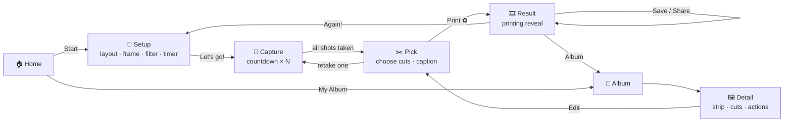

# Blaze Booth ✿ 네컷 Photo Booth for Android

A Korean self-photo-studio experience (think 인생네컷 *Life4Cuts*, Photoism, Haru Film) in your pocket. Pick a frame, pose through a bouncy countdown, choose your best cuts, and watch your strip "print" out. Then save it to your album forever or download it to your phone.

> **Built by an AI agent.** Claude (Claude Code) writes this app autonomously. This README is the **single source of truth** for what to build, how it looks and feels, how it's put together, and in what order. When a decision changes, update this file first (see the [Decision log](#18-decision-log)) and then change the code.

**Target device:** Google **Pixel 9** (`tokay`, verified over adb), running **Android 17 (API 37.1)**, with a 6.3" 1080×2424 OLED at 60–120 Hz, 420 dpi density, 12 GB RAM, a 10.5 MP front and 50 MP rear camera. Portrait only.
**Status:** M0 ✅ M1 ✅ M2 ✅ M3 ✅ (2026-10-20). Home, **Setup** and **Capture** run on the Pixel 9: a live strip preview, her 5 frames plus 9 themes, 6 filters, then the real camera with a cropped, filtered viewfinder, the bouncy countdown sequence, flash, sounds and haptics. Every shot lands upright in the draft, and an unfinished session can be continued from Home. Pick onwards are still placeholders (Pick shows the draft's shots). Next: M4. See [Milestones](#16-milestones).
**Her frames:** ✅ 5 frames processed, AI-upscaled, text removed, bundled, and **approved by her** (2026-10-20) (§5.5.6).

---

## Table of contents

1. [Vision & product principles](#1-vision--product-principles)
2. [Requirements → features](#2-requirements--features)
3. [User flow](#3-user-flow)
4. [Screens](#4-screens)
5. [Booth catalog: layouts, frames, filters](#5-booth-catalog)
6. [Design system](#6-design-system)
7. [Motion & animation catalog](#7-motion--animation-catalog)
8. [Architecture](#8-architecture)
9. [Camera pipeline](#9-camera-pipeline)
10. [Strip renderer](#10-strip-renderer)
11. [Data, storage & export](#11-data-storage--export)
12. [Permissions](#12-permissions)
13. [Edge cases & error handling](#13-edge-cases--error-handling)
14. [Project structure](#14-project-structure)
15. [Build, run & install on the Pixel](#15-build-run--install-on-the-pixel)
16. [Milestones](#16-milestones)
17. [Agent playbook](#17-agent-playbook)
18. [Decision log](#18-decision-log)
19. [Out of scope / future ideas](#19-out-of-scope--future-ideas)

---

## 1. Vision & product principles

Walking into a Korean photo booth is a small ritual. You pick a frame, step behind the curtain, get a few seconds to pose before each flash, choose your favourite shots, and leave holding a glossy strip. Blaze Booth recreates that ritual, keeps the cute energy, and makes every strip something you can keep.

| Principle | What it means in practice |
|---|---|
| **Instant joy** | From launch to the first shutter in **≤ 3 taps** (Start → Let's go → shutter). The app remembers your last setup. |
| **What you see is what you get** | One renderer draws the live strip preview *and* the exported file. They can never drift apart. |
| **Forgiving** | Extra "bonus" shots to choose from, single-shot retakes, and undo on delete. |
| **Never lose a photo** | Every shot goes to disk the moment it's taken. A session is saved to the album as soon as it's printed, including the cuts you didn't pick. |
| **Cute, not cluttered** | Whimsy lives in the motion, shapes, stickers and copy. Controls stay big, clear and few. |
| **One thumb** | Primary actions sit in the bottom third of the screen. Portrait only. Touch targets are ≥ 48 dp. |
| **Buttery** | Runs at 120 fps on the Pixel 9. All bitmap work happens off the main thread. Animations are physics-based springs, not linear tweens. |

---

## 2. Requirements → features

| # | Requirement (from the brief) | How Blaze Booth delivers it |
|---|---|---|
| 1 | Normal photo booth: themes/frames, countdown, multiple photos | **Setup** screen: 5 layouts, 9 built-in frame themes, **custom artwork frames** ("Her frames ♡", bundled and importable, §5.5), 6 filters, timer (3/5/10 s), bonus shots (+0/+2/+4), front/back camera. **Capture** runs an automatic countdown sequence with flash, sound and haptics. |
| 2 | Review photos after taking them | **Pick** screen: every shot in a tray, tap to place into slots, long-press to peek full-screen, retake a single shot, live strip preview. Saved sessions can be reviewed and re-picked in **Detail**. |
| 3 | Download locally, individually or as a strip | **Result** and **Detail** offer *Save strip* and *Save photos* (all cuts, or the one you're viewing) to the phone's Photos via MediaStore (`Pictures/Blaze Booth`). Share is available too. |
| 4 | Save photos in the app forever | Each session (strip and every original shot) is stored in app-private storage and indexed in a Room database. Browse it in the **Album**. It persists across restarts and updates, and moves to a new phone with device-to-device transfer. |
| 5 | Sleek, modern animations | Spring-based motion system, shared-element transitions, predictive back, the strip "printing" reveal, confetti, a morphing blob logo, a bouncy countdown. See §7. |
| 6 | Modern, responsive UI | Jetpack Compose with Material 3, edge-to-edge, adaptive to font scale and display size, dark mode, reduce-motion support. |
| 7 | Latest technologies | Kotlin 2.4, AGP 9.4 (built-in Kotlin), Compose BOM 2026.09, Navigation 3, CameraX 1.6 with the Compose viewfinder, Room 2.8 with KSP, Coil 3, DataStore, Graphics Shapes. See §8.1. |
| 8 | Well-thought-out UI/UX | This document: flows, screens, edge cases, accessibility, haptics and copy are all specified up front. |
| 9 | Cute and whimsical theme | Pastel "strawberry milk" palette, rounded Fredoka type, handwritten Gaegu captions, floating hearts and sparkles, sticker decorations on frames, playful copy ("Say kimchi! 📸"). |

---

## 3. User flow



**Back behaviour** (predictive back everywhere):
- Capture → back asks *"Leave the booth? Your N shots will be lost"* (Stay / Leave). With 0 shots it leaves silently.
- Pick → back goes to Capture only after confirming *"Retake everything?"*. The usual escape is ✕ → *Discard session?*
- Result → back goes **Home**. The session is already saved, so it never returns into the capture flow.
- Detail in edit mode → Pick → back cancels the edit with no changes.

---

## 4. Screens

Every screen follows the same pattern: a stateful `XxxRoute` collects state from a `ViewModel`, and a stateless `XxxScreen(state, onEvent)` is previewable in Android Studio.

### 4.1 Home 🏠
- **Look:** cream-to-strawberry-milk vertical gradient. Hearts ♡, stars ☆ and sparkles ✦ drift slowly upward (≈ 14 particles, parallax at three depths). In the centre sits a **morphing blob** (Graphics Shapes `RoundedPolygon` cookie ↔ flower morph, slowly rotating) with a camera glyph inside. Below it, the wordmark **Blaze Booth** in Fredoka SemiBold and a Gaegu tagline: *"오늘의 네컷 · today's four cuts"*.
- **Actions:** a large pill **Start ✿** button (primary, squishes on press), a secondary **My Album** button showing a small count badge, and a settings gear in the top-right corner.
- **Recent strip peek:** if the album isn't empty, the latest strip is tucked behind the Album button at a −8° tilt, peeking out. Tapping it opens Detail.
- **Draft recovery:** if an unfinished session exists (§11.4), a snackbar-style card appears: *"You have 3 unfinished shots. Continue?"* (Continue / Discard).
- **Data wiring:** the badge, peek and draft card read a `HomeUiState` from `HomeViewModel`, which combines the flows of a `HomeSource` (`AppContainer.homeSource`). M1 ships `EmptyHomeSource` (no strips, no draft), so all three stay hidden. M3 (draft) and M5 (album) provide the real source, and they light up without UI changes.

### 4.2 Setup 🎀
- **Top 55%:** a **live strip preview** rendered by the real `StripRenderer` with cute placeholder silhouettes in each cell. It cross-fades and springs whenever a choice changes. It tilts subtly with device tilt (±3°, optional parallax).
- **Bottom sheet (always expanded, rounded 32 dp top):** a segmented tab row **Layout · Frame · Filter · Options**, swipeable with a `HorizontalPager`.
  - *Layout:* chips with mini diagrams (1×4, 2×2, 1×3, 2×3, Solo) and the cut count.
  - *Frame:* a horizontal carousel of swatch cards (each a tiny rendered frame). The selected card scales to 1.08× and gets a wobbling sticker ✓. **"Her frames ♡"** (custom artwork frames, §5.5) come **first**, with a heart badge, followed by the built-in themes. The carousel ends with a dashed **"+ Add frame"** card that opens the import flow (§4.9). Choosing an image frame sets the layout automatically (its slot count and shapes come from the artwork), so the *Layout* tab shows "Set by frame".
  - *Filter:* round thumbnails showing a sample photo through each filter, with the name below.
  - *Options:* Timer (3/5/10 s segmented), Bonus shots (+0/+2/+4), Camera (Front/Back), Mirror selfies (switch).
- **CTA:** a sticky **Let's go!** button at the bottom. Its label shows the total shots, e.g. *"Let's go! · 6 shots"*.
- **Persistence:** every choice is saved to DataStore immediately and restored next time. On the very first launch, or if the saved frame no longer exists (e.g. a deleted import), the first frame in the carousel is chosen: her first frame, *Lilac Pals*.
- *As built in M2:* the back button and the title *"Make your strip"* sit over the preview; the sheet is a fixed-height `Surface` (not a draggable sheet), so the preview takes the remaining ~55% of the screen. Theme swatches are rendered on the classic strip; her frames' swatches are her `thumb.png` drawn through the renderer with placeholders. While an image frame is selected, the Layout tab shows a *"Set by frame ♡ · Lilac Pals has 3 photo windows"* card above the dimmed layout chips. Device tilt / parallax is **not built yet** (it was optional); it's an M8 polish item.

### 4.3 Capture 📸
- **Viewfinder:** full-bleed CameraX viewfinder **cropped to the chosen layout's cell aspect ratio** (WYSIWYG), framed by the selected frame colour with rounded 28 dp corners. The live filter is applied in real time (§9.3).
- **Top bar:** ✕ (leave), a shot counter pill **"2 / 6"**, and a flip-camera button that's disabled mid-countdown.
- **Bottom:** a **shot tray** of N small rounded slots that fill as photos land, plus a big round **shutter** button that starts the sequence. While a sequence runs, the shutter becomes a **pause ⏸** button.
- **Sequence:** tap the shutter, then countdown → capture → 1.2 s "nice!" beat → next countdown, repeated automatically until all N shots are taken, just like a real booth. The user can pause or resume at any time.
- **Countdown:** a giant number (Fredoka Bold, 160 sp) pops in with an overshoot spring while a ring drains around it. Each tick plays a soft beep and a haptic `CLOCK_TICK`. The last second turns the ring pink and gives a little camera wiggle.
- **Capture moment:** a white flash overlay (≈ 220 ms ease-out), the shutter sound (`MediaActionSound`), a `CONFIRM` haptic, and a mini thumbnail that **flies along an arc into its tray slot**. Front camera uses a **screen flash** (full white plus maximum brightness) when the scene is dark.
- **Cheerful prompts** rotate above the countdown: *"Say kimchi!"*, *"Heart hands! 🫶"*, *"Look surprised!"*, *"Peace ✌️"*, *"Cheek poke!"*.
- **When all shots are done**, the view auto-advances to Pick with a container transform from the tray.
- *As built in M3:* the viewfinder sits between the top bar and the tray on the app's gradient, with an 8 dp border in the frame's colour (a theme's top background colour; for her frames, the average of the artwork's solid pixels). It springs (`Gentle`) to the next slot's shape during the beat. The countdown ring and number are sized to fit the viewfinder (up to 160 sp, ignoring font scale). The prompt pill sits at the top of the viewfinder, and "Nice! ✿" pops in during the beat. Bonus shots show "5 / 6 ✦ bonus" in the pill. While idle or paused, a hint pill says what to do. The flying thumbnail is a 650 ms quadratic Bézier that lifts 120 dp above the start. The **A7 container transform to Pick is not built yet**: Pick is still a placeholder, so it moves to M4 with the real Pick. Pausing, backgrounding (§13) and failed shots all pause; resuming always starts a fresh countdown. ✕ (or back) with shots asks *"Leave the booth?"* and then discards the draft; with no shots it leaves silently. Low storage (< 50 MB allocatable) asks before the first shot. The camera permission (§12) and camera errors (§13) replace the viewfinder with a card. Sounds, haptics and the screen flash read `BoothSettings` (§11.6), which default to on until M8.

### 4.4 Pick ✂️ (review)
- **Top:** the live strip preview, with slots numbered ①②③④. Empty slots show a dashed outline and a pulsing "+".
- **Bottom:** a **shot tray** (grid, 3 columns) with every shot taken, each wearing a filter-applied thumbnail.
  - **Tap a shot** to place it in the next empty slot. The thumbnail flies into the slot with a shared-bounds animation, and the shot gets a numbered badge.
  - **Tap a filled slot** (or the badge) to remove it.
  - **Long-press a shot** to peek full-screen. Release to dismiss.
  - **Retake** (on the peek view) goes back to Capture for a single shot that replaces this one.
- **Auto-fill:** on arrival, shots 1…cuts are pre-placed in order. With no bonus shots this means Pick is effectively "review and confirm".
- **Quick edits row:** frame swatch carousel, filter selector, caption text field (≤ 24 chars, Gaegu), date stamp toggle.
- **CTA:** **Print ✿**, disabled with a gentle shake on tap until every slot is filled.

### 4.5 Result 🎞️
- **Printing reveal:** a stylised "printer slot" bar sits at the top. The strip slides out downward in stepped increments (like a real printer feeding paper), sways once on a pendulum spring, settles, and then **confetti** bursts (hearts, stars, pastel rectangles).
- **Saved badge:** the moment rendering finishes, the session is already in the album. A chip reads *"Saved to your album ♡"*.
- **Actions** (a floating rounded toolbar):
  - **Save strip**: writes to Photos and shows a checkmark morph and snackbar *"Strip saved to Photos"*.
  - **Save photos**: saves all chosen cuts to Photos as individual files.
  - **Share**: system share sheet with the strip.
  - **Album**, and **Again!** (back to Setup with the same settings).

### 4.6 Album 📒
- A **staggered grid** (2 columns) of strip thumbnails, grouped under sticky month headers ("October 2026").
- Each card shows the strip with a small date and a ♡ favourite toggle (pop + particle burst).
- **Filter chips:** All · Favourites · by layout.
- **Empty state:** a cute illustration (camera with a heart) and *"No strips yet. Let's make memories!"* with a Start button.
- Items animate in and out with `Modifier.animateItem()`. Long-press enters multi-select (select → delete / save to Photos).

### 4.7 Detail 🖼️
- **Hero:** the strip transitions in from the Album card via a **shared element transition**.
- A **segmented toggle**: *Strip* | *Photos*. *Photos* is a `HorizontalPager` of the individual cuts (with filter) plus an "unused shots" section.
- **Actions:** Save strip · Save this photo · Save all photos · Share · ♡ · **Edit** (opens Pick in edit mode to re-pick cuts, change frame, filter or caption, then re-render) · Delete.
- **Delete:** the item leaves with a shrink and fade. A snackbar offers **Undo** for 5 s (soft delete, §11.2).

### 4.8 Settings ⚙️ (modal bottom sheet from Home)
Shutter & countdown sounds · Haptics · Screen flash for selfies · Save mirrored selfies as seen · Auto-save strip to Photos after printing (default **off**) · **Manage frames** (rename, reorder, hide or delete custom frames) · Storage used (e.g. "42 strips · 310 MB") · About & licenses.

*Since M1:* the sheet opens from the Home gear as a read-only preview. Toggles show their defaults but are disabled, the other rows carry a "Soon" pill, and a note says they switch on later. M8 wires them to DataStore (§11.6).

### 4.9 Add frame ➕ (import flow)
1. **Pick:** the system Photo Picker (`PickVisualMedia`, images only, no permission needed) opens. She chooses her frame image (PNG or JPG).
2. **Detect:** a short "Finding the photo windows… ✨" animation runs the slot detector (§5.5.2).
3. **Confirm:** the frame is shown with each detected window outlined and numbered ①②③④, with photo placeholders peeking through. A line of text explains the result: *"Found 4 photo windows"*.
   - **Looks right** → name it (defaults to "Frame 1", "Frame 2", …) → **Save**. A heart pops and it joins "Her frames ♡".
   - **Adjust** → opens the slot editor.
4. **Slot editor** (fallback when detection is wrong or the image has no clear windows): draggable, resizable rounded rectangles with corner handles, snap-to-edges guides, **+ Add window**, and a delete button on the selected window. Numbers reorder by position automatically. For opaque (JPG) frames the windows are cut out of the artwork, so photos show through.
5. **Errors:** if the image is too small (< 600 px wide) she sees a gentle warning that it may look blurry, but can still continue. If there's no window and she cancels the editor, nothing is saved.

---

## 5. Booth catalog

### 5.1 Layouts
All geometry is defined in **export pixels** (600 dpi). Cells are computed, not hand-placed: `cellW = (W − 2·margin − (cols−1)·gap) / cols`, and `cellH = (H − margin − footer − (rows−1)·gap) / rows`.

| id | Name | Grid | Cuts | Canvas (px) | margin / gap / footer | Cell aspect (w:h) |
|---|---|---|---|---|---|---|
| `classic` | Classic Strip | 1×4 | 4 | 1200×3600 (2×6 in) | 72 / 48 / 440 | ≈ 1.43 (landscape) |
| `grid` | Four Grid | 2×2 | 4 | 2400×3600 (4×6 in) | 96 / 56 / 520 | ≈ 0.73 (portrait) |
| `trio` | Trio Strip | 1×3 | 3 | 1200×3600 | 72 / 48 / 440 | ≈ 1.06 |
| `six` | Six Grid | 2×3 | 6 | 2400×3600 | 96 / 56 / 520 | ≈ 1.12 |
| `solo` | Solo Polaroid | 1×1 | 1 | 1800×2200 | 120 / 0 / 520 | 1.00 |

Strip anatomy (classic):
```
┌────────────────┐  ← margin 72
│ ┌────────────┐ │
│ │   cut 1    │ │
│ └────────────┘ │  ← gap 48
│ ┌────────────┐ │
│ │   cut 2    │ │
│ └────────────┘ │
│      ...       │
│ ┌────────────┐ │
│ │   cut 4    │ │
│ └────────────┘ │
│  ✿ Blaze Booth │  ← footer 440: wordmark · caption · date
│   2026.10.20   │
└────────────────┘
```

### 5.2 Frame themes
| id | Name | Background | Ink (text) | Stickers / decoration |
|---|---|---|---|---|
| `milk` | Milk | `#FFFFFF` | `#3A3A3A` | none (clean classic) |
| `ink` | Ink | `#1E1E22` | `#FFFFFF` | tiny white sparkles |
| `strawberry` | Strawberry Milk | `#FFD6E3` → `#FFB8CF` | `#D6336C` | hearts |
| `cloud` | Cloud Nine | `#CFE8FF` | `#3B6FB6` | clouds and small stars |
| `matcha` | Matcha Latte | `#DCEFD6` | `#4F7A45` | four-leaf clovers |
| `lavender` | Lavender Dream | `#E6DCFF` → `#CDB9FF` | `#6B4FBB` | stars and crescent moons |
| `butter` | Butter Daisy | `#FFF1B8` | `#B07A00` | daisies |
| `cherry` | Cherry Blossom | `#FFE9EF` | `#C2185B` | falling petals |
| `film` | Film | `#111111` | `#F5F5F5` | sprocket holes down both edges (Haru Film style) |

Stickers are vector paths drawn by the renderer (no bitmap assets). They're scattered with a **seeded RNG** (seed = theme id and layout id), so placement is deterministic and identical in preview and export. They sit in margins, gaps and the footer, overlapping cell edges by at most 12 px so faces are never covered, and never touching the centred footer text block. As built (`render/StickerLayout.kt`): 3–4 larger stickers are placed in the footer first, either side of the text, then the margins and gaps are filled; most stickers get a white die-cut border like paper stickers.

### 5.3 Filters
Every filter is a 4×5 `ColorMatrix`. The same matrix is used for the live viewfinder (RenderEffect), thumbnails (Compose `ColorFilter`) and export (`Paint.colorFilter`).

| id | Name | Character |
|---|---|---|
| `original` | Original | identity |
| `mono` | Mono 흑백 | high-contrast black and white, the classic Korean booth look |
| `milky` | Milky 뽀샤시 | brighter, lifted shadows, lower contrast, faint pink warmth (the "glow skin" look) |
| `peach` | Peach | warm, slightly saturated |
| `cool` | Soda | cool blue tint, crisp |
| `film` | Film | faded blacks, warm highlights, slight green shadows |

### 5.4 Options
- **Timer:** 3 / 5 / 10 s (default **5**).
- **Bonus shots:** +0 / +2 / +4 (default **+2**, so a classic strip takes 6 shots and you pick 4).
- **Camera:** front (default) / back.
- **Mirror selfies:** on by default. The preview is mirrored, and the saved photo matches what you saw.

### 5.5 Image frames (custom artwork) ♡
Built-in themes (§5.2) are drawn in code. **Image frames** are real artwork, e.g. frames designed by the person this app is for, just like the frames in a real Korean booth. Known so far: **her frames have 4 photos per strip**. The file format isn't known yet (probably JPG or PNG), so the app supports both.

#### 5.5.1 How an image frame works
An image frame is **artwork with windows**. The photos are drawn *underneath* and the artwork is drawn *on top*, so her borders, stickers and lettering can overlap the photos exactly as designed.

```
 photos (centre-cropped into each window's rect)   ← drawn first
 frame artwork (windows transparent)               ← drawn on top
```

- **Geometry comes from the artwork.** The canvas size is the image's own size, and the slots are the detected windows. The window count sets the number of cuts, which is **4** for her strips.
- **Window shapes:** a slot is the window's bounding rectangle. Non-rectangular windows (rounded corners, hearts, clouds) just work, because the artwork masks the photo's edges.
- **Capture:** the viewfinder is cropped to the aspect ratio of the slot being shot (shot *i* → slot *i*). Bonus shots use slot 1's aspect. At render time every photo is centre-cropped ("cover") into its slot.
- **Base:** the canvas is filled white before the photos, so anything the artwork leaves see-through exports as white rather than black (JPEG has no alpha).
- **Text:** the artwork usually has its own lettering, so the generated footer (wordmark, caption, date) is **off** for image frames. An optional `textArea` in the frame's metadata re-enables caption and date in that box.
- **Export resolution:** the frame's native size. Frames narrower than 1200 px are upscaled ×2 with filtering so the photos stay sharp. Anything longer than 7200 px is downscaled.

#### 5.5.2 Window (slot) detection
`FrameSlotDetector` is pure Kotlin over an `IntArray` of pixels, so it's unit-testable on the JVM. It works on a copy downscaled to a long edge ≤ 1200 px, then scales the rects back up.

1. **Mode A (transparent PNG):** mask = pixels with alpha < 32. Find 4-connected components (iterative flood fill). Discard components that touch the image border (the transparent outside of rounded frames) and components < 1.5% of the image area. Each remaining component's bounding box is a slot.
2. **Mode B (opaque JPG/PNG):** used when Mode A finds nothing. Flood-fill regions of **near-uniform colour** (RGB distance ≤ 18) from a grid of seed points. Keep regions that are rectangle-like (fill ratio of the bounding box ≥ 0.85), ≥ 3% of the area, and not touching the border. Then choose the largest group of regions sharing the same colour (photo boxes are almost always one colour, e.g. white or grey). The chosen regions are **converted to transparency** (with a 2 px feathered edge), so the frame then behaves exactly like Mode A.
3. **Ordering:** sort slots into rows (top edges within 5% of the height = same row), then left to right within a row.
4. **Validation:** 1–8 slots, no overlaps. If detection fails or looks implausible, the import flow goes straight to the slot editor (§4.9).
5. **Tests:** synthetic frames for each case: transparent 1×4, transparent 2×2, rounded heart windows, white-box JPG with JPEG noise, a frame whose outside is transparent, and no windows at all.

#### 5.5.3 Two ways frames get into the app
| | **Bundled** ("Her frames ♡" ship with the app) | **Imported** (added on the phone, §4.9) |
|---|---|---|
| Source | The human drops files into [`photo-frames/`](photo-frames/) in this repo (screenshots and Pinterest saves are fine) | The system Photo Picker |
| Processing | The agent adds an entry to [`tools/frames/frames.config.json`](tools/frames/frames.config.json) and runs [`tools/frames/process_frames.py`](tools/frames/process_frames.py) (§5.5.5). JPGs are converted to PNGs with transparent windows **at build time**. The human approves the previews | The detector on the device, plus the slot editor if needed |
| Stored as | `app/src/main/assets/frames/<id>/frame.png` + entry in `assets/frames/frames.json` | `files/frames/<uuid>/frame.png` + row in the `frames` table |
| Can delete? | Hide only | Yes (see §11.2) |

`frames.json` (the agent writes this; the slots are explicit, so detection isn't needed at runtime for bundled frames):
```json
[
  {
    "id": "lilac-pals",
    "name": "Lilac Pals",
    "file": "lilac-pals/frame.png",
    "thumb": "lilac-pals/thumb.png",
    "width": 1200, "height": 3142,
    "slots": [ { "x": 58, "y": 69, "w": 1081, "h": 874 }, "…" ],
    "textArea": null
  }
]
```
The order in `frames.json` is the order in the Setup carousel.

#### 5.5.4 Guidance for frame files (for the designer)
- **Best:** PNG, with the photo areas erased to **transparent**.
- **Also fine:** JPG or PNG with plain **solid-colour boxes** (e.g. white) where the photos go.
- **Size:** 1200×3600 px for a 2×6" strip or 2400×3600 px for a 4×6" print is ideal. Anything ≥ 600 px wide works.
- Exports from Canva, Procreate, Photoshop, Ibis Paint and similar apps are all fine. Screenshots and Pinterest saves work too; the pipeline crops, straightens and upscales them.

#### 5.5.5 Bundled frame pipeline (`tools/frames/`)
A reproducible Python script (Pillow, NumPy, SciPy; see `requirements.txt`) turns raw images into app-ready frames. Each frame is an entry in `frames.config.json`:

| Key | Meaning |
|---|---|
| `id`, `name` | Asset folder name and display name |
| `source` | Glob under the repo root (handles Korean/emoji file names) |
| `rotate` | Optional deskew in degrees (counter-clockwise) |
| `crop` | `[x0, y0, x1, y1]` strip bounds in source pixels. Several frames can come from one image |
| `window_color` | RGB of the photo windows (white, black, olive…) |
| `tolerance` | `[t0, t1]` colour distance: < t0 is fully transparent, > t1 fully opaque, with a smoothstep in between |
| `erase` | Optional list of `{rect: [x0,y0,x1,y1] in output px, tolerance, grow}` or `{rect, mode: "all"}` areas to paint out (text, logos). Text pixels (those that differ from the rect's surroundings) are refilled by a Laplace solve from the surrounding background; `mode: "all"` refills the whole rect (for plain backgrounds) |

Steps:
1. **Segment at native resolution:** windows are big window-coloured regions that don't touch the edge. Same-coloured shapes that aren't windows (a white cloud, a white bear) are **protected** so they stay opaque.
2. **Upscale** to 1200 px wide (Lanczos, or a pre-upscaled image via `--upscaled-dir`, e.g. from an AI upscaler).
3. **Soft-key** the windows at full resolution with colour decontamination, so edges are anti-aliased without coloured fringes. Decorations inside windows (stars, sparkles) stay on top of the photos.
4. **Erase** any configured text or logo areas.
5. **Slots** are each window's solid body (thin leaks along outlines are ignored), grown by 6 px so photos tuck under the artwork.
6. **Output:** `assets/frames/<id>/frame.png` + `thumb.png`, `assets/frames/frames.json`, and review images in `photo-frames/_previews/` (`*_photos.jpg` with numbered sample photos, `*_alpha.jpg` with transparency shown as a checkerboard).

```bash
python -m venv .venv && .venv/Scripts/pip install -r tools/frames/requirements.txt
.venv/Scripts/python tools/frames/process_frames.py            # all frames
.venv/Scripts/python tools/frames/process_frames.py --only usagi-gold
```

#### 5.5.6 Her frames (bundled, v1)
Five frames from three images she picked (2026-10-20). Sources are in `photo-frames/`.

| id | Name | Source | Windows | Output |
|---|---|---|---|---|
| `lilac-pals` | Lilac Pals | purple strip with bears and cloud | **3** | 1200×3142 |
| `usagi-gold` | Usagi | yellow Usagi strip (left of the two identical strips) | 4 | 1200×3658 |
| `ikmyeong-night` | Ikmyeong Night | Play in the Box sheet, left (charcoal) | 4 | 1200×3633 |
| `blossom-picnic` | Blossom Picnic | Play in the Box sheet, middle (yellow) | 4 | 1200×3584 |
| `rribbitt-sky` | Rribbitt Sky | Play in the Box sheet, right (blue) | 4 | 1200×3633 |

**AI upscaling:** the sources are tiny (the Play in the Box strips are only about 146 px wide), so each crop (`photo-frames/_previews/<id>_crop.png`) was upscaled with **Real-ESRGAN** (`realesrgan-ncnn-vulkan` v0.2.5.0, model `realesrgan-x4plus-anime`, running on the local GPU). Lilac Pals and Usagi got one ×4 pass; the three Play in the Box strips got two ×4 passes. The results are committed in [`photo-frames/upscaled/`](photo-frames/upscaled/) and fed to the pipeline with `--upscaled-dir photo-frames/upscaled`, so rebuilding doesn't need the upscaler. To redo it: download the release zip from github.com/xinntao/Real-ESRGAN/releases into a folder outside the repo, then run `realesrgan-ncnn-vulkan -i <crop>.png -o <id>.png -n realesrgan-x4plus-anime -s 4`.

**All writing removed** (the human's request, 2026-10-20): the "usagi" title and Vietnamese caption, the Ikmyeong / Play in the Box logo, the Blossom Picnic tablecloth text, and the Rribbitt / Play in the Box logo are painted out via `erase`. The AI upscale had garbled the small text anyway. The frames now carry no lettering, which leaves room for an optional `textArea` (caption/date) later.

**Known limits:** characters that stood *above* the strips in the promo image are cropped off. On Rribbitt Sky, the faint diamond pattern behind the old logo is smoothed over.

**Personal use only:** these designs are third-party artwork (Pinterest saves; the Play in the Box frames are that booth brand's official art, and Usagi is a Chiikawa character). They're fine in a privately sideloaded gift app, but **must not ship in a public Play Store release**.

---

## 6. Design system

### 6.1 Colour
A custom Material 3 `ColorScheme`. Dynamic colour is **off**, because the brand palette *is* the experience.

| Token | Light | Dark ("midnight candy") |
|---|---|---|
| `primary` (strawberry) | `#F0628F` | `#FF8FB1` |
| `onPrimary` | `#FFFFFF` | `#3B0A1E` |
| `secondary` (butter) | `#F5C84C` | `#FFE38A` |
| `tertiary` (lavender) | `#9C83F0` | `#C9B6FF` |
| `background` / `surface` | `#FFF7F3` (cream) | `#1B1520` |
| `surfaceContainer` | `#FFEDEF` | `#261E2C` |
| `onSurface` | `#3A2E33` | `#F3E8EE` |
| `outline` | `#E8C9D2` | `#5A4A55` |
| accent mint (decor only) | `#9FE2BF` | `#7FCFAA` |
| accent sky (decor only) | `#A7D8FF` | `#86BDEB` |
| Home gradient (top → bottom) | `#FFF7F3` → `#FFD6E3` | `#1B1520` → `#3A2342` |
| raised controls on the gradient | `#FFFFFF` | `#3B3141` |

The remaining Material roles (containers, variants, inverse) are filled in `ui/theme/Color.kt` to match. Colours with no Material slot (mint, sky, gradient, raised) live in `BoothExtraColors`, read via `BoothTheme.extraColors`.

### 6.2 Typography
- **Fredoka** (variable, OFL) for all UI text. Display/headline use weight 600, titles 500, body 400. It's bundled at `res/font/fredoka.ttf`.
- **Gaegu Bold** (OFL, Hangul support) for handwritten touches: taglines, strip captions and date stamps. Bundled at `res/font/gaegu_bold.ttf`.
- Hangul in UI text falls back to the system font, so Korean captions render correctly.
- Every size is in `sp` and respects the user's font scale. Layouts are tested at 200%.

### 6.3 Shape
- Corner radii: small 12 dp, medium 20 dp, large 28 dp, sheets 32 dp, buttons fully rounded (pill).
- Blob shapes come from `androidx.graphics:graphics-shapes`: cookie (9 rounded scallops), flower, soft star. They're used for the home logo, the selected-state stickers and the empty-state art.

### 6.4 Iconography
Material Symbols **Rounded** (via `material-icons-extended`, `Icons.Rounded.*`). Inline emoji are allowed in copy, sparingly.

### 6.5 Haptics & sound
| Moment | Haptic | Sound |
|---|---|---|
| Countdown tick | `CLOCK_TICK` | soft beep (≤ 120 ms) |
| Capture | `CONFIRM` | `MediaActionSound.SHUTTER_CLICK` |
| Select chip, card or slot | `SEGMENT_TICK` | none |
| Invalid action (Print with empty slot) | `REJECT` | none |
| Favourite ♡ | `CONFIRM` | none |

Sounds and haptics can each be switched off in Settings.

### 6.6 Copy voice
Short, warm and playful, never childish. Examples: *"Let's go!"*, *"Say kimchi!"*, *"Pick your favourite cuts"*, *"Printing your memories…"*, *"Saved to your album ♡"*. All strings live in `strings.xml`.

### 6.7 Accessibility
- Contrast: text on surfaces is ≥ 4.5:1. Frame themes are decorative, but footer text on them is ≥ 3:1.
- Every icon button has a `contentDescription`, and the countdown is announced politely to TalkBack.
- **Reduce motion:** when the system animator duration scale is 0 (or "Remove animations" is on), ambient motion stops: floating particles freeze in place (still drawn, as decoration), the blob and wordmark hold still, and confetti and the printing sway are skipped. State changes still cross-fade. `core/ReduceMotion.kt` reads the setting live, and `BoothTheme` provides it as `LocalReduceMotion`.
- Touch targets are ≥ 48 dp, and the shutter is 88 dp.

---

## 7. Motion & animation catalog

**Motion tokens** (`ui/theme/Motion.kt`):
| Token | Spec | Used for |
|---|---|---|
| `Bouncy` | `spring(dampingRatio = 0.5f, stiffness = 400f)` | stickers, countdown pop, selected cards |
| `Snappy` | `spring(dampingRatio = 0.8f, stiffness = 800f)` | presses, toggles, slot fills |
| `Gentle` | `spring(dampingRatio = 1f, stiffness = 200f)` | screen-level layout, sheets |
| `Float` | infinite, 6–12 s, ease-in-out | ambient particles, blob morph |
| `floatSpin` | infinite, 24 s per turn, linear | blob rotation (linear, so the turn never pauses) |
| `release` | `spring(dampingRatio = 0.38f, stiffness = 500f)` | the overshoot when a squished button is let go (A3) |
| `BobMillis` | 2.6 s sine loop, linear | wordmark letter bob (A2) |
| `wobble` | infinite, 0.9 s per leg, ease-in-out | the selected card's ✓ sticker rocking ±9° (A4) |

Particles drift at a constant speed per depth (9 / 15 / 24 dp/s) on a frame clock, with a slow sine sway, rather than a tween.

| # | Where | Animation |
|---|---|---|
| A1 | Global | Nav 3 transitions: forward = slide-in 12% and fade with `Gentle`, pop = reverse. **Predictive back** is supported natively. |
| A2 | Home | Floating particles (3 depths), blob morph and rotation, wordmark letters bob with staggered phase. |
| A3 | All buttons | **Squish:** scale to 0.92 on press via `Snappy`, overshoot on release. |
| A4 | Setup | Preview cross-fades and springs on change; the selected card scales and gets a sticker ✓ that pops in with a wobble. |
| A5 | Capture | Countdown number pops with an overshoot, ring drains, last-second wiggle. |
| A6 | Capture | Flash overlay; thumbnail flies on a quadratic-bezier arc into the tray slot. |
| A7 | Capture → Pick | Tray container transform (shared bounds). |
| A8 | Pick | Shot → slot fly-in (shared bounds); a shake on invalid Print. |
| A9 | Result | Stepped printing feed, pendulum sway, confetti burst (≈ 80 particles, physics with gravity and drag, 2.5 s). |
| A10 | Album → Detail | **Shared element** strip hero (`SharedTransitionLayout` with Nav 3's `LocalNavAnimatedContentScope`). |
| A11 | Album | `animateItem()` for insert, delete and reorder; ♡ pop with a mini particle burst. |
| A12 | Save actions | The icon morphs into a ✓ via `AnimatedContent`; a snackbar slides in. |

Performance rules: animate with `graphicsLayer {}` lambdas (no recomposition per frame), avoid allocations in draw lambdas, and keep particles in a single `Canvas`.

---

## 8. Architecture

### 8.1 Tech stack
Versions are pinned in [`gradle/libs.versions.toml`](gradle/libs.versions.toml) and were current stable releases on 2026-10-20.

| Concern | Choice | Version |
|---|---|---|
| Language | Kotlin (K2) | 2.4.21 |
| Build | Gradle / Android Gradle Plugin (built-in Kotlin) | 9.8.2 / 9.4.1 |
| SDK | compileSdk / targetSdk 37 (Android 17), minSdk 31 | — |
| JDK | Microsoft OpenJDK | 21 |
| UI | Jetpack Compose BOM (UI 1.12, Material 3 1.4) | 2026.09.00 |
| Navigation | Navigation 3 (`NavDisplay`, typed `NavKey` back stack) | 1.2.0 |
| ViewModels | Lifecycle ViewModel + `lifecycle-viewmodel-navigation3` (per-entry scoping) | 2.11.0 |
| Camera | CameraX (core, camera2, lifecycle, **camera-compose** `CameraXViewfinder`) | 1.6.2 |
| Database | Room with KSP | 2.8.5 / KSP 2.3.12 |
| Preferences | DataStore Preferences | 1.2.1 |
| Images | Coil 3 (album thumbnails, pager) | 3.6.3 |
| Shapes | androidx.graphics:graphics-shapes | 1.1.0 |
| Async | Kotlin Coroutines and Flow (`kotlinx-coroutines-test` for virtual-time tests) | 1.11.0 |
| Serialization | kotlinx.serialization (nav keys) | 1.12.0 |
| Splash | core-splashscreen | 1.2.0 |
| DI | **Manual** `AppContainer` on the `Application` (small app, no Hilt overhead) | — |
| Screenshot tests | Roborazzi (+ compose, junit-rule) on Robolectric native graphics; Compose `ui-test-junit4` (BOM); androidx.test ext-junit; Espresso core | 1.76.0 / Robolectric 4.17 / 1.3.0 / 3.7.0 |

### 8.2 Layers
```
 UI (Compose screens)  ──events──▶  ViewModel (StateFlow<UiState>)
        ▲                                   │
        └──────────── state ◀───────────────┤
                                            ▼
                     Repositories / Controllers
     SessionRepository · BoothDraftStore · BoothPreferences · CameraController · Exporter
                                            │
                     Room DB · SessionFileStore (filesDir) · MediaStore · DataStore
```
- **Unidirectional data flow:** each ViewModel exposes one immutable `UiState` as a `StateFlow`, plus one-shot `effects` (snackbars, navigation) via a `Channel`.
- **`BoothDraftStore`** (singleton in `AppContainer`) holds the in-progress session (config, shot files, slot selection, caption) shared by Setup → Capture → Pick → Result. It's mirrored to disk (§11.4), so a process death mid-session is recoverable.
- **Threading:** bitmap decode, crop, render and encode on `Dispatchers.Default`; file and DB work on `Dispatchers.IO`. The main thread never touches a full-size bitmap.

### 8.3 Navigation (Navigation 3)
```kotlin
@Serializable data object Home : NavKey
@Serializable data object Setup : NavKey
@Serializable data object Capture : NavKey
@Serializable data class Pick(val editSessionId: String? = null) : NavKey
@Serializable data class Result(val sessionId: String) : NavKey
@Serializable data object Album : NavKey
@Serializable data class Detail(val sessionId: String) : NavKey
```
The back stack is `rememberNavBackStack(Home)`. `NavDisplay` uses `rememberSaveableStateHolderNavEntryDecorator()` and `rememberViewModelStoreNavEntryDecorator()`, wrapped in a `SharedTransitionLayout`. "Print" navigates with `backStack.removeAll { it is Setup || it is Capture || it is Pick }`, then `add(Result(id))`.

As built in M1 (`ui/navigation/BoothNavHost.kt`): Nav 3 1.2.0's `NavDisplay` takes the `SharedTransitionScope` directly (`sharedTransitionScope = this`), and the scope is also exposed as `LocalSharedTransitionScope` for the A10 hero. `transitionSpec`, `popTransitionSpec` and `predictivePopTransitionSpec` implement A1. Pushing a key that's already on top is ignored (no double-tap duplicates). Leaving Result (Again! / Album) removes Result from the stack, so back never returns to it. M2 adds `@Serializable data object AddFrame : NavKey` for the "+ Add frame" card (a placeholder until M7) and replaces the Setup placeholder with the real screen. M3 replaces the Capture placeholder with the real screen. When every shot is taken, Capture removes itself from the back stack and pushes `Pick()`, so back from Pick never re-enters a finished booth. Until M4, `Pick()` is a placeholder that shows the draft's shots in a 3-column grid; `Pick(editSessionId)` stays a plain placeholder. Home's *Continue* goes to Capture, or straight to Pick if every shot is already taken. Until their milestones, the remaining keys show a `PlaceholderScreen`: an emoji, "Coming in Mx ✿", a back button, and buttons that walk the real flow (Setup → Capture → Pick → Print → Result, Album → Detail → Edit → Pick).

### 8.4 Domain model (in-memory)
```kotlin
enum class BoothLayout(id, rows, cols, canvasWidth, canvasHeight, margin, gap, footer) // §5.1; cuts = rows × cols
enum class FrameTheme(id, backgroundTop, backgroundBottom, ink, decoration, stickerColors) // §5.2, ARGB ints
enum class PhotoFilter(id, matrix: FloatArray)                                    // §5.3, built by ColorMatrices
data class BoothConfig(layout, frameId: FrameId, filter, timerSec, bonusShots, lens, mirror)
value class FrameId(value)            // "theme:<id>" | "asset:<id>" | "custom:<uuid>"
data class ImageFrame(id, name, width, height, slots: List<SlotRect>, textArea, artwork, thumb)
sealed interface FrameSource { Theme(theme); Image(frame: ImageFrame, bitmap: Bitmap) }
data class StripSpec(frame: FrameSource, layout, filter, caption: String?, date: LocalDate?, preview: Boolean)
    // .canvasSize, .slots, .cuts are asked of the spec, never of the frame kind (§10)
data class Shot(index: Int, file: File, width: Int, height: Int)
```
The photos themselves are passed to the renderer next to the spec (`draw(canvas, spec, photos)`), so the same spec can be drawn with preview-size or full-size bitmaps.

---

## 9. Camera pipeline

### 9.1 Binding
- `ProcessCameraProvider.awaitInstance(context)` binds **Preview** and **ImageCapture** to the Capture screen's lifecycle.
- `ImageCapture` uses `CAPTURE_MODE_MINIMIZE_LATENCY` and `ResolutionSelector` with `AspectRatioStrategy.RATIO_4_3_FALLBACK_AUTO_STRATEGY` at the highest available resolution ≤ 12 MP. Full 50 MP isn't needed for a strip and costs latency.
- `Preview` feeds a `SurfaceRequest` into the Compose **`CameraXViewfinder`** (camera-compose).

### 9.2 Viewfinder crop (WYSIWYG)
The viewfinder container has the layout's **cell aspect ratio** and uses `ContentScale.Crop`-equivalent scaling, so the user sees exactly what lands in the cell. The front camera preview is mirrored.

### 9.3 Live filter
`CameraXViewfinder` is set to `ImplementationMode.EMBEDDED` (TextureView-backed), so a `graphicsLayer { renderEffect = RenderEffect.createColorFilterEffect(ColorMatrixColorFilter(matrix)).asComposeRenderEffect() }` applies the filter at 120 Hz on the GPU. (A SurfaceView-backed viewfinder can't be post-processed this way.)

### 9.4 Capture → stored shot
1. `takePicture(executor, OnImageCapturedCallback)` returns an `ImageProxy`, then `imageProxy.toBitmap()`.
2. Rotate by `imageInfo.rotationDegrees` and mirror horizontally if front camera and mirror is on.
3. **Centre-crop to the cell aspect** (the same rect the viewfinder showed).
4. Downscale so the long edge is ≤ **2400 px**.
5. Encode JPEG at quality 95 to `sessions/_draft/shot_{index}.jpg` and record it in `BoothDraftStore`.
6. Recycle bitmaps. Everything after step 1 runs on `Dispatchers.Default`.

The **filter is not baked into stored shots.** Originals stay pristine, so a frame or filter can be changed later in Edit.

### 9.5 Screen flash (front camera)
Use `ImageCapture.FLASH_MODE_SCREEN` with a Compose implementation of `ImageCapture.ScreenFlash`. `apply()` shows a full-screen white overlay, sets `WindowManager.LayoutParams.screenBrightness = 1f`, and then signals completion. `clear()` restores both. It's on by default only when the user enables it in Settings or the scene is dark (auto).
*As built in M3:* `ComposeScreenFlash` signals completion 150 ms after the white frame goes up, and restores the brightness if the screen goes away mid-flash. Settings and scene-brightness detection don't exist yet, so `BoothSettings.screenFlash` **defaults to on** and every front-camera shot uses it. M8 adds the switch and decides whether to add "auto".

### 9.6 As built (M3)
- `camera/CameraController` binds with `ProcessCameraProvider.awaitInstance` to the Capture entry's `LocalLifecycleOwner` and unbinds when the screen leaves. Preview and ImageCapture both use `RATIO_4_3_FALLBACK_AUTO_STRATEGY`. ImageCapture uses `HIGHEST_AVAILABLE_STRATEGY` plus a `ResolutionFilter` that keeps sizes ≤ 12 MP (the Pixel 9's back camera picks 4000×3000). `targetRotation` comes from the display.
- The front preview is mirrored by CameraX itself (`Preview.Builder.setMirrorMode`, `MIRROR_MODE_ON_FRONT_ONLY`, or `OFF` when *Mirror selfies* is off). The stored shot is mirrored by our pipeline, so it matches what the viewfinder showed. The back camera never mirrors and uses `FLASH_MODE_AUTO`.
- The shutter sound, `CONFIRM` haptic and white flash fire from `OnImageCapturedCallback.onCaptureStarted`, after any screen flash, when the sensor actually exposes. In regions that require it (`MediaActionSound.mustPlayShutterSound()`), the shutter sound plays even with sounds off.
- Camera errors come from `cameraInfo.cameraState` (LiveData): `CAMERA_IN_USE` / `MAX_CAMERAS_IN_USE` → "another app might be using it", anything critical → a generic card. Both offer Retry, which binds again.
- §9.4 is done in **one draw**: `ShotGeometry.plan` (pure, unit-tested) computes rotation, mirror, the centre crop and the output size, and one 2×3 affine. `ShotProcessor` draws `ImageProxy.toBitmap()` through it into the output bitmap with bitmap filtering, writes JPEG 95 to `shot_{i}.jpg.part`, fsyncs, then atomically renames it. A 320 px thumbnail is kept for the tray. Everything runs on `Dispatchers.Default` / `IO`, and every big bitmap is recycled.
- The automatic sequence is `CaptureSequencer` (pure coroutines, tested with virtual time). A capture that has started always finishes, even if the user pauses during it.

---

## 10. Strip renderer

**One renderer, two consumers.** `StripRenderer.draw(canvas: android.graphics.Canvas, spec: StripSpec, photos: List<Bitmap?>)` draws in canvas units (§5.1 pixels).

- **Export:** a `Bitmap.createBitmap(W, H, ARGB_8888)` gets drawn at 1:1, then is encoded as JPEG 95 (`strip.jpg`, about 1.5–3 MB). A 600 px-wide `thumb.jpg` is written for the album grid.
- **Preview:** a Compose `Canvas` → `drawIntoCanvas { it.nativeCanvas.scale(viewW / W) ; draw(...) }` with *downsampled* bitmaps: frame artwork at ≤ 600 px **wide** (a 1:3 strip at 600 px tall would look soft on the phone), photos at ≤ 600 px on the long edge (`BitmapOps.PreviewMaxPx`). It's the same code, so it's pixel-identical in composition; `StripRenderScreenshotTest.previewMatchesExport` checks that a 1:1 export shrunk to preview size matches the preview render.
- *As built in M2:* `ui/components/StripPreview` is the composable; `StripRenderer.get(context)` is the app-wide instance (fonts loaded once). Each `draw` call makes its own `Paint`s, so a preview and an export can render at the same time. Empty cells in preview mode get a soft card with a little person silhouette and a heart.

**Two frame kinds, one entry point.** `StripSpec.frame` is a sealed type: `FrameSource.Theme(FrameTheme)` (built-in, §5.2) or `FrameSource.Image(id, bitmap, slots, textArea)` (§5.5). Geometry comes from `LayoutGeometry` for themes and from the frame's slot list for images. Everything downstream (preview, export, Pick, Capture aspect) asks the spec for `slots` and `canvasSize`, and never asks which kind of frame it is.

**Image frame draw order:** photos (cover-cropped into each slot, filter via `Paint.colorFilter`) → frame artwork bitmap on top → optional caption and date in `textArea`.

**Theme frame draw order:** background (solid or gradient) → photo cells (centre-crop into cell rect, clipped with a 12 px corner radius, filter via `Paint.colorFilter`) → empty-cell placeholders (preview only) → stickers (seeded) → footer (Fredoka wordmark "✿ Blaze Booth", Gaegu caption, Gaegu date `yyyy.MM.dd`) → theme extras (film sprocket holes).

**Fonts on Canvas:** `android.graphics.fonts.Font.Builder(resources, R.font.fredoka).setFontVariationSettings("'wght' 600")` → `FontFamily` → `Typeface.CustomFallbackBuilder`. These are cached.

**Testability:** cell-rect math lives in a pure-Kotlin `LayoutGeometry` object that's unit-tested (cells in bounds, no overlap, aspect matches spec). Sticker placement (`StickerLayout`), cover-crop maths (`BitmapOps.coverSource`), filter matrices and `FrameSlotDetector` are pure Kotlin and unit-tested too.

---

## 11. Data, storage & export

### 11.1 Files (app-private, `context.filesDir`)
```
files/
└── sessions/
    ├── _draft/                 ← in-progress booth session
    │   ├── draft.json          ← BoothConfig + shot list + selection (kotlinx.serialization)
    │   └── shot_0.jpg …
    └── {sessionId}/            ← finalised session (UUID)
        ├── shot_0.jpg … shot_N.jpg   ← ALL originals, including unused bonus shots
        ├── strip.jpg                 ← rendered strip (export resolution)
        └── thumb.jpg                 ← 600 px wide thumbnail for the album grid
└── frames/
    └── {frameId}/              ← imported image frame (UUID)
        ├── frame.png           ← artwork, windows transparent (Mode B frames already converted)
        └── thumb.png           ← 300 px wide swatch for the carousel
```
Bundled frames live read-only in `assets/frames/` (§5.5.3).
Finalising a session is an **atomic directory rename** of `_draft` → `{sessionId}`, followed by the DB insert in one transaction-like step. If the insert fails, the rename is reversed.

### 11.2 Room schema (`booth.db`, version 1, schema exported to `app/schemas/`)
```
sessions(
  id TEXT PRIMARY KEY,          -- UUID, also the folder name
  created_at INTEGER NOT NULL,  -- epoch millis
  updated_at INTEGER NOT NULL,
  layout_id TEXT NOT NULL,      -- built-in layout id, or "image" for image frames
  frame_id TEXT NOT NULL,       -- "theme:strawberry" | "asset:her-pink-ribbon" | "custom:{uuid}"
  filter_id TEXT NOT NULL,
  caption TEXT, show_date INTEGER NOT NULL,
  is_favorite INTEGER NOT NULL DEFAULT 0,
  deleted_at INTEGER            -- soft delete for Undo; purged on next app start (> 10 s old)
)
shots(
  session_id TEXT NOT NULL REFERENCES sessions(id) ON DELETE CASCADE,
  shot_index INTEGER NOT NULL,
  slot_index INTEGER,           -- position in the strip, NULL = unused bonus shot
  width INTEGER NOT NULL, height INTEGER NOT NULL,
  PRIMARY KEY(session_id, shot_index)
)
frames(                         -- imported image frames only (bundled ones come from frames.json)
  id TEXT PRIMARY KEY,          -- UUID, also the folder name
  name TEXT NOT NULL,
  width INTEGER NOT NULL, height INTEGER NOT NULL,
  slots_json TEXT NOT NULL,     -- [{x,y,w,h}, …] in frame pixels
  text_area_json TEXT,
  sort_order INTEGER NOT NULL,
  created_at INTEGER NOT NULL,
  hidden INTEGER NOT NULL DEFAULT 0   -- hidden from the picker but kept while any session uses it
)
```
**Frame deletion:** a frame used by saved sessions is **hidden**, not deleted, so those sessions can still be re-framed in Edit. Its files are removed once no session references it (checked at startup). Finished `strip.jpg` files never depend on the frame still existing.
File paths are **derived** from `id` and `shot_index` and never stored, which avoids broken absolute paths after a restore.

### 11.3 "Forever"
App-private storage survives restarts and app updates. It's removed only on uninstall or "Clear storage". `data_extraction_rules.xml` includes sessions, DB and DataStore in **device-to-device transfer**, so a new phone keeps the album. They're excluded from cloud backup because photos would exceed the 25 MB quota. Users who want a copy outside the app use *Save to Photos*. Settings shows storage used.

### 11.4 Draft recovery
`_draft/draft.json` is rewritten after every shot and selection change. On launch, if a draft exists with ≥ 1 shot, Home offers **Continue / Discard**.
*As built in M3:* `data/files/BoothDraftStore` (one instance in `AppContainer`) writes `draft.json` atomically (temp file, then rename). The JSON holds `version`, `createdAt`, `config` (as the same string ids DataStore uses), `totalShots`, `shots` (`index`, `width`, `height`), `selection` and `caption` (the last two are M4's). **Setup's "Let's go!" starts a fresh draft**, wiping any old one, and Capture always works from the draft. A shot listed in the JSON whose file is missing is dropped on load. Flipping the camera mid-session updates the draft's lens and the saved Setup lens. Home's card reads the draft through `BoothHomeSource`. *Discard* deletes `_draft/`; *Continue* resumes Capture at the next shot.

### 11.5 Export to Photos (MediaStore)
- `MediaStore.Images.Media.EXTERNAL_CONTENT_URI`, `RELATIVE_PATH = "Pictures/Blaze Booth"`, `IS_PENDING = 1` during write, then 0. **No storage permission needed** (API 29+, own files).
- File names: `BlazeBooth_20261020_143012_strip.jpg`, `BlazeBooth_20261020_143012_cut1.jpg`, and so on.
- Individual cuts are exported **with the session's filter applied**, at stored resolution.
- **Share:** render or copy to `cache/shared/`, then a `FileProvider` URI and `Intent.ACTION_SEND` (`image/jpeg`, `FLAG_GRANT_READ_URI_PERMISSION`).

### 11.6 Preferences (DataStore)
Last `BoothConfig` choices, sound, haptics, screen flash, save-mirrored, auto-save-to-Photos.
*Since M3:* `BoothPreferences.settings` (`BoothSettings`: `settings.sounds`, `settings.haptics`, `settings.screen_flash`, all default **on**) is the seam for the Settings sheet. Capture already obeys it; M8 writes it with `saveSettings`.
*Since M2:* `data/prefs/BoothPreferences` stores the `BoothConfig` in the `booth` DataStore under `setup.*` keys (layout, frame, filter, timer_sec, bonus_shots, lens, mirror). Unknown or out-of-range values fall back to defaults one field at a time; a saved frame id that no longer exists is resolved against the frame catalog by `SetupViewModel` (§4.2).

---

## 12. Permissions

| Permission | When | UX |
|---|---|---|
| `CAMERA` | On entering Capture | A friendly pre-prompt card ("We need your camera to take cute photos 📸"), then the system dialog. If permanently denied, the card switches to "Open settings" (deep link to app details). |

No storage, location, microphone or network permissions. The app works **fully offline**.

---

## 13. Edge cases & error handling

| Situation | Behaviour |
|---|---|
| Camera fails to bind or is in use by another app | Friendly error card with Retry; logged. |
| App backgrounded mid-countdown | Sequence auto-pauses; resumes with a fresh countdown on return. |
| Process death mid-session | Draft recovery on next launch (§11.4). |
| Low storage (< 50 MB free) | Warn before starting a session; on write failure, show a snackbar and keep the draft. |
| Device rotated | Activity is portrait-locked; capture uses `targetRotation` from the display so photos are upright. |
| Back camera chosen | No mirroring; screen flash disabled. *M3 used normal flash on auto; M4 adds a back-camera flash choice (Off / Auto, default **Off**), because the LED firing at close range hurt the human's eyes in testing.* |
| Print with empty slots | Button shakes, `REJECT` haptic, empty slots pulse. |
| Export fails (MediaStore) | Snackbar with Retry; the pending row is deleted. |
| Very long caption or emoji | Max 24 chars, single line, auto-shrinks to fit the footer width. |
| Font scale 200% | Layouts scroll; the strip preview shrinks before controls overflow. |
| Dark mode | App UI switches; **frame themes don't** (a strip looks the same everywhere). |
| Imported frame has no detectable windows | Go straight to the slot editor with one default window in the middle. |
| Imported frame is huge (e.g. 8000 px) | Downscale on import to a long edge ≤ 7200 px before saving. |
| Imported frame windows have very different shapes | Each shot's viewfinder uses its own slot's aspect ratio; the counter pill shows the slot number. |

---

## 14. Project structure

```
BlazePhotoBooth/
├── README.md                     ← this spec (source of truth)
├── settings.gradle.kts · build.gradle.kts · gradle.properties
├── gradle/libs.versions.toml     ← all versions
├── photo-frames/                 ← INBOX: raw frame images (any format); _previews/ = pipeline review output
├── tools/frames/                 ← frame pipeline: process_frames.py, frames.config.json, requirements.txt (§5.5.5)
└── app/
    ├── build.gradle.kts · proguard-rules.pro
    ├── schemas/                  ← exported Room schemas
    └── src/
        ├── main/
        │   ├── AndroidManifest.xml
        │   ├── assets/frames/          ← bundled image frames + frames.json
        │   ├── res/ (font/, values/, values-night/, xml/, drawable/, mipmap-anydpi/)
        │   └── java/com/blaze/photobooth/
        │       ├── BoothApp.kt               ← Application + AppContainer
        │       ├── MainActivity.kt           ← edge-to-edge, splash, BoothTheme { BoothNavHost() }
        │       ├── model/                    ← BoothLayout, FrameTheme, PhotoFilter, BoothConfig, Shot, StripSpec
        │       ├── render/                   ← StripRenderer, LayoutGeometry, FrameSlotDetector, StickerLayout, Stickers, Filters, BitmapOps, StripFonts, SampleArt
        │       ├── camera/                   ← CameraController, ComposeScreenFlash, ShotGeometry (pure), ShotProcessor
        │       ├── data/
        │       │   ├── db/                   ← BoothDatabase, SessionDao, entities
        │       │   ├── files/                ← SessionFileStore, BoothDraftStore
        │       │   ├── frames/               ← FrameRepository (bundled frames.json + imported frames table)
        │       │   ├── export/               ← PhotoExporter (MediaStore), ShareHelper
        │       │   ├── prefs/                ← BoothPreferences (DataStore)
        │       │   └── SessionRepository.kt
        │       ├── core/                     ← ReduceMotion (M1), Haptics (M2), BoothSounds + Beep (M3)
        │       └── ui/
        │           ├── theme/                ← Color, Type, Shape, Motion, Theme
        │           ├── components/           ← SquishyButton, FloatingParticles, BlobShape, StripPreview,
        │           │                            CountdownRing, Confetti, ShotThumb, SwatchCard, ...
        │           ├── navigation/           ← NavKeys, BoothNavHost
        │           └── feature/
        │               ├── home/  setup/  capture/  pick/  result/  album/  detail/  settings/  frames/
        │               │   (each: XxxRoute.kt, XxxScreen.kt, XxxViewModel.kt, XxxUiState.kt; home/ also HomeSource.kt)
        │               └── placeholder/     ← PlaceholderScreen for screens not built yet (M1 shell)
        │                   (pick/PickPlaceholder shows the draft's shots until M4)
        └── test/
            ├── java/com/blaze/photobooth/  ← JVM unit tests + Roborazzi screenshot tests (screenshots/)
            └── screenshots/               ← recorded Roborazzi PNGs (§15.4)
```

---

## 15. Build, run & install on the Pixel

### 15.1 Toolchain (already installed on this machine)
- **JDK 21:** `C:\Program Files\Microsoft\jdk-21.0.12.101-hotspot`
- **Android SDK:** `%LOCALAPPDATA%\Android\Sdk` (cmdline-tools, platform-tools, `platforms;android-37.0`, `build-tools;37.0.0`, plus `build-tools;36.0.0`, which AGP 9.4.1 uses by default and installed itself on the first build)
- **Gradle:** no global install needed. Always use the committed wrapper (`./gradlew`, Gradle 9.8.2, distribution checksum pinned in `gradle/wrapper/gradle-wrapper.properties`).
- **Android Studio** (optional, recommended for previews and debugging): point it at the SDK above.

### 15.2 Build
```bash
export JAVA_HOME="/c/Program Files/Microsoft/jdk-21.0.12.101-hotspot"
./gradlew assembleDebug            # → app/build/outputs/apk/debug/app-debug.apk
./gradlew testDebugUnitTest lintDebug
./gradlew assembleRelease          # R8-minified, debug-signed for sideloading
```

### 15.3 Install on the Pixel 9
1. On the phone: **Settings → About phone →** tap **Build number** 7 times to unlock Developer options.
2. **Settings → System → Developer options → Wireless debugging** (on) **→ Pair device with pairing code**.
3. On the PC:
   ```bash
   adb pair <ip>:<pairing-port>     # enter the 6-digit code
   adb connect <ip>:<debug-port>
   ./gradlew installDebug
   ```
   USB works too: enable **USB debugging**, plug in, accept the prompt, then run `./gradlew installDebug`.

**Status:** ✅ the phone is paired with this PC (2026-10-20); pairing persists. The phone's IP and port change after reboots or Wi-Fi changes. To reconnect, have Wireless debugging on, then let adb find it:
```bash
ADB="$LOCALAPPDATA/Android/Sdk/platform-tools/adb.exe"
"$ADB" mdns services                 # lists  _adb-tls-connect._tcp  <ip>:<port>
"$ADB" connect <ip>:<port>           # often unnecessary: adb auto-connects via mDNS
"$ADB" devices -l                    # expect: model:Pixel_9 device:tokay
```
In PowerShell, call adb as `& "$env:LOCALAPPDATA\Android\Sdk\platform-tools\adb.exe" …`.

**What the agent does with the phone:** `installDebug`, launching the app (`am start`), screenshots (`exec-out screencap -p`), screen recordings, `logcat` for crashes, UI hierarchy dumps (`uiautomator dump`) and taps/swipes (`input`) to walk through flows. It never changes device settings and never touches other apps.

### 15.4 Screenshot tests (Roborazzi)
Composables render to PNG on the JVM (Robolectric native graphics at Pixel 9 size, `w411dp-h923dp-port-420dpi`), with no phone needed. Tests live in `app/src/test/java/.../screenshots/`, and the PNGs in `app/src/test/screenshots/` (committed).
```bash
./gradlew recordRoborazziDebug     # (re)write the PNGs after an intended UI change
./gradlew verifyRoborazziDebug     # fail if the UI drifted from the PNGs
```
Plain `testDebugUnitTest` runs them too, without comparing. Since M2, `StripRenderScreenshotTest` also renders the strip renderer straight into bitmaps: `her_frame_<id>.png` (each of her frames with numbered sample photos, to compare with `photo-frames/_previews/<id>_photos.jpg`), `her_frames_all.png`, `her_frames_preview.png`, `strip_layouts_<theme>.png` (every layout), `strip_themes_preview.png` (all 9 themes as Setup shows them) and `strip_filters.png`; Setup is captured on every tab (`setup_*.png`, light and dark). Sample photos are generated pastel gradients with numbers, never real people. Since M3, Capture is captured with a fake gradient viewfinder (`CaptureScreenshotTest.kt`): `capture_idle_dark`, `capture_countdown_dark`, `capture_last_second_light`, `capture_flash_dark` (60 ms into the flash), `capture_tray_lilac_dark` (her 3-window frame, tray part-filled), `capture_permission_dark`, `capture_permission_blocked_light` and `capture_error_dark`. Each state has its own one-test class because of the `graphicsLayer` gotcha below. The Compose test clock pauses infinite animations, so each PNG is the first frame. Gotchas: unit tests need `--add-exports/--add-opens java.base/jdk.internal.access` (set in `app/build.gradle.kts`). A `graphicsLayer` (scale or rotation) renders **blank if another Compose test already ran in the same JVM**, so each test class gets its own JVM (`forkEvery = 1`) and such a sample must be its class's first test (or have a class of its own).

---

## 16. Milestones

Each milestone ends with a **green build** (`assembleDebug testDebugUnitTest lintDebug`), a git commit, and a short **on-device checklist** for the human to run on the Pixel. The agent can't see the camera.

| # | Milestone | Scope | Done when |
|---|---|---|---|
| **M0** ✅ | Scaffold & toolchain | JDK and SDK installed ✅, Gradle config ✅, manifest ✅, fonts ✅, Gradle wrapper ✅, app icon and splash ✅, `git init` ✅ | Empty themed app launches on the phone ✅ (2026-10-20) |
| **M1** ✅ | Design system & shell | `ui/theme` (colour, type, shape, motion) ✅, core components (SquishyButton, FloatingParticles, BlobShape) ✅, Nav 3 shell with all keys as placeholder screens ✅, Home screen complete ✅, settings sheet shell ✅, Roborazzi screenshot tests ✅ | Home looks and animates as in §4.1; navigation and predictive back work ✅ (2026-10-20) |
| **M2** ✅ | Catalog & renderer | `model/` catalog (§5) ✅, `LayoutGeometry` and tests ✅, `FrameSource` (theme **and image** frames) ✅, `FrameSlotDetector` with synthetic-frame tests (§5.5.2) ✅, `StripRenderer` with stickers and fonts ✅, `StripPreview` composable ✅, `FrameRepository` (bundled `frames.json`) ✅, **Setup** screen with DataStore persistence ✅. Her 5 real bundled frames are the proof of the image-frame pipeline | Changing layout, frame or filter updates the live preview instantly; her frames preview with their windows filled; settings survive a restart ✅ (2026-10-20) |
| **M3** ✅ | Capture | Camera permission flow ✅, CameraController ✅, filtered and cropped viewfinder ✅, countdown sequence ✅, flash ✅, sound ✅, haptics ✅, screen flash ✅, shot pipeline (§9.4) ✅, draft store and Home's draft card ✅ | A full sequence of N shots lands in `_draft/` upright and correctly cropped ✅ (2026-10-20: front camera on Cherry Blossom classic, 6 shots; back camera on her Lilac Pals, 5 shots, with force-stop and Continue) |
| **M4** | Pick & Result | Pick interactions (§4.4), retake-one, caption and date, Print → render → finalise session (Room and files), Result printing reveal and confetti, the A7 tray → Pick container transform (moved from M3), and a **back-camera flash option** (Off / Auto, default Off; see §13) | The printed strip matches the preview exactly; the session appears in the DB |
| **M5** | Album & Detail | Album grid with month headers, favourites, filters, multi-select; Detail with shared element, pager, soft delete with Undo, Edit (re-pick, re-frame) | Browse, favourite, delete/undo and edit all work after an app restart |
| **M6** | Export & share | MediaStore exporter (strip, single cut, all cuts), share sheet, optional auto-save, storage stats | Files appear in Google Photos under *Blaze Booth*, with correct filter and orientation |
| **M7** | Her frames ♡ | Import flow and slot editor (§4.9), `frames` table, Manage frames in Settings, frame hide/cleanup rules. Bundled frames are already processed (§5.5.6). New files in `photo-frames/` can arrive at any time: process them (§5.5.5) and show the human the previews for approval | Her frames appear first in Setup; a strip shot with one looks right on the phone; she can import a new frame on the phone |
| **M8** | Polish | Animation pass (§7 complete), dark mode, reduce-motion, TalkBack labels, font scale 200%, copy review, settings sheet, draft recovery | Checklist in §6.7 and §7 passes on device |
| **M9** | Hardening & release | Edge cases (§13), process-death test (`adb shell am kill`), R8 release build, baseline profile (optional), performance check (no jank in the Capture or Album scroll) | `assembleRelease` installs and runs; no crashes in a 15-minute exploratory session |

---

## 17. Agent playbook

Rules Claude follows while building this app:

1. **README first.** Read this file at the start of every session. If the implementation needs to diverge, update the relevant section **and** add a row to the [Decision log](#18-decision-log) in the same change.
2. **Work milestone by milestone** (§16), in order. Don't start a milestone until the previous one builds green.
3. **Compile to verify.** Library APIs (especially Navigation 3, camera-compose and Material 3) change between releases. Never assume an API exists. Build after every meaningful step and fix errors immediately.
4. **Green means:** `./gradlew assembleDebug testDebugUnitTest lintDebug` passes with no new lint errors.
5. **Commit per milestone** (or per coherent sub-step) with a descriptive message. Never commit `local.properties` or build outputs.
6. **Dependencies:** add new ones to `libs.versions.toml` and §8.1, stable versions only, with a one-line justification in the decision log.
7. **Code style:** idiomatic Kotlin; stateless, previewable `Screen` composables with `@Preview`s; immutable `UiState`; no business logic in composables; no `!!`; bitmap work off the main thread; strings in `strings.xml`; `contentDescription` on every icon.
8. **Tests:** pure logic (layout geometry, slot selection, file naming, draft serialisation, filter matrices) gets JVM unit tests. UI is also covered by Roborazzi screenshot tests (§15.4), which the agent records and inspects. The camera is verified by the human with the milestone checklist.
9. **Device testing:** if a phone is connected (`adb devices`), the agent may `installDebug` and read `adb logcat` for crashes. It must not change device settings.
10. **Ask the human only** when a choice changes the product (naming, scope, look). Otherwise pick the option most consistent with this README and log it.
11. **Never lose user data:** any schema change requires a Room migration (no `fallbackToDestructiveMigration`).

---

## 18. Decision log

| Date | Decision | Why |
|---|---|---|
| 2026-10-20 | Native Android (Kotlin + Compose), not cross-platform | One target device; best camera access, performance and animation fidelity. |
| 2026-10-20 | minSdk 31 | Allows `RenderEffect` live filters, splash API and modern haptics; the target is a Pixel 9 anyway. |
| 2026-10-20 | AGP 9 built-in Kotlin; KGP declared `apply false` in the root project only to pin Kotlin 2.4.21 | The current recommended setup; fewer plugins. |
| 2026-10-20 | compileSdk via `release(37) { minorApiLevel = 0 }` | The installed SDK platform is `android-37.0`. |
| 2026-10-20 | Navigation 3 instead of Navigation-Compose 2.x | Back stack as state, first-class predictive back and shared elements; the latest stable. |
| 2026-10-20 | Manual DI (`AppContainer`) instead of Hilt | Small single-module app; avoids extra annotation processing. |
| 2026-10-20 | Store originals unfiltered; filters and frames applied at render time | Enables Edit (re-frame, re-filter) and keeps preview and export identical. |
| 2026-10-20 | Keep unused bonus shots | "Never lose a photo"; enables re-picking later. |
| 2026-10-20 | Strip exported as JPEG 95 (not PNG) | 2400×3600 PNGs are 10–15 MB; JPEG 95 is visually lossless at about 2–3 MB. |
| 2026-10-20 | Dynamic colour off | The pastel brand palette is core to the "cute" requirement. |
| 2026-10-20 | Fonts bundled (Fredoka, Gaegu; both SIL OFL) | Must render identically on the Canvas export; no network needed. |
| 2026-10-20 | App name **"Blaze Booth"**, package `com.blaze.photobooth` | Derived from the project folder; easy to change before M9. |
| 2026-10-20 | Support **image frames** (artwork with windows) alongside code-drawn themes | The app is being made for someone who has her own frame designs (4 photos per strip); real Korean booths use artwork frames. |
| 2026-10-20 | Photos drawn *under* the artwork; windows auto-detected (transparency first, then solid-colour boxes), with a manual slot editor as a fallback | Her file format is unknown (probably JPG or PNG). This handles both without blocking work while we wait for the files. |
| 2026-10-20 | Her frames are both **bundled** and **importable on the phone** | Bundling gives a polished first-run experience; importing lets her add new designs without a rebuild. |
| 2026-10-20 | Her Pinterest frames are cleaned up by an offline Python pipeline (`tools/frames/`), not by hand | Reproducible; works on low-res JPG screenshots; she doesn't need an art program. |
| 2026-10-20 | Window detection runs at the source's native resolution; keying runs after upscaling | At native resolution, thin outlines still separate same-coloured characters (white cloud, white bear) from the windows. Keying at high resolution gives smooth edges. |
| 2026-10-20 | Third-party frame art is personal-use only; the app is sideloaded, not published | The frames come from Pinterest, Play in the Box and Chiikawa. |
| 2026-10-20 | Image frames can have any window count (Lilac Pals has 3) | Her picks aren't all 4-cut; the spec already allowed 1–8. |
| 2026-10-20 | All text and logos painted out of her frames | The human's call: the upscale garbled the small text, and plain frames look cleaner. |
| 2026-10-20 | Frame sources AI-upscaled with Real-ESRGAN (anime model); upscaled PNGs committed | Lanczos looked soft at 4–8×. Committing the outputs keeps the build reproducible without the upscaler binary. |
| 2026-10-20 | DataStore 1.2.0 → **1.2.1** | Lint flagged a newer stable patch release; no API change. |
| 2026-10-20 | Gradle wrapper 9.8.2 with `distributionSha256Sum` pinned | `./gradlew` refuses a tampered or corrupted Gradle download. |
| 2026-10-20 | No `buildToolsVersion` pinned; AGP 9.4.1 uses its default build-tools 36.0.0 (auto-installed) | AGP's tested default is the safest choice; 37.0.0 stays installed but unused. |
| 2026-10-20 | The theme follows the system light/dark setting from M0, and the window/splash background has a `values-night` variant (`#1B1520`) | §6.1 already defines both schemes. Without the night colour, dark-mode phones flashed cream before the dark app drew. M8 still owns the full dark-mode polish pass. |
| 2026-10-20 | Portrait lock kept; lint `LockedOrientationActivity` / `DiscouragedApi` suppressed on `MainActivity` | Portrait-only is a product decision (§1). Android 16+ only ignores it on large screens (≥ 600 dp), not on the Pixel 9. |
| 2026-10-20 | Splash icon (`drawable/ic_splash`) is a layer-list wrapping the launcher foreground | One camera drawing for the icon and splash, so they can't drift apart. |
| 2026-10-20 | The Gradle deprecation warning ("Configuration.setVisible", removed in Gradle 11) is left as is | It comes from AGP 9.4.1 itself, not our build scripts; it goes away when AGP updates. |
| 2026-10-20 | **Roborazzi 1.76.0** + Robolectric 4.17 for JVM screenshot tests; PNGs committed in `app/src/test/screenshots/` | Promised for M1. The agent can see every screen without a phone, and `verifyRoborazziDebug` catches visual regressions. Latest stable releases. |
| 2026-10-20 | Espresso core pinned to **3.7.0** in tests; androidx.test ext-junit 1.3.0 | Roborazzi pulls Espresso 3.5.1, which crashes on API 34+ framework jars (`InputManager.getInstance` is gone). ext-junit provides `AndroidJUnit4`. |
| 2026-10-20 | Unit tests run with `--add-exports/--add-opens java.base/jdk.internal.access=ALL-UNNAMED` | Robolectric's FileDescriptor interceptor needs them on JDK 21 for the API 37 framework. |
| 2026-10-20 | Reduce motion **freezes** particles in place instead of hiding them (§6.7) | Stopping the motion is what matters; still hearts and stars keep Home from looking empty. |
| 2026-10-20 | Motion tokens extended: `floatSpin` (linear 24 s turn), `release` spring, `BobMillis` 2.6 s (§7) | An ease-in-out spin would pause on every turn, a 6–12 s bob is too slow to read as bobbing, and the A3 overshoot needs its own lively spring. |
| 2026-10-20 | Home data comes through a `HomeSource` interface, with an `EmptyHomeSource` stub until M3/M5 | Home's badge, strip peek and draft card can be built and previewed now, and light up later with no UI changes. |
| 2026-10-20 | Placeholder screens walk the real flow (Setup → Capture → Pick → Result, Album → Detail → Edit) | Every Nav key and predictive back can be tried before the real screens exist. |
| 2026-10-20 | Brand colours with no Material slot (mint, sky, Home gradient, raised surface) live in `BoothExtraColors` (`BoothTheme.extraColors`) | Keeps the §6.1 palette in one place for light and dark. The dark gradient ends in plum `#3A2342`, and raised controls use `#3B3141` so they stand out on midnight. |
| 2026-10-20 | M2 drops the "placeholder image frame the agent draws" | Her 5 real frames are bundled and approved, so they prove the image-frame pipeline better than a drawn stand-in. |
| 2026-10-20 | First-launch (and missing-frame) default is the **first frame in the carousel**, her *Lilac Pals*; `BoothConfig()`'s own default stays `theme:strawberry` | The app is her gift: opening Setup on one of her frames is the nicer first impression. A model default that doesn't depend on the asset catalog keeps tests and previews simple. |
| 2026-10-20 | Preview artwork is downsampled to ≤ 600 px **wide** (photos: ≤ 600 px long edge) | §10 said ≤ 600 px; on the long edge a 1:3 strip would be only 200 px wide and look soft on the phone. 600×1800 ARGB is about 4 MB, which is fine. |
| 2026-10-20 | Image frames are drawn on a white base (§5.5.1) | Exports are JPEG; any see-through edge in the artwork would otherwise turn black. |
| 2026-10-20 | `StickerLayout` places footer stickers first and keeps a centred text block (≤ 64% of the width) clear | Uniform scattering left the narrow strips' footers bare; real booth strips decorate the foot. Tested: no sticker reaches more than 12 px into a cell or touches the text. |
| 2026-10-20 | Filter matrices are built from small pure helpers (`ColorMatrices`: saturation, contrast, tint, lift-and-fade, concat) and tuned by eye on the sample scene; unit tests pin each description (e.g. Milky lifts blacks above 35, Soda's blue beats red by 15) | Readable and testable, and the same matrix feeds Paint, Compose and (M3) RenderEffect. |
| 2026-10-20 | `FrameSlotDetector` uses the pipeline's "core rect" (rows and columns under 10% of the busiest are trimmed) and grows slots by 3 px unless that makes them touch; Mode B keys only pixels inside or next to the chosen region | The same tricks worked on her real frames in `process_frames.py`: thin leaks along outlines don't stretch a slot, and same-coloured characters stay opaque. |
| 2026-10-20 | Device tilt / parallax on the Setup preview is deferred to M8 | It was optional in §4.2; the spring and cross-fade (A4) are in, and both honour reduce motion. |
| 2026-10-20 | New motion token `wobble` (0.9 s) for the ✓ sticker | The `Float` family is 6–12 s per leg, far too slow to read as a wobble. |
| 2026-10-20 | Selected segmented buttons use `primaryContainer`, not Material's default `secondaryContainer` | The butter `secondaryContainer` turns a muddy olive in dark mode. |
| 2026-10-20 | Unit tests run with `forkEvery = 1` (a fresh JVM per test class); the squishy-button screenshot has its own class and `blobShapes` runs first in `BoothScreenshotTest` (`@FixMethodOrder`) | Robolectric draws `graphicsLayer` content (the squish, the blob spin) **blank once another Compose test has run in the same JVM**. That is why `blob_shapes.png` was blank in M1, and adding M2's tests made the squish sample flaky too. It is the real cause behind the M1 "wrap-content root" gotcha. |
| 2026-10-20 | Decorative icons next to a text label (settings rows, the My Album button) use `contentDescription = null`; every icon button and standalone icon has one | Otherwise TalkBack reads each label twice. |
| 2026-10-20 | `kotlinx-coroutines-test` 1.11.0 (same version as coroutines) for unit tests | The capture sequence (countdown, beat, pause, background) is tested in virtual time instead of waiting real seconds. |
| 2026-10-20 | Setup's "Let's go!" begins a fresh draft (wiping any old one); Capture always works from `BoothDraftStore` | One source of truth for the session, so Home's Continue, process death and Capture all resume the same way. Ignoring the draft card and starting again is a clear "start fresh". |
| 2026-10-20 | Front-camera screen flash defaults **on** (`BoothSettings.screenFlash`); there is no scene-brightness "auto" yet | §9.5's Settings switch and "auto" need M8. Always flashing is the booth-like behaviour, and it can't make a selfie worse. |
| 2026-10-20 | Sounds and haptics read `BoothSettings` (both default on); the shutter sound ignores the switch where the region requires it | It leaves a clear seam for M8's Settings sheet, and respects the law in places like Japan. |
| 2026-10-20 | The viewfinder is mirrored by CameraX's `Preview` mirror mode (experimental opt-in); stored shots are mirrored by our own pipeline (§9.4) | CameraX already mirrors the front preview correctly, and doing it again in a `graphicsLayer` would un-mirror it. With *Mirror selfies* off, the preview isn't mirrored either, so it stays WYSIWYG. |
| 2026-10-20 | Rotate, mirror, crop and downscale happen in **one** affine bitmap draw (`ShotGeometry` + `ShotProcessor`) | One 12 MP decode plus one output bitmap instead of four intermediate bitmaps. The maths is pure and unit-tested, and a Robolectric test checks real pixels. |
| 2026-10-20 | Shutter sound, `CONFIRM` haptic and white flash fire on `onCaptureStarted` | That's when the photo is actually exposed (after the screen flash), so the click matches the picture. |
| 2026-10-20 | When every shot is taken, Capture leaves the back stack and Pick is pushed; until M4, Pick is a placeholder that shows the draft's shots | Back from a finished booth must not land in a camera that immediately finishes again. M4 adds Pick's "Retake everything?" path back into Capture. |
| 2026-10-20 | The A7 tray → Pick container transform moves to M4 | It needs the real Pick tray as its target; the placeholder has none. |
| 2026-10-20 | The countdown numeral is sized to fit the viewfinder (≤ 160 sp) and ignores font scale | A fixed 160 sp number overflows landscape slots, and at 200% font scale it would cover the whole viewfinder. It is announced politely to TalkBack instead. |
| 2026-10-20 | The counter pill shows "n / N", plus "✦ bonus" for bonus shots, rather than the slot number (§13) | The viewfinder's shape already shows which window is being shot; the bonus marker is the more useful hint. |
| 2026-10-20 | An image frame's viewfinder colour is the average of the thumbnail's solid pixels | Her frames have no single colour; the average reads as "her frame's colour" (Lilac Pals → lilac). |
| 2026-10-20 | Coming back from the background resumes the sequence by itself (with a fresh countdown); a manual pause stays paused | That's §13's behaviour; a manual pause is the user's choice and is respected. |
| 2026-10-20 | Free space is measured with `StorageManager.getAllocatableBytes` | Lint (`UsableSpace`): it counts cache Android would clear for us, so the 50 MB warning isn't a false alarm. |
| 2026-10-20 | Camera errors are read from `cameraInfo.cameraState` (LiveData), not `addCameraStateListener` | The listener API is restricted to the CameraX library group (lint `RestrictedApi`). |
| 2026-10-20 | Capture screenshot tests have one class per state | Robolectric draws `graphicsLayer` content blank after another Compose test in the same JVM (§15.4), and Capture uses layers for the shutter squish and the countdown pop. |
| 2026-10-20 | M4 adds a back-camera flash option (Off / Auto), defaulting to **Off** | The human's request after the M3 phone test: the back LED flash on auto fired at close range and hurt their eyes. |

---

## 19. Out of scope / future ideas

Not in v1, listed so they aren't accidentally half-built:
- **Live/GIF strips:** a 1-second clip per cut, exported as an animated GIF or MP4 (Photoism-style "live photo").
- **Beauty filter / skin smoothing** (needs face detection via ML Kit).
- **AR stickers or face-tracking props.**
- **Draggable stickers and drawing** on the finished strip.
- **QR "download from booth" flow, cloud sync, accounts.**
- **Custom frame designer** (build a frame from colours and stickers inside the app; importing ready-made artwork *is* in scope, §5.5).
- **Tablet, foldable and landscape layouts.**
- **Wireless printing** (Android Print framework / Instax Link).

---

*Fonts: Fredoka and Gaegu are licensed under the SIL Open Font License 1.1.*
