# Blaze Booth ✿ 네컷 Photo Booth for Android

A Korean self-photo-studio experience (think 인생네컷 *Life4Cuts*, Photoism, Haru Film) in your pocket. Pick a frame, pose through a bouncy countdown, choose your best cuts, and watch your strip "print" out. Then save it to your album forever or download it to your phone.

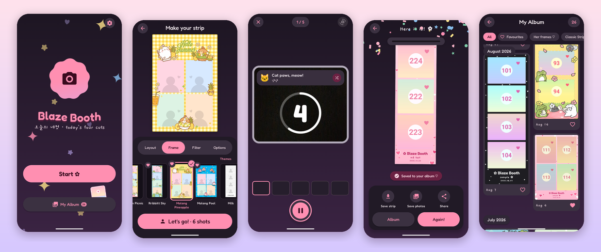

<table>
  <tr>
    <td align="center">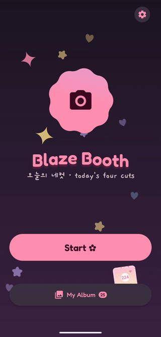<br><sub><b>Home</b>: floating sparkles and a morphing blob</sub></td>
    <td align="center">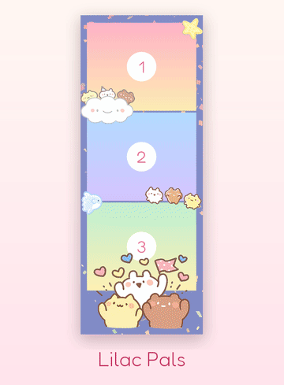<br><sub><b>Her frames ♡</b>: all 12 bundled designs</sub></td>
  </tr>
</table>

| Setup | Who's in the booth? | Pose ideas | Pick your cuts |
|:---:|:---:|:---:|:---:|
| 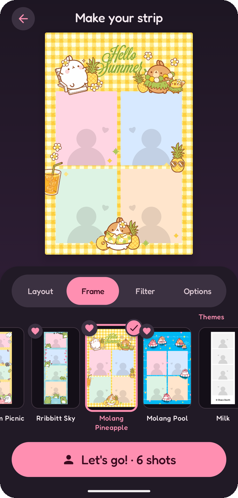 | 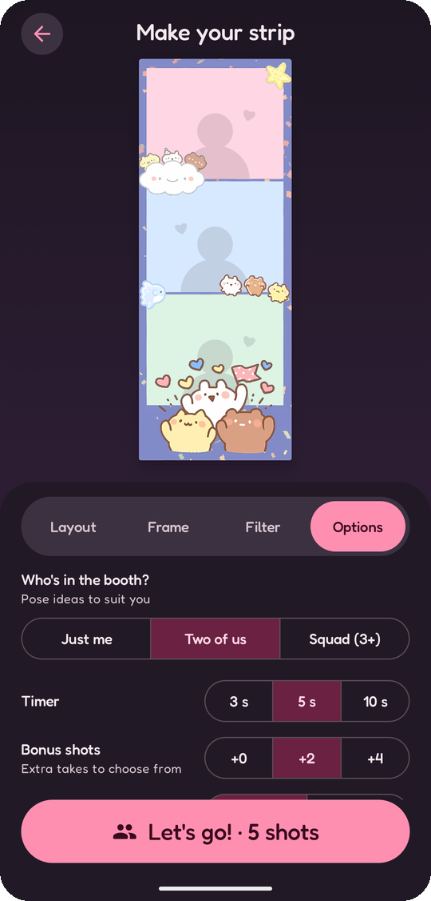 | 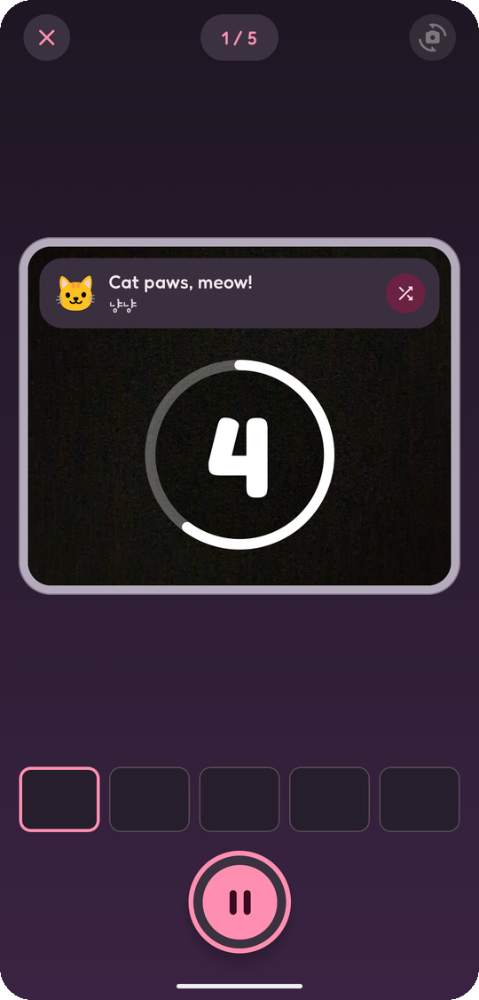 | 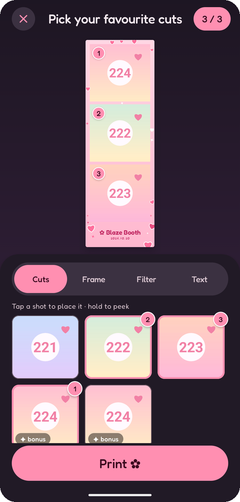 |
| **Printed!** | **My Album** | **Strip detail** | **Manage frames** |
| 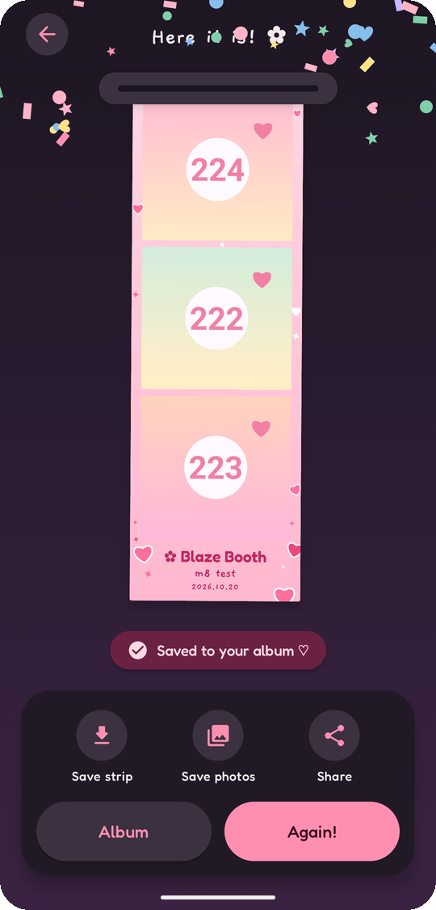 | 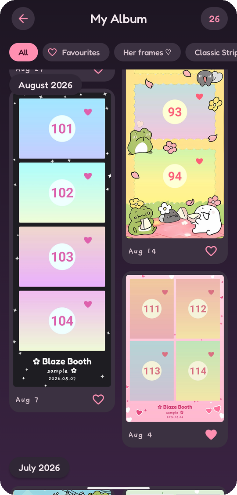 | 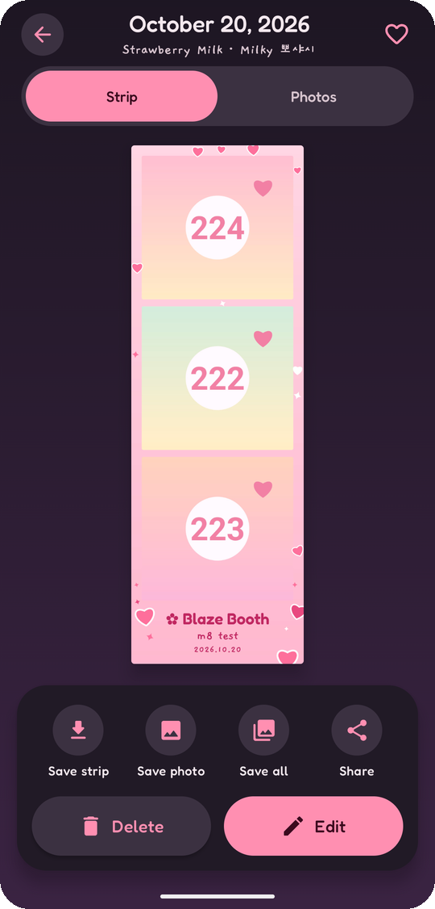 | 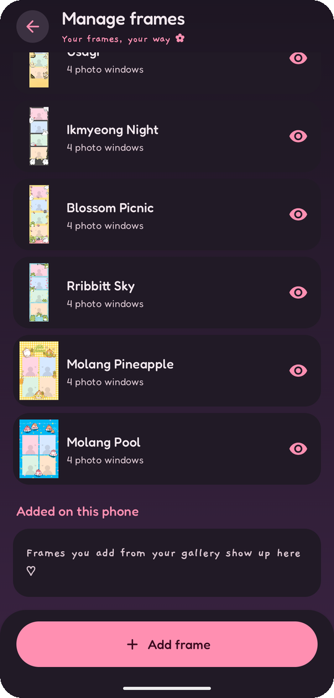 |

<sub>Captured on a Pixel 9 in dark mode. Every strip shown uses generated sample photos (the numbered pastel cards), and status bars are cropped. The bundled frames are third-party artwork for personal use only (§5.5.6), which is why this repository is private.</sub>

> **Built by an AI agent.** Claude (Claude Code) writes this app autonomously. This README is the **single source of truth** for what to build, how it looks and feels, how it's put together, and in what order. When a decision changes, update this file first (see the [Decision log](#18-decision-log)) and then change the code.

**Target device:** Google **Pixel 9** (`tokay`, verified over adb), running **Android 17 (API 37.1)**, with a 6.3" 1080×2424 OLED at 60–120 Hz, 420 dpi density, 12 GB RAM, a 10.5 MP front and 50 MP rear camera. Portrait only.
**Status:** v1.2.0 ✅ (2026-11-03): five new frames on top of v1.1.0 (M0–M10, 2026-10-20, pose ideas). Released as a sideloaded APK (`release/BlazeBooth-1.2.0.apk`, §15.5) that installs **over** 1.1.0 and keeps the album (installed on the Pixel 9 over wireless debugging). See [What's new in v1.2](#whats-new-in-v12), [What's new in v1.1](#whats-new-in-v11), [What's in v1.0](#whats-in-v10) and [Milestones](#16-milestones).
**Her frames:** ✅ 5 frames processed, AI-upscaled, text removed, bundled, and **approved by her** (2026-10-20); since v1.1 also 2 Molang frames, and since v1.2 five more strips, all at the user's request (§5.5.6).

### What's new in v1.2
- **Five new frames ♡ (§5.5.6):** *Best Day*, *Union Jack*, *HBD Autumn*, *Snowy Christmas* and *Yalary Spring*, 4-photo strips after the Molang frames in Setup, Pick and Manage frames. Data only, no code change; version **1.2.0 / versionCode 3**, installs over 1.1.0 and keeps the album.

### What's new in v1.1
- **Pose ideas (§5.6):** a pose card on the viewfinder suggests what to do for every shot: *"First up"* before the first one, the current pose during the countdown, and *"Next: …"* during the "Nice!" beat. 51 poses (with Korean names like 볼하트 and 꽃받침), no repeats in a session, a cute warm-up first, a love pose on the strip's last cut, and never two of the same mood in a row. Tap the card (🔀) for another pose.
- **Who's in the booth?** A new Setup → Options row: *Just me · Two of us · Squad (3+)*. Two of us and Squad get poses written for them (about 60%) mixed with the ones that work for everyone; a little icon on "Let's go!" shows the choice.
- **Two new frames ♡:** *Molang Pineapple* and *Molang Pool* (2×2 grids, 4 photos), after her five in Setup, Pick and Manage frames (§5.5.6).
- **Settings → Pose ideas** turns the card off for just the countdown, as in v1.0.
- The pose plan is saved with the session, so a retake, a restart or Android closing the app shows the same poses. Updating keeps every strip, setting and unfinished session.

### What's in v1.0
- **The booth:** Setup (her 5 frames first, then 9 themes, 6 filters, 5 layouts, timer, bonus shots, front/back camera, flash) → Capture (a cropped, filtered viewfinder, a bouncy countdown, flash, sounds, haptics) → Pick (choose the cuts, retake one, change the frame or filter, caption, date) → Print → Result (the strip prints out with confetti and is already in the album).
- **The album, forever:** every strip and every original shot are kept on the phone, with month headers, ♡, filters, multi-select, Detail (Strip | Photos), Edit (re-pick, re-frame, re-filter) and Delete with Undo.
- **Save and share:** the strip, one photo or all photos go to Photos (`Pictures/Blaze Booth`) or the share sheet; auto-save after printing is optional.
- **Her frames ♡:** 5 bundled frames, and she can import her own from the gallery (windows found automatically or placed by hand), then rename, reorder, hide or delete them.
- **Polish:** springy motion everywhere, reduce motion, light and dark themes with checked contrast, TalkBack, and layouts that work at 200% font.
- **Hardening (M9):** every edge case in §13 checked and tested, safe when Android closes the app in the background, StrictMode-clean, smoother first frames, an R8-shrunk 13 MB release build with a baseline profile, and an install guide (§15.5).

---

## Table of contents

1. [Vision & product principles](#1-vision--product-principles)
2. [Requirements → features](#2-requirements--features)
3. [User flow](#3-user-flow)
4. [Screens](#4-screens)
5. [Booth catalog: layouts, frames, filters](#5-booth-catalog)
6. [Design system](#6-design-system)
7. [Motion & animation catalog](#7-motion--animation-catalog)
8. [Architecture](#8-architecture)
9. [Camera pipeline](#9-camera-pipeline)
10. [Strip renderer](#10-strip-renderer)
11. [Data, storage & export](#11-data-storage--export)
12. [Permissions](#12-permissions)
13. [Edge cases & error handling](#13-edge-cases--error-handling)
14. [Project structure](#14-project-structure)
15. [Build, run & install on the Pixel](#15-build-run--install-on-the-pixel)
16. [Milestones](#16-milestones)
17. [Agent playbook](#17-agent-playbook)
18. [Decision log](#18-decision-log)
19. [Out of scope / future ideas](#19-out-of-scope--future-ideas)

---

## 1. Vision & product principles

Walking into a Korean photo booth is a small ritual. You pick a frame, step behind the curtain, get a few seconds to pose before each flash, choose your favourite shots, and leave holding a glossy strip. Blaze Booth recreates that ritual, keeps the cute energy, and makes every strip something you can keep.

| Principle | What it means in practice |
|---|---|
| **Instant joy** | From launch to the first shutter in **≤ 3 taps** (Start → Let's go → shutter). The app remembers your last setup. |
| **What you see is what you get** | One renderer draws the live strip preview *and* the exported file. They can never drift apart. |
| **Forgiving** | Extra "bonus" shots to choose from, single-shot retakes, and undo on delete. |
| **Never lose a photo** | Every shot goes to disk the moment it's taken. A session is saved to the album as soon as it's printed, including the cuts you didn't pick. |
| **Cute, not cluttered** | Whimsy lives in the motion, shapes, stickers and copy. Controls stay big, clear and few. |
| **One thumb** | Primary actions sit in the bottom third of the screen. Portrait only. Touch targets are ≥ 48 dp. |
| **Buttery** | Runs at 120 fps on the Pixel 9. All bitmap work happens off the main thread. Animations are physics-based springs, not linear tweens. |

---

## 2. Requirements → features

| # | Requirement (from the brief) | How Blaze Booth delivers it |
|---|---|---|
| 1 | Normal photo booth: themes/frames, countdown, multiple photos | **Setup** screen: 5 layouts, 9 built-in frame themes, **custom artwork frames** ("Her frames ♡", bundled and importable, §5.5), 6 filters, timer (3/5/10 s), bonus shots (+0/+2/+4), front/back camera. **Capture** runs an automatic countdown sequence with flash, sound and haptics. |
| 2 | Review photos after taking them | **Pick** screen: every shot in a tray, tap to place into slots, long-press to peek full-screen, retake a single shot, live strip preview. Saved sessions can be reviewed and re-picked in **Detail**. |
| 3 | Download locally, individually or as a strip | **Result** and **Detail** offer *Save strip* and *Save photos* (all cuts, or the one you're viewing) to the phone's Photos via MediaStore (`Pictures/Blaze Booth`). Share is available too. |
| 4 | Save photos in the app forever | Each session (strip and every original shot) is stored in app-private storage and indexed in a Room database. Browse it in the **Album**. It persists across restarts and updates, and moves to a new phone with device-to-device transfer. |
| 5 | Sleek, modern animations | Spring-based motion system, shared-element transitions, predictive back, the strip "printing" reveal, confetti, a morphing blob logo, a bouncy countdown. See §7. |
| 6 | Modern, responsive UI | Jetpack Compose with Material 3, edge-to-edge, adaptive to font scale and display size, dark mode, reduce-motion support. |
| 7 | Latest technologies | Kotlin 2.4, AGP 9.4 (built-in Kotlin), Compose BOM 2026.09, Navigation 3, CameraX 1.6 with the Compose viewfinder, Room 2.8 with KSP, Coil 3, DataStore, Graphics Shapes. See §8.1. |
| 8 | Well-thought-out UI/UX | This document: flows, screens, edge cases, accessibility, haptics and copy are all specified up front. |
| 9 | Cute and whimsical theme | Pastel "strawberry milk" palette, rounded Fredoka type, handwritten Gaegu captions, floating hearts and sparkles, sticker decorations on frames, playful copy ("Say kimchi! 📸"). |

---

## 3. User flow

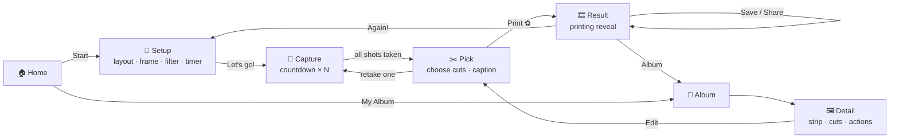

**Back behaviour** (predictive back everywhere):
- Capture → back asks *"Leave the booth? Your N shots will be lost"* (Stay / Leave). With 0 shots it leaves silently.
- Pick → back goes to Capture only after confirming *"Retake everything?"*. The usual escape is ✕ → *Discard session?*
- Result → back goes **Home**. The session is already saved, so it never returns into the capture flow.
- Detail in edit mode → Pick → back cancels the edit with no changes.

---

## 4. Screens

Every screen follows the same pattern: a stateful `XxxRoute` collects state from a `ViewModel`, and a stateless `XxxScreen(state, onEvent)` is previewable in Android Studio.

### 4.1 Home 🏠
- **Look:** cream-to-strawberry-milk vertical gradient. Hearts ♡, stars ☆ and sparkles ✦ drift slowly upward (≈ 14 particles, parallax at three depths). In the centre sits a **morphing blob** (Graphics Shapes `RoundedPolygon` cookie ↔ flower morph, slowly rotating) with a camera glyph inside. Below it, the wordmark **Blaze Booth** in Fredoka SemiBold and a Gaegu tagline: *"오늘의 네컷 · today's four cuts"*.
- **Actions:** a large pill **Start ✿** button (primary, squishes on press), a secondary **My Album** button showing a small count badge, and a settings gear in the top-right corner.
- **Recent strip peek:** if the album isn't empty, the latest strip is tucked behind the Album button at a −8° tilt, peeking out. Tapping it opens Detail.
- **Draft recovery:** if an unfinished session exists (§11.4), a snackbar-style card appears: *"You have 3 unfinished shots. Continue?"* (Continue / Discard).
- **Data wiring:** the badge, peek and draft card read a `HomeUiState` from `HomeViewModel`, which combines the flows of a `HomeSource` (`AppContainer.homeSource`). M1 ships `EmptyHomeSource` (no strips, no draft), so all three stay hidden. M3 (draft) and M5 (album) provide the real source, and they light up without UI changes.
- *Since M8:* the camera in the blob is decoration (TalkBack reads the wordmark, a heading); the peek says *"Your latest strip"* with an *Open* action; with big fonts the draft card puts its message on its own lines and the buttons under it.
- *Since M5:* `BoothHomeSource` reads `SessionRepository.count` (badge, soft-deleted strips excluded) and `latest` (the newest strip's `thumb.jpg`, or `strip.jpg` if the thumbnail is lost). The peek shows the top of the strip (crop, top-aligned); tapping it opens Detail.

### 4.2 Setup 🎀
- **Top 55%:** a **live strip preview** rendered by the real `StripRenderer` with cute placeholder silhouettes in each cell. It cross-fades and springs whenever a choice changes. It tilts subtly with device tilt (±3°, optional parallax).
- **Bottom sheet (always expanded, rounded 32 dp top):** a segmented tab row **Layout · Frame · Filter · Options**, swipeable with a `HorizontalPager`.
  - *Layout:* chips with mini diagrams (1×4, 2×2, 1×3, 2×3, Solo) and the cut count.
  - *Frame:* a horizontal carousel of swatch cards (each a tiny rendered frame). The selected card scales to 1.08× and gets a wobbling sticker ✓. **"Her frames ♡"** (custom artwork frames, §5.5) come **first**, with a heart badge, followed by the built-in themes. The carousel ends with a dashed **"+ Add frame"** card that opens the import flow (§4.9). Choosing an image frame sets the layout automatically (its slot count and shapes come from the artwork), so the *Layout* tab shows "Set by frame".
  - *Filter:* round thumbnails showing a sample photo through each filter, with the name below.
  - *Options:* Timer (3/5/10 s segmented), Bonus shots (+0/+2/+4), Camera (Front/Back), then Mirror selfies (switch) for the front camera, or **Flash** (Off / Auto, default Off, §13) for the back camera. The row under Camera follows the lens (since M4).
- **CTA:** a sticky **Let's go!** button at the bottom. Its label shows the total shots, e.g. *"Let's go! · 6 shots"*.
- **Persistence:** every choice is saved to DataStore immediately and restored next time. On the very first launch, or if the saved frame no longer exists (e.g. a deleted import), the first frame in the carousel is chosen: her first frame, *Lilac Pals*.
- *As built in M2:* the back button and the title *"Make your strip"* sit over the preview; the sheet is a fixed-height `Surface` (not a draggable sheet), so the preview takes the remaining ~55% of the screen. Theme swatches are rendered on the classic strip; her frames' swatches are her `thumb.png` drawn through the renderer with placeholders. While an image frame is selected, the Layout tab shows a *"Set by frame ♡ · Lilac Pals has 3 photo windows"* card above the dimmed layout chips. Device tilt / parallax was not built in M2 (it was optional).
- *Since M8:* **tilt and parallax**: the preview leans up to ±3° as the phone tilts and drifts up to 6 dp (`ui/components/DeviceTilt`: the gravity sensor while Setup is resumed; a slow baseline follows the pose, so holding the phone at any angle settles back to level, and only the movement leans the strip). The angles are read only in the preview's `graphicsLayer`, so a sensor update redraws one layer and never recomposes. Off with reduce motion. Each frame card (swatch and name together) is one tap target and one TalkBack stop (*"Lilac Pals, one of her frames, selected"*); tapping the name now selects it too. *Mirror selfies* is a whole-row switch; the Timer and Bonus segments read *"5 seconds"*, *"2 bonus shots"*. With big fonts the sheet grows (the preview shrinks), option rows stack their words above the control, and names shrink to fit two lines rather than break mid-word (never below their 100% size).
- *Since M10:* **Who's in the booth?** is the first row of *Options* (§5.6.1): *Just me · Two of us · Squad (3+)*, a full-width segmented control under its words (*"Pose ideas to suit you"*), default *Just me*, saved like every other choice (`setup.crowd`). "Let's go!" carries a small Material Rounded icon for it (`Person`, `People`, `Groups`: the 👤 / 👥 / group of §5.6.1 in the app's icon style, §6.4); it's decorative, since the row says it in words.
- *Since M7:* her imported frames follow her bundled ones inside "Her frames ♡" (same heart badge), in her order from Manage frames. Frames she hid leave the carousel. Coming back from "+ Add frame" with a new frame selects it, and the carousel slides it into view if it's off-screen. If the remembered frame is hidden or deleted, Setup opens on the first frame in the carousel (`SetupViewModel.resolve`, pure and tested).

### 4.3 Capture 📸
- **Viewfinder:** full-bleed CameraX viewfinder **cropped to the chosen layout's cell aspect ratio** (WYSIWYG), framed by the selected frame colour with rounded 28 dp corners. The live filter is applied in real time (§9.3).
- **Top bar:** ✕ (leave), a shot counter pill **"2 / 6"**, and a flip-camera button that's disabled mid-countdown.
- **Bottom:** a **shot tray** of N small rounded slots that fill as photos land, plus a big round **shutter** button that starts the sequence. While a sequence runs, the shutter becomes a **pause ⏸** button.
- **Sequence:** tap the shutter, then countdown → capture → 1.2 s "nice!" beat → next countdown, repeated automatically until all N shots are taken, just like a real booth. The user can pause or resume at any time.
- **Countdown:** a giant number (Fredoka Bold, 160 sp) pops in with an overshoot spring while a ring drains around it. Each tick plays a soft beep and a haptic `CLOCK_TICK`. The last second turns the ring pink and gives a little camera wiggle.
- **Capture moment:** a white flash overlay (≈ 220 ms ease-out), the shutter sound (`MediaActionSound`), a `CONFIRM` haptic, and a mini thumbnail that **flies along an arc into its tray slot**. Front camera uses a **screen flash** (full white plus maximum brightness) when the scene is dark.
- **Cheerful prompts** rotate above the countdown: *"Say kimchi!"*, *"Heart hands! 🫶"*, *"Look surprised!"*, *"Peace ✌️"*, *"Cheek poke!"*. *Replaced in M10 by **pose ideas** (§5.6): a pose card with a pose plan per session, chosen for who's in the booth.*
- **When all shots are done**, the view auto-advances to Pick with a container transform from the tray.
- *As built in M3:* the viewfinder sits between the top bar and the tray on the app's gradient, with an 8 dp border in the frame's colour (a theme's top background colour; for her frames, the average of the artwork's solid pixels). It springs (`Gentle`) to the next slot's shape during the beat. The countdown ring and number are sized to fit the viewfinder (up to 160 sp, ignoring font scale). The prompt pill sits at the top of the viewfinder, and "Nice! ✿" pops in during the beat. Bonus shots show "5 / 6 ✦ bonus" in the pill. While idle or paused, a hint pill says what to do. The flying thumbnail is a 650 ms quadratic Bézier that lifts 120 dp above the start. The **A7 container transform to Pick is not built yet**: Pick is still a placeholder, so it moves to M4 with the real Pick. Pausing, backgrounding (§13) and failed shots all pause; resuming always starts a fresh countdown. ✕ (or back) with shots asks *"Leave the booth?"* and then discards the draft; with no shots it leaves silently. Low storage (< 50 MB allocatable) asks before the first shot. The camera permission (§12) and camera errors (§13) replace the viewfinder with a card. Sounds, haptics and the screen flash read `BoothSettings` (§11.6), which default to on until M8.
- *Since M10:* the prompt pill and its five fixed prompts (`capture_prompts`) are gone; the **pose card** (§5.6.1, `ui/feature/capture/PoseCard`) sits at the top of the viewfinder, with the countdown ring, the "Nice!" word or the hint pill in the space under it. Its shot is the next one to take (during the beat that's already the next shot), or the retaken shot.
- *Since M4:* on the back camera, a **flash toggle** (⚡ off / ⚡A auto) sits left of the flip button. It changes `ImageCapture.flashMode` at once (no rebind) and is remembered like Setup's Flash row. **Retake one:** `Capture(retakeIndex = k)` shoots only shot *k* (its slot's shape, one slot in the tray, the pill says "Retake · shot 3") and replaces it in the draft; ✕ or back returns to Pick without asking and keeps the old shot. The tray carries the A7 shared-bounds key, so when the last shot lands it grows into Pick's tray.

### 4.4 Pick ✂️ (review)
- **Top:** the live strip preview, with slots numbered ①②③④. Empty slots show a dashed outline and a pulsing "+".
- **Bottom:** a **shot tray** (grid, 3 columns) with every shot taken, each wearing a filter-applied thumbnail.
  - **Tap a shot** to place it in the next empty slot. The thumbnail flies into the slot with a shared-bounds animation, and the shot gets a numbered badge.
  - **Tap a filled slot** (or the badge) to remove it.
  - **Long-press a shot** to peek full-screen. Release to dismiss.
  - **Retake** (on the peek view) goes back to Capture for a single shot that replaces this one.
- **Auto-fill:** on arrival, shots 1…cuts are pre-placed in order. With no bonus shots this means Pick is effectively "review and confirm".
- **Quick edits row:** frame swatch carousel, filter selector, caption text field (≤ 24 chars, Gaegu), date stamp toggle.
- **CTA:** **Print ✿**, disabled with a gentle shake on tap until every slot is filled.
- *As built in M4:* the strip preview fills the top; the sheet below (rounded 32 dp, like Setup's) has four tabs: **Cuts** (the tray, where Capture's tray lands, A7), **Frame**, **Filter** and **Text**, then Print ✿. A counter pill ("2 / 3") sits top-right and turns strawberry when full.
  - Every slot has a number badge; empty slots are dashed with a pulsing "+". Placed shots wear the slot number in the tray and a strawberry border. Bonus shots wear "✦ bonus".
  - Tapping a placed shot in the tray also takes it out (a toggle). With every slot full, tapping another shot plays `REJECT`; free a slot first.
  - A8: the thumbnail flies from the tray into its slot on a small arc (spring, like A6), and the slot fills when it lands.
  - **Peek** stays open after a long-press (it does not close on release) so its **Retake** and **Done** buttons can be tapped; tapping outside or back closes it.
  - **Frame** offers her frames and the themes with no more slots than there are shots. A theme keeps the session's layout. Switching keeps the picks that fit and fills new empty slots with unused shots. **Filter** shows her own first cut through each filter. Frame and filter changes belong to this session only; Setup keeps its saved choices.
  - **Text:** caption (≤ 24 chars, Gaegu, one line) and a date switch. Her frames have no `textArea`, so the tab shows *"Her frames carry their own artwork, so a caption and date don't print on them ♡"* instead.
  - Print with empty slots: the button shakes, `REJECT` plays, and the empty slots blush pink. While printing, *"Printing your memories…"* covers the screen. If it fails, a snackbar says so and the draft is untouched.
  - *Since M8:* the caption's keyboard pushes the sheet up (`imePadding`, the strip shrinks) and Done closes it; the Text tab scrolls; the date row is a whole-row switch. TalkBack: the counter (*"2 of 3 slots filled"*) is a polite live region, slots read *"Slot 2 of 3, filled"* (action *Take it out*), tray shots read *"Shot 5, bonus"* with *In slot 2* / *Not in the strip* and actions *Put it in the strip* / *Take it out* and (long press) *Peek*. (M4's tray wired TalkBack's double-tap to Peek by mistake; fixed and tested.) Choosing a frame or filter, or the date switch, ticks (`SEGMENT_TICK`). While the keyboard is up, the Text page shrinks to the caption and date and Print steps aside, so the strip stays big enough to watch the caption land (found on the Pixel 9: the strip shrank to a sliver).
  - Back asks *"Retake everything?"* (Keep these / Retake all → a fresh draft, Capture from shot 1). ✕ asks *"Discard session?"* (→ Home).

### 4.5 Result 🎞️
- **Printing reveal:** a stylised "printer slot" bar sits at the top. The strip slides out downward in stepped increments (like a real printer feeding paper), sways once on a pendulum spring, settles, and then **confetti** bursts (hearts, stars, pastel rectangles).
- **Saved badge:** the moment rendering finishes, the session is already in the album. A chip reads *"Saved to your album ♡"*.
- **Actions** (a floating rounded toolbar):
  - **Save strip**: writes to Photos and shows a checkmark morph and snackbar *"Strip saved to Photos"*.
  - **Save photos**: saves all chosen cuts to Photos as individual files.
  - **Share**: system share sheet with the strip.
  - **Album**, and **Again!** (back to Setup with the same settings).
- *As built in M4:* the strip is the saved `strip.jpg` (decoded ≤ 900 px wide). It feeds out in 8 steps (230 ms each: a quick ease-out shove, then a pause), then sways on a loose spring (damping 0.22) from its top edge, while ≈ 80 confetti pieces (hearts, stars, strips, dots in the palette) burst for 2.5 s. Confetti has a closed-form motion (gravity plus linear drag), so any moment can be drawn and tested. The title changes from *"Printing your memories…"* to *"Here it is! ✿"*, and the *"Saved to your album ♡"* chip pops in. With reduce motion the strip just fades in. Album and Again! leave Result (it's removed from the stack); ← and system back go Home.
- *Since M6:* **Save strip** saves `strip.jpg`, **Save photos** saves every cut (strip order, with the session's filter), **Share** sends the strip (§11.5). Each button morphs into a ✓ and shows "Saved" (A12); a snackbar says *"Strip saved to Photos"* / *"3 photos saved to Photos"* with a `CONFIRM` haptic. A saved button stays ✓ while Result is open, so the same file isn't saved twice by accident. With Settings' auto-save on, Print already saved the strip: a Gaegu note under the chip says *"Saving to Photos too…"*, then *"Also saved to Photos ✓"*, and Save strip shows ✓. The snackbar sits just above the chip and toolbar.

### 4.6 Album 📒
- A **staggered grid** (2 columns) of strip thumbnails, grouped under sticky month headers ("October 2026").
- Each card shows the strip with a small date and a ♡ favourite toggle (pop + particle burst).
- **Filter chips:** All · Favourites · by layout.
- **Empty state:** a cute illustration (camera with a heart) and *"No strips yet. Let's make memories!"* with a Start button.
- Items animate in and out with `Modifier.animateItem()`. Long-press enters multi-select (select → delete / save to Photos).
- *As built in M5:* `ui/feature/album/`. The grid is a `LazyVerticalStaggeredGrid` (2 columns) of `thumb.jpg` cards loaded by Coil; each card knows its picture's aspect ratio (read once from the JPEG header), so the grid lays out before any picture arrives. Month headers ("October 2026", in the phone's language and time zone) are full-width pill rows; the staggered grid has no sticky headers, so a copy of the current month's pill floats over the top of the grid and is pushed up by the next month's header (its position is read in the layout phase, so scrolling doesn't recompose). Each card shows the date ("Oct 20", Gaegu) and a ♡ (`FavoriteButton`: pop, a burst of 8 hearts and dots, `CONFIRM`; un-favouriting is a `SEGMENT_TICK` and a smaller pop). Chips: All · Favourites · **Her frames ♡** (every image frame, whatever its window count) · then the built-in layouts, but only layouts that have strips. A filter with nothing in it shows a short message (*"No favourites yet. Tap ♡ on a strip you love."*). Long-press starts multi-select: cards show check circles, the top bar says *"2 selected"* with ✕, and a bar in the thumb zone offers **Delete (2)** and **Save to Photos** (since M6: each selected strip's `strip.jpg`, newest first, one after another; the button counts *"Saving 2 of 3…"*, then shows ✓ for 0.9 s, the snackbar (lifted above the selection bar while selecting) says *"2 strips saved to Photos"*, and the selection clears). Back while selecting clears the selection. The empty state is a pastel blob with a camera and a heart, *"No strips yet. Let's make memories!"* and Start ✿ (→ Setup).

### 4.7 Detail 🖼️
- **Hero:** the strip transitions in from the Album card via a **shared element transition**.
- A **segmented toggle**: *Strip* | *Photos*. *Photos* is a `HorizontalPager` of the individual cuts (with filter) plus an "unused shots" section.
- **Actions:** Save strip · Save this photo · Save all photos · Share · ♡ · **Edit** (opens Pick in edit mode to re-pick cuts, change frame, filter or caption, then re-render) · Delete.
- **Delete:** the item leaves with a shrink and fade. A snackbar offers **Undo** for 5 s (soft delete, §11.2).
- *As built in M5:* `ui/feature/detail/`. The top bar has ←, the date ("October 20, 2026") with *frame · filter* in Gaegu below it, and ♡. The *Strip | Photos* toggle is the Setup/Pick pill tab row over a pager that only switches by tapping (Photos has its own pager). **Strip**: `strip.jpg` (or the thumbnail if it's lost), with the album thumbnail as its placeholder, so the A10 hero has a picture from its first frame. **Photos**: the cuts in slot order with the session's filter (*"Cut 1 of 3"*), then the unused bonus shots (*"✦ Unused shot 1 of 2"*) in the same pager; an *Unused shots ✦* row of thumbnails jumps to them (page dots when there are none). The bottom toolbar has Save strip · Save photo · Save all · Share, then **Delete** and **Edit**. Delete shrinks and fades the strip, soft-deletes it and returns to **Album**, which shows the Undo snackbar (if Detail was opened from Home's peek, Album takes its place). A frame that no longer exists doesn't matter: Detail only shows the saved files.
- *Since M6:* **Save strip** saves `strip.jpg`; **Save photo** saves the Photos page in view (a cut as `…_cutN.jpg`, an unused shot as `…_bonusN.jpg`; on the Strip tab it first slides to the Photos tab, so she sees which photo she's saving); **Save all** saves every cut, one after another, counting *"2 of 3"*; **Share** opens a small menu: *The strip*, *This photo* (Photos tab only), *All 3 photos* (`ACTION_SEND_MULTIPLE`). The ✓ and snackbar work as on Result; ✓ resets after an Edit, since the files changed. A missing file shows *"Oh no, that file is missing from your album."* with no Retry.
- **Edit** (as built in M5): `Pick(editSessionId)` opens the same Pick screen backed by the saved session (`PickSource`: `DraftPickSource` for a new session, `SavedPickSource` for Edit). Every shot can be re-picked, bonus shots included; frame, filter, caption and date can change. The title is *"Edit your strip"*, Print becomes **Save changes ✿**, the peek has no Retake (there's no camera behind a saved session), and ✕ or back cancel at once with no changes (no dialog, and back keeps its predictive animation). Nothing is written until Save, which re-renders `strip.jpg` and `thumb.jpg` at full size (`StripExporter`, `preview = false`) and updates the rows in one transaction (§11.2); Pick then pops back to Detail, which shows the new strip. The date stamp stays the day the strip was made. The draft is never touched. If the session's frame no longer exists, Edit starts on the default theme with a layout that fits the shots.

### 4.8 Settings ⚙️ (modal bottom sheet from Home)
Shutter & countdown sounds · Haptics · Screen flash for selfies · Save mirrored selfies as seen · Auto-save strip to Photos after printing (default **off**) · **Manage frames** (rename, reorder, hide or delete custom frames) · Storage used (e.g. "42 strips · 310 MB") · About & licenses.

*Since M1:* the sheet opens from the Home gear as a read-only preview. Toggles show their defaults but are disabled, the other rows carry a "Soon" pill, and a note says they switch on later. M8 wires them to DataStore (§11.6).
*Since M6 (moved up from M8):* the switches are real and saved at once (`BoothPreferences.updateSettings`, one read-modify-write per tap); a whole row toggles its switch. **Sounds** and **Screen flash** are read by Capture; **Haptics** reaches every screen through `LocalBoothSettings` (provided in `MainActivity`, read by `rememberBoothHaptics`). **Save mirrored selfies as seen** is the same stored value as Setup's *Mirror selfies* (`setup.mirror`, summary *"The same switch as Mirror selfies in Setup"*), so the capture pipeline is unchanged. **Auto-save strip to Photos** (default **off**) makes Print also save the strip (§11.5). **Storage used** reads *"23 strips · 48 MB"*: the live strip count and every byte under `files/sessions/` (shots, strips, thumbnails, the draft, strips waiting to be purged), counted off the main thread each time the sheet opens (*"Counting…"* meanwhile; 1 MB = 1,000,000 bytes, like Android's Settings). **Manage frames** keeps its "Soon" pill (M7). *About & licenses* is a plain line.
*Since M10:* **Pose ideas** (*"A pose to try for every shot"*, default **on**, `settings.pose_ideas`) sits under *Screen flash for selfies*. Off: Capture shows no pose card, just the countdown.
*Since M7:* **Manage frames** (with a ›) closes the sheet and opens its own screen (`ManageFrames` key, `ui/feature/frames/ManageFrames*`): ← and *"Your frames, your way ✿"*, then **Her frames ♡** (her bundled frames, 5 in v1.0 and 7 since v1.1: a swatch, the name, *"4 photo windows"* and a 👁 hide/show button; *"These came with the booth: they can be hidden, not deleted."*) and **Added on this phone** (her imports: tap the row to rename, ⌃ ⌄ to move it up or down, 👁 to hide or show, 🗑 to delete; empty: *"Frames you add from your gallery show up here ♡"*), and a sticky **+ Add frame** at the bottom. Hidden rows are dimmed with a *Hidden* pill. Delete asks first: *"It will be removed from your booth."*, or, when strips use it, *"It's in 3 of your strips, so it'll be hidden instead, and those strips can still be edited."* (§11.2); a snackbar confirms. Bundled frames keep their fixed order (only imports reorder). The note under the title is *"Make the booth yours ✿"*.

### 4.9 Add frame ➕ (import flow)
1. **Pick:** the system Photo Picker (`PickVisualMedia`, images only, no permission needed) opens. She chooses her frame image (PNG or JPG).
2. **Detect:** a short "Finding the photo windows… ✨" animation runs the slot detector (§5.5.2).
3. **Confirm:** the frame is shown with each detected window outlined and numbered ①②③④, with photo placeholders peeking through. A line of text explains the result: *"Found 4 photo windows"*.
   - **Looks right** → name it (defaults to "Frame 1", "Frame 2", …) → **Save**. A heart pops and it joins "Her frames ♡".
   - **Adjust** → opens the slot editor.
4. **Slot editor** (fallback when detection is wrong or the image has no clear windows): draggable, resizable rounded rectangles with corner handles, snap-to-edges guides, **+ Add window**, and a delete button on the selected window. Numbers reorder by position automatically. For opaque (JPG) frames the windows are cut out of the artwork, so photos show through.
5. **Errors:** if the image is too small (< 600 px wide) she sees a gentle warning that it may look blurry, but can still continue. If there's no window and she cancels the editor, nothing is saved.

*As built in M7* (`ui/feature/frames/AddFrame*`, `SlotEditor.kt`; `data/frames/FrameImporter`, `render/FrameImport`, `render/FrameCutout`, `model/WindowEditor`):
- The `AddFrame` key opens the Photo Picker at once (`PickVisualMedia`, `ImageOnly`); backing out of it leaves. The file is decoded with `ImageDecoder` (EXIF orientation applied, sRGB, 8-bit ARGB) at most **7200 px on the long edge and 12 MP** (§13), a power-of-two decoder sample then an exact scale.
- **Finding:** the picture (a quick small decode) dims under a strawberry band that sweeps down it with twinkling ✦ sparkles, and *"Finding the photo windows… ✨"*; it plays at least 1.4 s. The detector runs off the main thread.
- **Confirm** (*"Your new frame ✿"*): the real renderer draws the frame with its windows see-through and the placeholder silhouettes under it; each window gets a dashed strawberry outline and a number badge. *"Found 4 photo windows"* (or *"4 photo windows"* after adjusting), the Gaegu note *"Your photos go under the artwork, just like in a real booth ♡"*, the small-picture card when needed, then **Adjust** · **Looks right ♡**. Looks right swaps the buttons for a name field (default *"Frame N"*, the first free number) with Cancel · **Save ♡**; the screen rides above the keyboard (`imePadding`) and Save closes it; *"Saving your frame…"*, then a heart pops with a little burst and *"Added to Her frames ♡"* (`CONFIRM`), and after 1.3 s the flow closes back to Setup (which selects it) or Manage frames.
- **Slot editor** (*"Adjust windows"*): her picture as it is (white behind any transparency) with each window as a tinted rounded rect and its number. Touch a window to select it (white corner handles appear); drag it to move, drag a corner to resize (28 dp touch radius). Edges and centres snap to the frame's edges and centre lines and to other windows within 10 dp, and a dashed lavender guide shows the line. The bottom bar has the validation note, **+ Add window** (a free spot, centred, top first; at most 8), a 🗑 for the selected window, and **Done** (only when 1–8 windows don't overlap: *"Windows 2 and 3 overlap. Nudge them apart ♡"*). Done returns to Confirm with the new windows cut in. ✕ or back return to Confirm unchanged, or leave the flow if no windows were found. TalkBack: each window is a node (*"Photo window 2, selected"*) with actions Move left/right/up/down, Make bigger/smaller and Delete window.
- **Cut-out** (`FrameCutout`, the same code for the preview and the saved file): an unchanged Mode B window keeps the detector's keyed pixels; a window over pixels that are already mostly transparent is left alone; anything else (a window she drew or moved on an opaque frame) is cut out as the rounded rect the editor shows (corner radius 6% of the short side) with a 2 px soft edge just inside it. Mode B boxes she moved or deleted get their colour back.
- **Save** writes `frame.png` and a 300 px `thumb.png` into a staging folder, renames it to `files/frames/{uuid}/` and inserts the row last in her order (`CustomFrameStore.add`); any failure leaves nothing behind.

---

## 5. Booth catalog

### 5.1 Layouts
All geometry is defined in **export pixels** (600 dpi). Cells are computed, not hand-placed: `cellW = (W − 2·margin − (cols−1)·gap) / cols`, and `cellH = (H − margin − footer − (rows−1)·gap) / rows`.

| id | Name | Grid | Cuts | Canvas (px) | margin / gap / footer | Cell aspect (w:h) |
|---|---|---|---|---|---|---|
| `classic` | Classic Strip | 1×4 | 4 | 1200×3600 (2×6 in) | 72 / 48 / 440 | ≈ 1.43 (landscape) |
| `grid` | Four Grid | 2×2 | 4 | 2400×3600 (4×6 in) | 96 / 56 / 520 | ≈ 0.73 (portrait) |
| `trio` | Trio Strip | 1×3 | 3 | 1200×3600 | 72 / 48 / 440 | ≈ 1.06 |
| `six` | Six Grid | 2×3 | 6 | 2400×3600 | 96 / 56 / 520 | ≈ 1.12 |
| `solo` | Solo Polaroid | 1×1 | 1 | 1800×2200 | 120 / 0 / 520 | 1.00 |

Strip anatomy (classic):
```
┌────────────────┐  ← margin 72
│ ┌────────────┐ │
│ │   cut 1    │ │
│ └────────────┘ │  ← gap 48
│ ┌────────────┐ │
│ │   cut 2    │ │
│ └────────────┘ │
│      ...       │
│ ┌────────────┐ │
│ │   cut 4    │ │
│ └────────────┘ │
│  ✿ Blaze Booth │  ← footer 440: wordmark · caption · date
│   2026.10.20   │
└────────────────┘
```

### 5.2 Frame themes
| id | Name | Background | Ink (text) | Stickers / decoration |
|---|---|---|---|---|
| `milk` | Milk | `#FFFFFF` | `#3A3A3A` | none (clean classic) |
| `ink` | Ink | `#1E1E22` | `#FFFFFF` | tiny white sparkles |
| `strawberry` | Strawberry Milk | `#FFD6E3` → `#FFB8CF` | `#C02660` (*M8*: was `#D6336C`, 2.9:1 on the bottom pink) | hearts |
| `cloud` | Cloud Nine | `#CFE8FF` | `#3B6FB6` | clouds and small stars |
| `matcha` | Matcha Latte | `#DCEFD6` | `#4F7A45` | four-leaf clovers |
| `lavender` | Lavender Dream | `#E6DCFF` → `#CDB9FF` | `#6B4FBB` | stars and crescent moons |
| `butter` | Butter Daisy | `#FFF1B8` | `#B07A00` | daisies |
| `cherry` | Cherry Blossom | `#FFE9EF` | `#C2185B` | falling petals |
| `film` | Film | `#111111` | `#F5F5F5` | sprocket holes down both edges (Haru Film style) |

Stickers are vector paths drawn by the renderer (no bitmap assets). They're scattered with a **seeded RNG** (seed = theme id and layout id), so placement is deterministic and identical in preview and export. They sit in margins, gaps and the footer, overlapping cell edges by at most 12 px so faces are never covered, and never touching the centred footer text block. As built (`render/StickerLayout.kt`): 3–4 larger stickers are placed in the footer first, either side of the text, then the margins and gaps are filled; most stickers get a white die-cut border like paper stickers.

### 5.3 Filters
Every filter is a 4×5 `ColorMatrix`. The same matrix is used for the live viewfinder (RenderEffect), thumbnails (Compose `ColorFilter`) and export (`Paint.colorFilter`).

| id | Name | Character |
|---|---|---|
| `original` | Original | identity |
| `mono` | Mono 흑백 | high-contrast black and white, the classic Korean booth look |
| `milky` | Milky 뽀샤시 | brighter, lifted shadows, lower contrast, faint pink warmth (the "glow skin" look) |
| `peach` | Peach | warm, slightly saturated |
| `cool` | Soda | cool blue tint, crisp |
| `film` | Film | faded blacks, warm highlights, slight green shadows |

### 5.4 Options
- **Timer:** 3 / 5 / 10 s (default **5**).
- **Bonus shots:** +0 / +2 / +4 (default **+2**, so a classic strip takes 6 shots and you pick 4).
- **Camera:** front (default) / back.
- **Mirror selfies:** on by default. The preview is mirrored, and the saved photo matches what you saw.

### 5.5 Image frames (custom artwork) ♡
Built-in themes (§5.2) are drawn in code. **Image frames** are real artwork, e.g. frames designed by the person this app is for, just like the frames in a real Korean booth. Known so far: **her frames have 4 photos per strip**. The file format isn't known yet (probably JPG or PNG), so the app supports both.

#### 5.5.1 How an image frame works
An image frame is **artwork with windows**. The photos are drawn *underneath* and the artwork is drawn *on top*, so her borders, stickers and lettering can overlap the photos exactly as designed.

```
 photos (centre-cropped into each window's rect)   ← drawn first
 frame artwork (windows transparent)               ← drawn on top
```

- **Geometry comes from the artwork.** The canvas size is the image's own size, and the slots are the detected windows. The window count sets the number of cuts, which is **4** for her strips.
- **Window shapes:** a slot is the window's bounding rectangle. Non-rectangular windows (rounded corners, hearts, clouds) just work, because the artwork masks the photo's edges.
- **Capture:** the viewfinder is cropped to the aspect ratio of the slot being shot (shot *i* → slot *i*). Bonus shots use slot 1's aspect. At render time every photo is centre-cropped ("cover") into its slot.
- **Base:** the canvas is filled white before the photos, so anything the artwork leaves see-through exports as white rather than black (JPEG has no alpha).
- **Text:** the artwork usually has its own lettering, so the generated footer (wordmark, caption, date) is **off** for image frames. An optional `textArea` in the frame's metadata re-enables caption and date in that box.
- **Export resolution:** the frame's native size. Frames narrower than 1200 px are upscaled ×2 with filtering so the photos stay sharp. Anything longer than 7200 px is downscaled.

#### 5.5.2 Window (slot) detection
`FrameSlotDetector` is pure Kotlin over an `IntArray` of pixels, so it's unit-testable on the JVM. It works on a copy downscaled to a long edge ≤ 1200 px, then scales the rects back up.

1. **Mode A (transparent PNG):** mask = pixels with alpha < 32. Find 4-connected components (iterative flood fill). Discard components that touch the image border (the transparent outside of rounded frames) and components < 1.5% of the image area. Each remaining component's bounding box is a slot.
2. **Mode B (opaque JPG/PNG):** used when Mode A finds nothing. Flood-fill regions of **near-uniform colour** (RGB distance ≤ 18) from a grid of seed points. Keep regions that are rectangle-like (fill ratio of the bounding box ≥ 0.85), ≥ 3% of the area, and not touching the border. Then choose the largest group of regions sharing the same colour (photo boxes are almost always one colour, e.g. white or grey). The chosen regions are **converted to transparency** (with a 2 px feathered edge), so the frame then behaves exactly like Mode A.
3. **Ordering:** sort slots into rows (top edges within 5% of the height = same row), then left to right within a row.
4. **Validation:** 1–8 slots, no overlaps. If detection fails or looks implausible, the import flow goes straight to the slot editor (§4.9).
5. **Tests:** synthetic frames for each case: transparent 1×4, transparent 2×2, rounded heart windows, white-box JPG with JPEG noise, a frame whose outside is transparent, and no windows at all.
6. *Since M7:* `FrameImport.analyze` wraps the detector for the import flow (the found windows plus Mode B's keyed copy, or one default window for the editor, and the *too small* flag). Tests run the whole pipeline on code-drawn frames, including real PNG and JPEG encode/decode (`FrameImportTest`, `FrameImporterTest`, `FrameCutoutTest`).

#### 5.5.3 Two ways frames get into the app
| | **Bundled** ("Her frames ♡" ship with the app) | **Imported** (added on the phone, §4.9) |
|---|---|---|
| Source | The human drops files into [`photo-frames/`](photo-frames/) in this repo (screenshots and Pinterest saves are fine) | The system Photo Picker |
| Processing | The agent adds an entry to [`tools/frames/frames.config.json`](tools/frames/frames.config.json) and runs [`tools/frames/process_frames.py`](tools/frames/process_frames.py) (§5.5.5). JPGs are converted to PNGs with transparent windows **at build time**. The human approves the previews | The detector on the device, plus the slot editor if needed |
| Stored as | `app/src/main/assets/frames/<id>/frame.png` + entry in `assets/frames/frames.json` | `files/frames/<uuid>/frame.png` + row in the `frames` table |
| Can delete? | Hide only | Yes (see §11.2) |

`frames.json` (the agent writes this; the slots are explicit, so detection isn't needed at runtime for bundled frames):
```json
[
  {
    "id": "lilac-pals",
    "name": "Lilac Pals",
    "file": "lilac-pals/frame.png",
    "thumb": "lilac-pals/thumb.png",
    "width": 1200, "height": 3142,
    "slots": [ { "x": 58, "y": 69, "w": 1081, "h": 874 }, "…" ],
    "textArea": null
  }
]
```
The order in `frames.json` is the order in the Setup carousel.

#### 5.5.4 Guidance for frame files (for the designer)
- **Best:** PNG, with the photo areas erased to **transparent**.
- **Also fine:** JPG or PNG with plain **solid-colour boxes** (e.g. white) where the photos go.
- **Size:** 1200×3600 px for a 2×6" strip or 2400×3600 px for a 4×6" print is ideal. Anything ≥ 600 px wide works.
- Exports from Canva, Procreate, Photoshop, Ibis Paint and similar apps are all fine. Screenshots and Pinterest saves work too; the pipeline crops, straightens and upscales them.

#### 5.5.5 Bundled frame pipeline (`tools/frames/`)
A reproducible Python script (Pillow, NumPy, SciPy; see `requirements.txt`) turns raw images into app-ready frames. Each frame is an entry in `frames.config.json`:

| Key | Meaning |
|---|---|
| `id`, `name` | Asset folder name and display name |
| `source` | Glob under the repo root (handles Korean/emoji file names) |
| `rotate` | Optional deskew in degrees (counter-clockwise) |
| `crop` | `[x0, y0, x1, y1]` strip bounds in source pixels. Several frames can come from one image |
| `window_color` | RGB of the photo windows (white, black, olive…) |
| `tolerance` | `[t0, t1]` colour distance: < t0 is fully transparent, > t1 fully opaque, with a smoothstep in between |
| `width` | Optional output width in px (default 1200); the Molang 2×2 frames use 1800 so each window stays sharp |
| `window_points` | Optional `[[x, y], …]` in native crop pixels: white bits of a window cut off by a character's outline (beside the HBD bunny, say) that should be keyed too. They never become slots |
| `labels` | Optional crisp captions drawn over ones the upscaler garbled: `{pills: [[x0,y0,x1,y1], …] in output px, lines: [...], fill, outline, ink}`, one rounded pill per line (overlapping pills merge), Fredoka Bold (`res/font/fredoka.ttf`) centred in each |
| `erase` | Optional list of `{rect: [x0,y0,x1,y1] in output px, tolerance, grow}` or `{rect, mode: "all"}` areas to paint out (text, logos). Text pixels (those that differ from the rect's surroundings) are refilled by a Laplace solve from the surrounding background; `mode: "all"` refills the whole rect (for plain backgrounds) |

Steps:
1. **Segment at native resolution:** windows are big window-coloured regions that don't touch the edge. Same-coloured shapes that aren't windows (a white cloud, a white bear) are **protected** so they stay opaque.
2. **Upscale** to 1200 px wide (Lanczos, or a pre-upscaled image via `--upscaled-dir`, e.g. from an AI upscaler).
3. **Soft-key** the windows at full resolution with colour decontamination, so edges are anti-aliased without coloured fringes. Decorations inside windows (stars, sparkles) stay on top of the photos.
4. **Erase** any configured text or logo areas, then draw any `labels`.
5. **Slots** are each window's solid body (thin leaks along outlines are ignored), grown by 6 px so photos tuck under the artwork.
6. **Output:** `assets/frames/<id>/frame.png` + `thumb.png`, `assets/frames/frames.json`, and review images in `photo-frames/_previews/` (`*_photos.jpg` with numbered sample photos, `*_alpha.jpg` with transparency shown as a checkerboard).

```bash
python -m venv .venv && .venv/Scripts/pip install -r tools/frames/requirements.txt
.venv/Scripts/python tools/frames/process_frames.py            # all frames
.venv/Scripts/python tools/frames/process_frames.py --only usagi-gold
.venv/Scripts/python tools/frames/prep_sources.py              # only to rebuild photo-frames/prepped/ (v1.2)
```

**Pre-cleaned sources (v1.2):** `tools/frames/prep_sources.py` writes `photo-frames/prepped/<id>.png` for sources the keyer can't handle as they are, filling the windows with magenta (`window_color` 255,0,255): *Union Jack* came as a printed sheet with photos in the windows (left strip kept, navy border repainted flat, the neighbour strip's flag sliver replaced by a mirror of the left edge, the printed date painted out), and *Snowy Christmas* has gradient windows with sparkles (each window is grown from a seed through smooth gradients, stopping at outlines and snow). The prepped PNGs are committed.

#### 5.5.6 Her frames (bundled, v1)
Five frames from three images she picked (2026-10-20), plus two Molang frames added in v1.1 (M10) and five strips added in v1.2 (2026-11-03), both at the user's request. Sources are in `photo-frames/`.

| id | Name | Source | Windows | Output |
|---|---|---|---|---|
| `lilac-pals` | Lilac Pals | purple strip with bears and cloud | **3** | 1200×3142 |
| `usagi-gold` | Usagi | yellow Usagi strip (left of the two identical strips) | 4 | 1200×3658 |
| `ikmyeong-night` | Ikmyeong Night | Play in the Box sheet, left (charcoal) | 4 | 1200×3633 |
| `blossom-picnic` | Blossom Picnic | Play in the Box sheet, middle (yellow) | 4 | 1200×3584 |
| `rribbitt-sky` | Rribbitt Sky | Play in the Box sheet, right (blue) | 4 | 1200×3633 |
| `molang-pineapple` | Molang Pineapple | `molang_pineapple.jpg`, yellow gingham, keeps its "Hello Summer" title (*v1.1*) | 4 (2×2) | 1800×2695 |
| `molang-pool` | Molang Pool | `molang_water.jpg`, blue pool with swim rings, "molang" logo erased (*v1.1*) | 4 (2×2) | 1800×2695 |
| `best-day` | Best Day | `faa34073….jpg`, the empty right strip of the "February Photostrip" sheet: camera and window panels, "BEST DAY" tiles, "Fearless" player (*v1.2*) | 4 | 1200×3636 |
| `union-jack` | Union Jack | `35995ba5….jpg`, a Life4Cuts print: left strip, navy border with a Union Jack foot; photos, stickers, logo and date removed via `prepped/` (*v1.2*) | 4 | 1200×3468 |
| `hbd-autumn` | HBD Autumn | `45456065….jpg`, the yellow strip with wavy windows (deskewed 1.93°); studio logo erased, "Happy Jeonghan / The8 / Woozi Day" re-lettered with `labels` (*v1.2*) | 4 | 1200×3525 |
| `snowy-christmas` | Snowy Christmas | `cbc2c6af….jpg`, the blue gingham Christmas strip; gradient windows keyed via `prepped/`, signature erased, keeps "Snow" and "Merry Christmas" (*v1.2*) | 4 | 1200×3605 |
| `yalary-spring` | Yalary Spring | `09abfff7….jpg`, the Yalary × Photolab+ springtime strip (deskewed 2.45°); header collab text and "PHOTOLAB+" erased, keeps the speech bubbles (*v1.2*) | 4 | 1200×3355 |

**The v1.2 strips:** all single-column, 4 windows, 1200 px wide. The three tiny crops (Best Day 199 px, HBD 177 px, Snowy Christmas 225 px wide) got two Real-ESRGAN anime ×4 passes; Union Jack and Yalary (≈380 px) one. Brand marks, handles, watermarks and dates are erased; big designed lettering (BEST DAY, Fearless, HBD, Snow, Merry Christmas) is kept because it upscales cleanly. Same personal-use-only rule (Yalary and the SEVENTEEN birthday art are third-party designs).

**The Molang frames (v1.1):** both are 2×2 grids with grey windows (`window_color` 196,196,198) keyed out, each crop upscaled with Real-ESRGAN anime ×4 in **one** pass (`photo-frames/upscaled/molang-*.png`) and rendered at 1800 px wide (`width`). *Molang Pineapple* keeps its "Hello Summer" lettering; *Molang Pool*'s "molang" logo is painted out by an `erase` rect. They were processed by the main session and committed unchanged in M10; the same personal-use-only rule applies (Molang is a licensed character).

**AI upscaling:** the sources are tiny (the Play in the Box strips are only about 146 px wide), so each crop (`photo-frames/_previews/<id>_crop.png`) was upscaled with **Real-ESRGAN** (`realesrgan-ncnn-vulkan` v0.2.5.0, model `realesrgan-x4plus-anime`, running on the local GPU). Lilac Pals and Usagi got one ×4 pass; the three Play in the Box strips got two ×4 passes. The results are committed in [`photo-frames/upscaled/`](photo-frames/upscaled/) and fed to the pipeline with `--upscaled-dir photo-frames/upscaled`, so rebuilding doesn't need the upscaler. To redo it: download the release zip from github.com/xinntao/Real-ESRGAN/releases into a folder outside the repo, then run `realesrgan-ncnn-vulkan -i <crop>.png -o <id>.png -n realesrgan-x4plus-anime -s 4`.

**All writing removed** (the human's request, 2026-10-20): the "usagi" title and Vietnamese caption, the Ikmyeong / Play in the Box logo, the Blossom Picnic tablecloth text, and the Rribbitt / Play in the Box logo are painted out via `erase`. The AI upscale had garbled the small text anyway. The frames now carry no lettering, which leaves room for an optional `textArea` (caption/date) later.

**Known limits:** characters that stood *above* the strips in the promo image are cropped off. On Rribbitt Sky, the faint diamond pattern behind the old logo is smoothed over.

**Personal use only:** these designs are third-party artwork (Pinterest saves; the Play in the Box frames are that booth brand's official art, Usagi is a Chiikawa character and Molang is a licensed character). They're fine in a privately sideloaded gift app, but **must not ship in a public Play Store release**.

### 5.6 Pose ideas (M10)
Real Korean booths are half about the poses. Blaze Booth suggests one pose per shot, chosen for **who's in the booth**. This is picked by hand rather than detected; camera-based people counting is a possible later step (§19).

#### 5.6.1 How it works
- **Who's in the booth?** A new row in Setup → Options: **Just me · Two of us · Squad (3+)**, default *Just me*, persisted in `BoothConfig`. A small 👤 / 👥 / 👨‍👩‍👧 icon shows on the "Let's go!" button.
- **Pose plan:** when a session begins, the app draws one pose per shot (cuts + bonus) from the matching pool (§5.6.2), **with no repeats** in that session:
  - **Shot 1** is an easy warm-up (mood *cute*).
  - **The last cut** (shot index `cuts − 1`) is a *love* pose: the strip ends on a heart.
  - **No two shots in a row share a mood** (cute · silly · cool · love), so a strip has variety.
  - **Two of us:** about 60% duo poses and the rest from the solo list (they work for two). **Squad:** about 60% group poses, the rest from the solo list.
  - The plan is saved in `draft.json` (`posePlan: List<String>` of pose ids), so it survives process death and draft recovery. **Retake one** shows the pose originally planned for that shot.
- **Pose card** (replaces the old prompt pill):
  - **Before the first shot:** a large card at the top of the viewfinder: big emoji, the pose name in Fredoka, an optional Korean name in Gaegu (e.g. *"Cheek hearts · 볼하트"*), and *"First up"*.
  - **During the countdown:** the same card, a little smaller, for the current shot.
  - **During the 1.2 s "Nice!" beat:** a preview, *"Next: …"*, so they can get ready.
  - **Tap the card (🔀)** to swap the current pose for another unused one from the pool (`SEGMENT_TICK` haptic). The swap is saved to the plan.
  - Motion: the card pops in with *Bouncy* and cross-fades on change. Reduce-motion means a plain fade.
  - TalkBack announces the pose politely when each countdown starts.
- **Settings → "Pose ideas"** switch (default **on**). Off: no pose card, just the countdown.
- **Content lives in resources:** each pose is an id plus `pose_<id>_name`, an optional `pose_<id>_ko`, an emoji and tags (`who`, `mood`) in a small Kotlin catalogue (`model/Poses.kt`). The text lives in `strings.xml`, so poses can be added later without touching the logic.

*As built in M10* (`model/Poses.kt`, `model/PosePlanner.kt`, `ui/feature/capture/PoseCard.kt`):
- **Catalogue:** `Poses.all` lists the 51 poses below in order (`Pose(id, emoji, who, mood, name, korean)`); the strings are `pose_<id>_name` / `pose_<id>_ko` with `-` written as `_` (Korean names are `translatable="false"`). `Poses.poolFor(crowd)` is the solo list, plus the crowd's own list for Two of us (39) and Squad (37).
- **Planner** (`PosePlanner`, pure, seeded): `plan(crowd, cuts, total, seed)` walks the shots once. Each shot draws from the unused poses that meet the rules, also avoiding the mood the *next* shot is required to have (so the love cut can always follow); Two of us and Squad first pick their own list with probability 0.6 (`OwnShare`) when both lists have a fitting pose. Relaxing goes: "different mood" first, then the cute/love rule, then poses from the rest of the catalogue; a repeat only if everything is used (impossible with 51 poses and at most 10 shots). **Solo Polaroid** (one cut): shot 1 is both the first shot and the last cut, and the cute warm-up wins. The seed is the draft's `createdAt`.
- **Swap** (`swap(plan, index, …)`): another pose that isn't in the plan, keeping that shot's required mood and a mood different from both neighbours where an unused pose allows. Just me has only 3 love poses, so if the plan already uses all three, swapping the last cut gives a non-love pose rather than a repeat (tested).
- **Draft:** `draft.json` gains `posePlan` (one id per shot) and `config.crowd`. A draft from v1.0.0 has neither: it loads as *Just me* and gets `plan(…, seed = createdAt)`, the same plan on every load until a change is written. Unknown ids (a pose removed in a later version) are swapped for fitting ones in place (`repair`). The strip's cut count for the rules is `totalShots − bonusShots` (`BoothDraft.cuts`). Retakes, Pick's choices and config changes leave the plan alone; a swap is written at once (`BoothDraftStore.swapPose`).
- **Card:** big (*First up*, or *Up next* when a continued session or a retake starts idle or is paused), smaller during the countdown (and the capture), *Next:* during the beat, none when done. One TalkBack stop, a polite live region (*"First up: Cheek hearts"*, then *"Pose: Cheek hearts"* as the countdown starts, *"Next: Finger heart"*) with the action *Swap the pose*; the whole card (≥ 56 dp tall) is the tap target, the 🔀 marks it. No swap while the photo is being taken. It pops in on `Bouncy` (from 0.6×) and cross-fades with a small bouncy scale on each change; reduce motion fades. The words use `FitText` (they grow with the font but shrink back to fit, never below 100%) and the emoji ignores font scale, so at 200% the card still leaves room for the countdown on the landscape classic viewfinder. Under the card the idle and paused hints shrink to fit too, and at ≥ 150% font they switch to short versions (*"Tap the big button ✿"*, *"Paused · tap ▶"*), which fit on one line. Robolectric's font has no glyphs for the newest emoji (🫶, 🫰, …), so some PNGs show a box; the phone draws them all.

#### 5.6.2 Pose catalogue (v1: 51 poses)
**Solo, also fine for everyone together (25):**
| id | Pose | 한국어 | Mood |
|---|---|---|---|
| `smile` | 😁 Biggest smile ever | | cute (warm-up) |
| `cheek-heart` | 🫶 Cheek hearts | 볼하트 | cute |
| `finger-heart` | 🫰 Finger heart | 손하트 | love |
| `chin-v` | ✌️ V under the chin | 턱브이 | cute |
| `flower-cup` | 🌸 Flower cup, hands under your chin | 꽃받침 | cute |
| `puffy-cheeks` | 🐡 Puffy cheeks! | 볼빵빵 | silly |
| `cat-paws` | 🐱 Cat paws, meow! | 냥냥 | cute |
| `bunny-ears` | 🐰 Bunny ears! | | cute |
| `head-heart` | 💗 Big heart over your head | 머리 위 하트 | love |
| `blow-kiss` | 😘 Blow a kiss! | | love |
| `wink` | 😉 Wink! | | cool |
| `surprised` | 😮 Look SO surprised! | | silly |
| `thinking` | 🤔 Deep in thought… | | silly |
| `hand-glasses` | 😎 Hand sunglasses | | cool |
| `ok-eye` | 👌 OK sign over one eye | | cool |
| `point-camera` | 👉 Point at the camera! | | cool |
| `laugh` | 😂 Laugh at the funniest joke | | silly |
| `grumpy` | 😤 Cute grumpy face | | silly |
| `sleepy` | 😴 Sooo sleepy… | | silly |
| `chin-rest` | 🙂 Chin on your hands | 턱괴기 | cute |
| `peek` | 🙈 Peek through your fingers | 부끄 | cute |
| `tongue` | 😛 Tongue out! | | silly |
| `idol-fist` | ✊ Idol pose, fist under your chin | | cool |
| `hair-flip` | 💁 Hair flip, so fabulous | | cool |
| `aegyo` | ✨ Maximum aegyo! | 애교 | cute |

**Two of us (14):**
| id | Pose | 한국어 | Mood |
|---|---|---|---|
| `shared-heart` | 💕 One heart together, half each | 반쪽 하트 | love |
| `cheek-to-cheek` | 🥰 Cheek to cheek | | love |
| `back-to-back` | 😎 Back to back, arms crossed | | cool |
| `foreheads` | 💞 Foreheads together | | love |
| `cheek-kiss` | 😚 A kiss on the cheek | 뽀뽀 | love |
| `cheek-pinch` | 🤏 Pinch each other's cheeks | | silly |
| `secret` | 🤫 Whisper a secret | | silly |
| `back-hug` | 🤗 Back hug | 백허그 | love |
| `bunny-swap` | 🐰 Give each other bunny ears | | silly |
| `pretend-fight` | 🥊 Pretend fight! | | silly |
| `point-each` | 👉👈 Point at each other | | cute |
| `mirror` | 🪞 Mirror each other | | cool |
| `face-squish` | 🫠 Squish your faces together | | silly |
| `gaze` | 👀 Look at each other, not the camera | | love |

**Squad, 3+ (12):**
| id | Pose | 한국어 | Mood |
|---|---|---|---|
| `squish-in` | 🤭 Everyone squish in! | | cute |
| `size-order` | 📏 Small, medium, large! | | silly |
| `pyramid` | 🔺 A pyramid of faces | | silly |
| `group-heart` | 💖 One giant group heart | | love |
| `point-one` | 👇 Everyone point at one person | | silly |
| `look-up` | ⬆️ Everyone look up! | | cool |
| `same-pose` | 🪄 Same pose, different faces | | silly |
| `totem` | 🗿 Stack your faces like a totem | | silly |
| `gasp` | 😱 Everyone gasp! | | silly |
| `finger-hearts` | 🫰 Finger hearts, everyone! | | love |
| `hug-sandwich` | 🥪 Hug sandwich! | | love |
| `wave` | 👋 Wave bye-bye! | | cute |

The largest session is 10 shots (Six Grid + 4 bonus), and every pool is big enough to fill it with no repeats while keeping the mood rules. If a rule can't be met, the plan relaxes the "no repeated mood" rule first and never repeats a pose.

---

## 6. Design system

### 6.1 Colour
A custom Material 3 `ColorScheme`. Dynamic colour is **off**, because the brand palette *is* the experience.

| Token | Light | Dark ("midnight candy") |
|---|---|---|
| `primary` (strawberry) | `#C2305E` (*since M8*; text-safe) | `#FF8FB1` |
| decor pink `candy` (particles, blob, confetti, heart bursts; never text) | `#F0628F` | `#FF8FB1` |
| `onPrimary` | `#FFFFFF` | `#3B0A1E` |
| `secondary` (butter) | `#F5C84C` | `#FFE38A` |
| `tertiary` (lavender) | `#9C83F0` | `#C9B6FF` |
| `background` / `surface` | `#FFF7F3` (cream) | `#1B1520` |
| `surfaceContainer` | `#FFEDEF` | `#261E2C` |
| `onSurface` | `#3A2E33` | `#F3E8EE` |
| `outline` | `#E8C9D2` | `#5A4A55` |
| accent mint (decor only) | `#9FE2BF` | `#7FCFAA` |
| accent sky (decor only) | `#A7D8FF` | `#86BDEB` |
| Home gradient (top → bottom) | `#FFF7F3` → `#FFD6E3` | `#1B1520` → `#3A2342` |
| raised controls on the gradient | `#FFFFFF` | `#3B3141` |

The remaining Material roles (containers, variants, inverse) are filled in `ui/theme/Color.kt` to match.
*Since M8 (contrast, §6.7):* the bubblegum `#F0628F` was only 2.9:1 as text on cream (and 3.1:1 under white button labels), so light `primary` is the deeper strawberry `#C2305E` (≥ 4.5:1 on cream, white and every light container, dialogs included; white on it 5.4:1). The bubblegum lives on as `BoothExtraColors.candy` for decoration, so Home still sparkles in the same pink. Dark `inversePrimary` (the draft card's *Continue* on its light card) is `#B4285A` (5.2:1; it was 2.6:1). Strawberry text low on the pink gradient (Add frame's notes) uses `onPrimaryContainer`. Colours with no Material slot (mint, sky, gradient, raised) live in `BoothExtraColors`, read via `BoothTheme.extraColors`.

### 6.2 Typography
- **Fredoka** (variable, OFL) for all UI text. Display/headline use weight 600, titles 500, body 400. It's bundled at `res/font/fredoka.ttf`.
- **Gaegu Bold** (OFL, Hangul support) for handwritten touches: taglines, strip captions and date stamps. Bundled at `res/font/gaegu_bold.ttf`.
- Hangul in UI text falls back to the system font, so Korean captions render correctly.
- Every size is in `sp` and respects the user's font scale. Layouts are tested at 200%.

### 6.3 Shape
- Corner radii: small 12 dp, medium 20 dp, large 28 dp, sheets 32 dp, buttons fully rounded (pill).
- Blob shapes come from `androidx.graphics:graphics-shapes`: cookie (9 rounded scallops), flower, soft star. They're used for the home logo, the selected-state stickers and the empty-state art.

### 6.4 Iconography
Material Symbols **Rounded** (via `material-icons-extended`, `Icons.Rounded.*`). Inline emoji are allowed in copy, sparingly.

### 6.5 Haptics & sound
| Moment | Haptic | Sound |
|---|---|---|
| Countdown tick | `CLOCK_TICK` | soft beep (≤ 120 ms) |
| Capture | `CONFIRM` | `MediaActionSound.SHUTTER_CLICK` |
| Select chip, card or slot; swap the pose card (*M10*) | `SEGMENT_TICK` | none |
| Invalid action (Print with empty slot) | `REJECT` | none |
| Favourite ♡ | `CONFIRM` | none |
| Un-favourite, album selection, tabs, Pick's frame/filter/date, Capture's flip and flash toggles (*M8*) | `SEGMENT_TICK` | none |
| Saved to Photos, frame added, strip printed | `CONFIRM` | none |
| Save/share failed, a full tray | `REJECT` | none |

Sounds and haptics can each be switched off in Settings. *As checked in M8:* every haptic goes through `BoothHaptics` (`rememberBoothHaptics`, which reads Settings' Haptics switch through `LocalBoothSettings`) and the beeps and shutter through `BoothSounds`, which Capture plays only with Sounds on (except the shutter where the law requires it).

### 6.6 Copy voice
Short, warm and playful, never childish. Examples: *"Let's go!"*, *"Say kimchi!"*, *"Pick your favourite cuts"*, *"Printing your memories…"*, *"Saved to your album ♡"*. All strings live in `strings.xml`.
*M8 copy review:* the words are *strip* (the printed result), *cuts* (photos in a strip), *shots* (what the camera took), *photos* (files in Photos) and *frame*; British spelling (*favourite*). The M1 placeholder screen and its *"Coming in…"* strings are gone, the last hard-coded texts (badge "99+", the cards' emoji, preview samples) moved to `strings.xml` (emoji and "99+" as `translatable="false"`), apostrophes are escaped, counts use `<plurals>` (*"It's in one of your strips"* rather than *"in 1 of your strips"*), TalkBack phrases dropped "Tap to…" (TalkBack says how to act; actions carry labels like *Open*, *Take it out*), and *"Prints today's date"* became *"Prints the date"* (an edited strip keeps its own day).

### 6.7 Accessibility
- Contrast: text on surfaces is ≥ 4.5:1. Frame themes are decorative, but footer text on them is ≥ 3:1.
- Every icon button has a `contentDescription`, and the countdown is announced politely to TalkBack.
- **Reduce motion:** when the system animator duration scale is 0 (or "Remove animations" is on), ambient motion stops: floating particles freeze in place (still drawn, as decoration), the blob and wordmark hold still, and confetti and the printing sway are skipped. State changes still cross-fade. `core/ReduceMotion.kt` reads the setting live, and `BoothTheme` provides it as `LocalReduceMotion`.
- Touch targets are ≥ 48 dp, and the shutter is 88 dp.

*As built in M8:*
- **Reduce motion** is honoured by everything ambient or decorative: particles freeze, the blob and wordmark hold still, the Setup tilt is off, the ✓ sticker stops wobbling and Pick's "+" stops pulsing, confetti, the printing feed and sway, the countdown pop and wiggle, heart bursts, the Add-frame sweep, A6/A7/A8/A10 flights and Nav slides are skipped. Things that appear or leave cross-fade (`core/Calm`: `enter`/`exit` become `fadeIn`/`fadeOut`, pops `snap`); a pressed button still gives way but settles back without the bounce. A **debug-only override** (`files/debug_reduce_motion` = `on`/`off`, read at start by `debug/ReduceMotionTrigger`; §15.3) tries it on the phone without touching its settings.
- **Contrast** is tested for every text/background pair in use, in both schemes (`ThemeContrastTest`), and every frame theme's footer on both gradient ends (≥ 3:1). Frame themes never follow dark mode (`FrameDarkModeTest`: the preview and the renderer give identical pixels under a night configuration).
- **TalkBack:** every action has a name and a ≥ 48 dp target (`AccessibilityTest` walks every screen's semantics tree); decorations are silent (the logo's camera, stickers, number badges, page dots, the printer slot); cards and rows are one stop (frame cards, album cards, switch rows); the countdown, Pick's slot counter, Result's title and save states are polite live regions; selections are announced (*selected*, *"Slot 2 of 3, filled"*, *In slot 2*).
- **200% font:** fixed heights became minimums, the Setup/Pick sheets grow with the font (`growWithFont`, so the strip shrinks first), side-by-side label + control rows and button pairs stack (`isLargeFont`, ≥ 150%), one-line labels in fixed spots shrink to fit but never below their 100% size (`FitText`), and digits inside fixed badge circles keep their size (`fixedScale`). Checked with Roborazzi at 200% for every main screen (`big_font_*.png`).

---

## 7. Motion & animation catalog

**Motion tokens** (`ui/theme/Motion.kt`):
| Token | Spec | Used for |
|---|---|---|
| `Bouncy` | `spring(dampingRatio = 0.5f, stiffness = 400f)` | stickers, countdown pop, selected cards |
| `Snappy` | `spring(dampingRatio = 0.8f, stiffness = 800f)` | presses, toggles, slot fills |
| `Gentle` | `spring(dampingRatio = 1f, stiffness = 200f)` | screen-level layout, sheets |
| `Float` | infinite, 6–12 s, ease-in-out | ambient particles, blob morph |
| `floatSpin` | infinite, 24 s per turn, linear | blob rotation (linear, so the turn never pauses) |
| `release` | `spring(dampingRatio = 0.38f, stiffness = 500f)` | the overshoot when a squished button is let go (A3) |
| `BobMillis` | 2.6 s sine loop, linear | wordmark letter bob (A2) |
| `wobble` | infinite, 0.9 s per leg, ease-in-out | the selected card's ✓ sticker rocking ±9° (A4) |

Particles drift at a constant speed per depth (9 / 15 / 24 dp/s) on a frame clock, with a slow sine sway, rather than a tween.

| # | Where | Animation |
|---|---|---|
| A1 | Global | Nav 3 transitions: forward = slide-in 12% and fade with `Gentle`, pop = reverse. **Predictive back** is supported natively. |
| A2 | Home | Floating particles (3 depths), blob morph and rotation, wordmark letters bob with staggered phase. |
| A3 | All buttons | **Squish:** scale to 0.92 on press via `Snappy`, overshoot on release. |
| A4 | Setup | Preview cross-fades and springs on change; the selected card scales and gets a sticker ✓ that pops in with a wobble. |
| A5 | Capture | Countdown number pops with an overshoot, ring drains, last-second wiggle. |
| A6 | Capture | Flash overlay; thumbnail flies on a quadratic-bezier arc into the tray slot. |
| A7 | Capture → Pick | Tray container transform (shared bounds). |
| A8 | Pick | Shot → slot fly-in (shared bounds); a shake on invalid Print. |
| A9 | Result | Stepped printing feed, pendulum sway, confetti burst (≈ 80 particles, physics with gravity and drag, 2.5 s). |
| A10 | Album → Detail | **Shared element** strip hero (`SharedTransitionLayout` with Nav 3's `LocalNavAnimatedContentScope`). *As built in M5:* `Modifier.sharedHero(SharedKeys.strip(id))` (`ui/navigation/SharedElements.kt`, off with reduce motion) on the card's picture and Detail's strip; both are the same picture at the same aspect ratio. |
| A11 | Album | `animateItem()` for insert, delete and reorder; ♡ pop with a mini particle burst. *As built in M5:* a deleted card first shrinks to 0.6× and fades (260 ms), then the soft delete lands and the grid closes up. |
| A12 | Save actions | The icon morphs into a ✓ via `AnimatedContent`; a snackbar slides in. *As built in M6:* `ui/feature/export/ExportAction`: icon → spinner (label counts *"2 of 4"*) → ✓ on a strawberry circle (bouncy scale-in, a plain cross-fade with reduce motion), label *"Saved"*; `CONFIRM` on success, `REJECT` on an error. |

Performance rules: animate with `graphicsLayer {}` lambdas (no recomposition per frame), avoid allocations in draw lambdas, and keep particles in a single `Canvas`.

### 7.1 M8 audit
| # | Status | Notes |
|---|---|---|
| A1 | ✅ as specced, + reduce motion | Slide 12% + fade on `Gentle`, predictive back; with reduce motion a plain cross-fade (*M8*). |
| A2 | ✅ as specced | Particles on a frame clock in one `Canvas` (draw-only reads), blob morph read in draw + spin in a layer, wordmark bob in layers; all still with reduce motion. The particles and blob use the decor pink `candy` (§6.1). |
| A3 | ✅ as specced, + reduce motion | 0.92 on `Snappy`, overshoot on `release`; with reduce motion it settles on `Snappy` (no bounce). |
| A4 | ✅ **completed in M8** | Preview cross-fade + spring; selected card 1.08× with the ✓ sticker popping in and wobbling. **New:** the ±3° tilt and parallax (§4.2). With reduce motion: fade only, no wobble, no tilt, selection scale snaps. |
| A5 | ✅ as specced | Bouncy pop, linear ring drain (a timer, so linear is right), 480 ms wiggle on the last second; reduce motion: fade, no wiggle. |
| A6 | ✅ adjusted | Flash 220 ms ease-out (§4.3). The thumbnail arc is a 650 ms `FastOutSlowIn` tween (not a spring) so it lands exactly as its slot fills; *M8* moved it into a `graphicsLayer` (it recomposed the screen every frame and re-laid out the image). Instant with reduce motion. |
| A7 | ✅ as built in M4 | `sharedBounds` tray → Pick tray; off with reduce motion. |
| A8 | ✅ adjusted | A hand-made arc (both ends on one screen, §18) on a soft spring, and the Print shake; *M8* moved the flight into a layer and the "+" pulse / blush into draw/layer reads (each empty slot recomposed every frame before). |
| A9 | ✅ as specced | 8 stepped feeds, pendulum sway, 80 confetti for 2.5 s with closed-form physics; *M8*: the feed, sway and confetti clock are read only in the strip's layer and the confetti `Canvas` (the whole Result screen recomposed each frame before). Reduce motion: the strip fades in, nothing else. |
| A10 | ✅ as built in M5 | Strip hero; off with reduce motion. |
| A11 | ✅ as built in M5 | `animateItem`, 260 ms shrink/fade on delete (a tween so the purge waits for it), ♡ pop and burst; reduce motion: no burst, selection pops snap. |
| A12 | ✅ as built in M6 | Icon → spinner → ✓. |
| Tokens | ✅ | Springs everywhere a thing moves; tweens only where time itself is the point: fades, the countdown ring, the confetti and particle clocks, the bob, the flash, A6's arc, A11's leave, the Add-frame sweep. *M8* also removed per-frame allocations from the Add-frame sparkles (one reused `Path`) and per-frame recompositions from the tab colour fade (drawn) and the Capture flash (drawn). |

---

## 8. Architecture

### 8.1 Tech stack
Versions are pinned in [`gradle/libs.versions.toml`](gradle/libs.versions.toml) and were current stable releases on 2026-10-20.

| Concern | Choice | Version |
|---|---|---|
| Language | Kotlin (K2) | 2.4.21 |
| Build | Gradle / Android Gradle Plugin (built-in Kotlin) | 9.8.2 / 9.4.1 |
| SDK | compileSdk / targetSdk 37 (Android 17), minSdk 31 | — |
| JDK | Microsoft OpenJDK | 21 |
| UI | Jetpack Compose BOM (UI 1.12, Material 3 1.4) | 2026.09.00 |
| Navigation | Navigation 3 (`NavDisplay`, typed `NavKey` back stack) | 1.2.0 |
| ViewModels | Lifecycle ViewModel + `lifecycle-viewmodel-navigation3` (per-entry scoping) | 2.11.0 |
| Camera | CameraX (core, camera2, lifecycle, **camera-compose** `CameraXViewfinder`) | 1.6.2 |
| Database | Room with KSP | 2.8.5 / KSP 2.3.12 |
| Preferences | DataStore Preferences | 1.2.1 |
| Images | Coil 3 (album thumbnails, pager) | 3.6.3 |
| EXIF | androidx.exifinterface (export date stamp, §11.5) | 1.4.2 |
| Shapes | androidx.graphics:graphics-shapes | 1.1.0 |
| Async | Kotlin Coroutines and Flow (`kotlinx-coroutines-test` for virtual-time tests) | 1.11.0 |
| Serialization | kotlinx.serialization (nav keys) | 1.12.0 |
| Splash | core-splashscreen | 1.2.0 |
| DI | **Manual** `AppContainer` on the `Application` (small app, no Hilt overhead) | — |
| Screenshot tests | Roborazzi (+ compose, junit-rule) on Robolectric native graphics; Compose `ui-test-junit4` (BOM); androidx.test ext-junit; Espresso core | 1.76.0 / Robolectric 4.17 / 1.3.0 / 3.7.0 |

### 8.2 Layers
```
 UI (Compose screens)  ──events──▶  ViewModel (StateFlow<UiState>)
        ▲                                   │
        └──────────── state ◀───────────────┤
                                            ▼
                     Repositories / Controllers
     SessionRepository · BoothDraftStore · BoothPreferences · CameraController · Exporter
                                            │
                     Room DB · SessionFileStore (filesDir) · MediaStore · DataStore
```
- **Unidirectional data flow:** each ViewModel exposes one immutable `UiState` as a `StateFlow`, plus one-shot `effects` (snackbars, navigation) via a `Channel`.
- **`BoothDraftStore`** (singleton in `AppContainer`) holds the in-progress session (config, shot files, slot selection, caption) shared by Setup → Capture → Pick → Result. It's mirrored to disk (§11.4), so a process death mid-session is recoverable.
- **Threading:** bitmap decode, crop, render and encode on `Dispatchers.Default`; file and DB work on `Dispatchers.IO`. The main thread never touches a full-size bitmap.
- *Since M9:* debug builds run **StrictMode** from the first line of startup (`debug/StrictModeSetup`, a content provider with the highest `initOrder`; it logs disk/network on the main thread, slow calls and leaked closeables under the tag `StrictMode`). A walk through every screen found one offender (Print's "was the strip written?" check, now on `Dispatchers.IO`). Bitmaps that are about to be shown start their GPU upload at once (`BitmapOps.forScreen`, i.e. `prepareToDraw`), so a screen's first frame doesn't upload them all. `BoothApp.onTrimMemory` empties the frame-artwork cache when Android is short of memory (Coil trims its own). No `!!` anywhere in `src/main`; Print, Edit's Save, exports, imports and the startup checks catch failures and report them (snackbar or log) instead of crashing.

### 8.3 Navigation (Navigation 3)
```kotlin
@Serializable data object Home : NavKey
@Serializable data object Setup : NavKey
@Serializable data object Capture : NavKey
@Serializable data class Pick(val editSessionId: String? = null) : NavKey
@Serializable data class Result(val sessionId: String) : NavKey
@Serializable data object Album : NavKey
@Serializable data class Detail(val sessionId: String) : NavKey
```
The back stack is `rememberNavBackStack(Home)`. `NavDisplay` uses `rememberSaveableStateHolderNavEntryDecorator()` and `rememberViewModelStoreNavEntryDecorator()`, wrapped in a `SharedTransitionLayout`. "Print" navigates with `backStack.removeAll { it is Setup || it is Capture || it is Pick }`, then `add(Result(id))`.

As built in M1 (`ui/navigation/BoothNavHost.kt`): Nav 3 1.2.0's `NavDisplay` takes the `SharedTransitionScope` directly (`sharedTransitionScope = this`), and the scope is also exposed as `LocalSharedTransitionScope` for the A10 hero. `transitionSpec`, `popTransitionSpec` and `predictivePopTransitionSpec` implement A1. Pushing a key that's already on top is ignored (no double-tap duplicates). Leaving Result (Again! / Album) removes Result from the stack, so back never returns to it. M2 adds `@Serializable data object AddFrame : NavKey` for the "+ Add frame" card (a placeholder until M7) and replaces the Setup placeholder with the real screen. M3 replaces the Capture placeholder with the real screen. When every shot is taken, Capture removes itself from the back stack and pushes `Pick()`, so back from Pick never re-enters a finished booth. Until M4, `Pick()` is a placeholder that shows the draft's shots in a 3-column grid; `Pick(editSessionId)` stays a plain placeholder. Home's *Continue* goes to Capture, or straight to Pick if every shot is already taken. M4 turns `Capture` into `data class Capture(val retakeIndex: Int? = null)`: Pick's retake pushes `Capture(k)`, which removes itself when done and lands back on Pick. Pick's "Retake all" replaces Pick with `Capture()`; "Discard" and Result's ← clear the stack down to Home. Pick (new session) and Result are real screens since M4. Until their milestones, the remaining keys show a `PlaceholderScreen`: an emoji, "Coming in Mx ✿", a back button, and buttons that walk the real flow (Setup → Capture → Pick → Print → Result, Album → Detail → Edit → Pick). Since M5, Album, Detail and `Pick(editSessionId)` are real; only Add frame (M7) is still a placeholder. Since M7, `AddFrame` is the real import flow and `ManageFrames` (from the Settings sheet) is new; both leave by popping themselves. `PlaceholderScreen` was removed in M8. ← buttons pop their own key only if it's still on top (a double tap can't pop two screens). Edit's Save and Cancel pop back to Detail. Deleting in Detail removes Detail (and any Edit of it) and lands on Album.

### 8.4 Domain model (in-memory)
```kotlin
enum class BoothLayout(id, rows, cols, canvasWidth, canvasHeight, margin, gap, footer) // §5.1; cuts = rows × cols
enum class FrameTheme(id, backgroundTop, backgroundBottom, ink, decoration, stickerColors) // §5.2, ARGB ints
enum class PhotoFilter(id, matrix: FloatArray)                                    // §5.3, built by ColorMatrices
data class BoothConfig(layout, frameId: FrameId, filter, timerSec, bonusShots, lens, mirror, backFlash, crowd)  // crowd: M10, §5.6
value class FrameId(value)            // "theme:<id>" | "asset:<id>" | "custom:<uuid>"
data class ImageFrame(id, name, width, height, slots: List<SlotRect>, textArea, artwork, thumb)
sealed interface FrameSource { Theme(theme); Image(frame: ImageFrame, bitmap: Bitmap) }
data class StripSpec(frame: FrameSource, layout, filter, caption: String?, date: LocalDate?, preview: Boolean)
    // .canvasSize, .slots, .cuts are asked of the spec, never of the frame kind (§10)
data class Shot(index: Int, file: File, width: Int, height: Int)
```
The photos themselves are passed to the renderer next to the spec (`draw(canvas, spec, photos)`), so the same spec can be drawn with preview-size or full-size bitmaps.

---

## 9. Camera pipeline

### 9.1 Binding
- `ProcessCameraProvider.awaitInstance(context)` binds **Preview** and **ImageCapture** to the Capture screen's lifecycle.
- `ImageCapture` uses `CAPTURE_MODE_MINIMIZE_LATENCY` and `ResolutionSelector` with `AspectRatioStrategy.RATIO_4_3_FALLBACK_AUTO_STRATEGY` at the highest available resolution ≤ 12 MP. Full 50 MP isn't needed for a strip and costs latency.
- `Preview` feeds a `SurfaceRequest` into the Compose **`CameraXViewfinder`** (camera-compose).

### 9.2 Viewfinder crop (WYSIWYG)
The viewfinder container has the layout's **cell aspect ratio** and uses `ContentScale.Crop`-equivalent scaling, so the user sees exactly what lands in the cell. The front camera preview is mirrored.

### 9.3 Live filter
`CameraXViewfinder` is set to `ImplementationMode.EMBEDDED` (TextureView-backed), so a `graphicsLayer { renderEffect = RenderEffect.createColorFilterEffect(ColorMatrixColorFilter(matrix)).asComposeRenderEffect() }` applies the filter at 120 Hz on the GPU. (A SurfaceView-backed viewfinder can't be post-processed this way.)

### 9.4 Capture → stored shot
1. `takePicture(executor, OnImageCapturedCallback)` returns an `ImageProxy`, then `imageProxy.toBitmap()`.
2. Rotate by `imageInfo.rotationDegrees` and mirror horizontally if front camera and mirror is on.
3. **Centre-crop to the cell aspect** (the same rect the viewfinder showed).
4. Downscale so the long edge is ≤ **2400 px**.
5. Encode JPEG at quality 95 to `sessions/_draft/shot_{index}.jpg` and record it in `BoothDraftStore`.
6. Recycle bitmaps. Everything after step 1 runs on `Dispatchers.Default`.

The **filter is not baked into stored shots.** Originals stay pristine, so a frame or filter can be changed later in Edit.

### 9.5 Screen flash (front camera)
Use `ImageCapture.FLASH_MODE_SCREEN` with a Compose implementation of `ImageCapture.ScreenFlash`. `apply()` shows a full-screen white overlay, sets `WindowManager.LayoutParams.screenBrightness = 1f`, and then signals completion. `clear()` restores both. It's on by default only when the user enables it in Settings or the scene is dark (auto).
*As built in M3:* `ComposeScreenFlash` signals completion 150 ms after the white frame goes up, and restores the brightness if the screen goes away mid-flash. Settings and scene-brightness detection don't exist yet, so `BoothSettings.screenFlash` **defaults to on** and every front-camera shot uses it. M8 adds the switch and decides whether to add "auto".

### 9.6 As built (M3)
- `camera/CameraController` binds with `ProcessCameraProvider.awaitInstance` to the Capture entry's `LocalLifecycleOwner` and unbinds when the screen leaves. Preview and ImageCapture both use `RATIO_4_3_FALLBACK_AUTO_STRATEGY`. ImageCapture uses `HIGHEST_AVAILABLE_STRATEGY` plus a `ResolutionFilter` that keeps sizes ≤ 12 MP (the Pixel 9's back camera picks 4000×3000). `targetRotation` comes from the display.
- The front preview is mirrored by CameraX itself (`Preview.Builder.setMirrorMode`, `MIRROR_MODE_ON_FRONT_ONLY`, or `OFF` when *Mirror selfies* is off). The stored shot is mirrored by our pipeline, so it matches what the viewfinder showed. The back camera never mirrors and uses `FLASH_MODE_AUTO`.
- The shutter sound, `CONFIRM` haptic and white flash fire from `OnImageCapturedCallback.onCaptureStarted`, after any screen flash, when the sensor actually exposes. In regions that require it (`MediaActionSound.mustPlayShutterSound()`), the shutter sound plays even with sounds off.
- Camera errors come from `cameraInfo.cameraState` (LiveData): `CAMERA_IN_USE` / `MAX_CAMERAS_IN_USE` → "another app might be using it", anything critical → a generic card. Both offer Retry, which binds again.
- §9.4 is done in **one draw**: `ShotGeometry.plan` (pure, unit-tested) computes rotation, mirror, the centre crop and the output size, and one 2×3 affine. `ShotProcessor` draws `ImageProxy.toBitmap()` through it into the output bitmap with bitmap filtering, writes JPEG 95 to `shot_{i}.jpg.part`, fsyncs, then atomically renames it. A 320 px thumbnail is kept for the tray. Everything runs on `Dispatchers.Default` / `IO`, and every big bitmap is recycled.
- The automatic sequence is `CaptureSequencer` (pure coroutines, tested with virtual time). A capture that has started always finishes, even if the user pauses during it.
- *Since M4:* `CameraController.flashMode(lens, backFlash, screenFlash)` (pure, unit-tested) picks the mode: front → `FLASH_MODE_SCREEN` (or off without a screen flash); back → `FLASH_MODE_OFF` or `FLASH_MODE_AUTO` from `BoothConfig.backFlash`. `setBackFlash` changes it on the bound camera without rebinding.

---

## 10. Strip renderer

**One renderer, two consumers.** `StripRenderer.draw(canvas: android.graphics.Canvas, spec: StripSpec, photos: List<Bitmap?>)` draws in canvas units (§5.1 pixels).

- **Export:** a `Bitmap.createBitmap(W, H, ARGB_8888)` gets drawn at 1:1, then is encoded as JPEG 95 (`strip.jpg`, about 1.5–3 MB). A 600 px-wide `thumb.jpg` is written for the album grid.
- **Preview:** a Compose `Canvas` → `drawIntoCanvas { it.nativeCanvas.scale(viewW / W) ; draw(...) }` with *downsampled* bitmaps: frame artwork at ≤ 600 px **wide** (a 1:3 strip at 600 px tall would look soft on the phone), photos at ≤ 600 px on the long edge (`BitmapOps.PreviewMaxPx`). It's the same code, so it's pixel-identical in composition; `StripRenderScreenshotTest.previewMatchesExport` checks that a 1:1 export shrunk to preview size matches the preview render.
- *As built in M4:* `render/StripExporter` draws the strip with the same renderer into a bitmap sized by `ExportSize` (pure, unit-tested: themes 1:1; image frames native, ×2 under 1200 px wide, capped at a 7200 px long edge). Each photo is decoded only as large as its slot needs. It writes `strip.jpg` (JPEG 95) and a 600 px-wide `thumb.jpg` (JPEG 90), each via a `.part` file and an atomic rename. `StripExporterTest` checks that a real export, shrunk, matches the preview render for a theme and for Lilac Pals.
- *As built in M2:* `ui/components/StripPreview` is the composable; `StripRenderer.get(context)` is the app-wide instance (fonts loaded once). Each `draw` call makes its own `Paint`s, so a preview and an export can render at the same time. Empty cells in preview mode get a soft card with a little person silhouette and a heart.

**Two frame kinds, one entry point.** `StripSpec.frame` is a sealed type: `FrameSource.Theme(FrameTheme)` (built-in, §5.2) or `FrameSource.Image(id, bitmap, slots, textArea)` (§5.5). Geometry comes from `LayoutGeometry` for themes and from the frame's slot list for images. Everything downstream (preview, export, Pick, Capture aspect) asks the spec for `slots` and `canvasSize`, and never asks which kind of frame it is.

**Image frame draw order:** photos (cover-cropped into each slot, filter via `Paint.colorFilter`) → frame artwork bitmap on top → optional caption and date in `textArea`.

**Theme frame draw order:** background (solid or gradient) → photo cells (centre-crop into cell rect, clipped with a 12 px corner radius, filter via `Paint.colorFilter`) → empty-cell placeholders (preview only) → stickers (seeded) → footer (Fredoka wordmark "✿ Blaze Booth", Gaegu caption, Gaegu date `yyyy.MM.dd`) → theme extras (film sprocket holes).

**Fonts on Canvas:** `android.graphics.fonts.Font.Builder(resources, R.font.fredoka).setFontVariationSettings("'wght' 600")` → `FontFamily` → `Typeface.CustomFallbackBuilder`. These are cached.

**Testability:** cell-rect math lives in a pure-Kotlin `LayoutGeometry` object that's unit-tested (cells in bounds, no overlap, aspect matches spec). Sticker placement (`StickerLayout`), cover-crop maths (`BitmapOps.coverSource`), filter matrices and `FrameSlotDetector` are pure Kotlin and unit-tested too.

---

## 11. Data, storage & export

### 11.1 Files (app-private, `context.filesDir`)
```
files/
└── sessions/
    ├── _draft/                 ← in-progress booth session
    │   ├── draft.json          ← BoothConfig + shot list + selection (kotlinx.serialization)
    │   └── shot_0.jpg …
    └── {sessionId}/            ← finalised session (UUID)
        ├── shot_0.jpg … shot_N.jpg   ← ALL originals, including unused bonus shots
        ├── strip.jpg                 ← rendered strip (export resolution)
        └── thumb.jpg                 ← 600 px wide thumbnail for the album grid
└── frames/
    └── {frameId}/              ← imported image frame (UUID)
        ├── frame.png           ← artwork, windows transparent (Mode B frames already converted)
        └── thumb.png           ← 300 px wide swatch for the carousel
```
Bundled frames live read-only in `assets/frames/` (§5.5.3).
*Since M7:* an import is written to `frames/{uuid}.part/` and renamed into place before its row is inserted; at startup (after the session purge) any folder under `frames/` without a row is removed (`CustomFrameStore.cleanup`).
Finalising a session is an **atomic directory rename** of `_draft` → `{sessionId}`, followed by the DB insert in one transaction-like step. If the insert fails, the rename is reversed.
*Since M5:* Edit renders into a staging folder `sessions/{id}/edit-{stamp}/`, where *stamp* is the `updated_at` it is about to write. Then the rows are updated in one transaction and the two files are moved over the old ones (atomic renames). A failed render or update deletes the staging folder and changes nothing. At startup (`SessionRepository.startup`), a staging folder whose stamp the row already carries is an edit that was saved but not moved yet, so the move is finished; any other staging folder is dropped. A lost `thumb.jpg` is shown as `strip.jpg` in the album and made again from it at startup.
*As built in M4:* `SessionRepository.finalizeDraft` holds the draft store's lock (`BoothDraftStore.handOff`) while the strip renders into `_draft/`, then renames the folder and inserts the session and **every** shot in one Room transaction. On failure the folder is renamed back. On success `draft.json` is deleted from the session folder. If the process dies between the rename and the insert, the folder still holds `draft.json`; `recoverOrphans()` (run once at app start) re-inserts such a session, and leaves folders without one alone.

### 11.2 Room schema (`booth.db`, version 1, schema exported to `app/schemas/`)
```
sessions(
  id TEXT PRIMARY KEY,          -- UUID, also the folder name
  created_at INTEGER NOT NULL,  -- epoch millis
  updated_at INTEGER NOT NULL,
  layout_id TEXT NOT NULL,      -- built-in layout id, or "image" for image frames
  frame_id TEXT NOT NULL,       -- "theme:strawberry" | "asset:her-pink-ribbon" | "custom:{uuid}"
  filter_id TEXT NOT NULL,
  caption TEXT, show_date INTEGER NOT NULL,
  is_favorite INTEGER NOT NULL DEFAULT 0,
  deleted_at INTEGER            -- soft delete for Undo; purged on next app start (> 10 s old)
)
shots(
  session_id TEXT NOT NULL REFERENCES sessions(id) ON DELETE CASCADE,
  shot_index INTEGER NOT NULL,
  slot_index INTEGER,           -- position in the strip, NULL = unused bonus shot
  width INTEGER NOT NULL, height INTEGER NOT NULL,
  PRIMARY KEY(session_id, shot_index)
)
frames(                         -- imported image frames only (bundled ones come from frames.json)
  id TEXT PRIMARY KEY,          -- UUID, also the folder name
  name TEXT NOT NULL,
  width INTEGER NOT NULL, height INTEGER NOT NULL,
  slots_json TEXT NOT NULL,     -- [{x,y,w,h}, …] in frame pixels
  text_area_json TEXT,
  sort_order INTEGER NOT NULL,
  created_at INTEGER NOT NULL,
  hidden INTEGER NOT NULL DEFAULT 0   -- 0 shown · 1 hidden by her · 2 deleted, kept while any session uses it
)
```
*As built in M4:* `data/db/` has `BoothDatabase` (v1, schema in `app/schemas/`), `SessionEntity`, `ShotEntity`, `FrameEntity` and `SessionDao` (album newest first without soft-deleted rows, count, one session, its shots, favourite, soft delete / restore, `deletedBefore`, delete with cascade). The **`frames` table is created in v1** even though only M7 uses it, so M7 needs no migration. `layout_id` is the layout's id for themes and `"image"` for image frames. Room's transaction makes the session and shot rows land together or not at all.
*Since M5 (still v1, no schema change):* `observeLatest`, batch `softDeleteAll` / `restoreAll`, and `applyEdit` (the new look plus every shot's `slot_index`, in one transaction). `SessionRepository.softDelete(ids)` hides a batch at once and publishes it as `pendingUndo`; `restore(batch)` brings it all back. The **purge** runs at every app start: rows soft-deleted more than 10 s ago lose their folder first, then the row (a crash in between leaves a hidden row that the next start removes, never a lost folder). So a strip deleted and not undone is gone after the next restart, including after a process death. Favourite writes are serialized, so rapid ♡ taps land in order (and the UI shows the last tap at once, `FavoriteToggles`).

**Frame deletion:** a frame used by saved sessions is **hidden**, not deleted, so those sessions can still be re-framed in Edit. Its files are removed once no session references it (checked at startup). Finished `strip.jpg` files never depend on the frame still existing.
*As built in M7* (still v1: the `hidden` column keeps its type; `FrameEntity.hidden` is now an `Int`, so Room's schema is unchanged): `FrameDao` (all rows in order, insert, rename, set hidden, reorder in one transaction, delete) and `SessionDao.frameIdsInUse` / `countUsing`. `CustomFrameStore` (`AppContainer.customFrames`) is the `CustomFrameSource` behind `FrameRepository`. Delete: if any session row uses the frame (soft-deleted ones count, Undo could bring them back) or the draft does, `hidden = 2` (out of Setup and Manage frames, still found by id for Capture, Pick and Edit); otherwise the row and folder go at once. At startup, rows with `hidden = 2` that nothing uses any more lose their folder, then the row. Hiding (`hidden = 1`) never deletes anything. `FrameRepository` exposes `options` (the carousel: shown frames only), `allOptions` / `find(id)` (everything that can still be drawn) and `managed` (Manage frames' list). Pick's Frame tab offers the shown frames plus the session's own frame if it's hidden, so Edit can keep it.
File paths are **derived** from `id` and `shot_index` and never stored, which avoids broken absolute paths after a restore.

### 11.3 "Forever"
App-private storage survives restarts and app updates. It's removed only on uninstall or "Clear storage". `data_extraction_rules.xml` includes sessions, DB and DataStore in **device-to-device transfer**, so a new phone keeps the album. They're excluded from cloud backup because photos would exceed the 25 MB quota. Users who want a copy outside the app use *Save to Photos*. Settings shows storage used.
*Since M9* (`data_extraction_rules.xml`, checked by `BackupRulesTest`): device-to-device transfer also takes **`frames/`** (her imported frames; before, their rows moved without their pictures). The cloud backup now leaves out the **database** and `frames/` too, so it holds only her settings and Setup choices: restoring the album rows without their photos would have shown broken strips.

### 11.4 Draft recovery
`_draft/draft.json` is rewritten after every shot and selection change. On launch, if a draft exists with ≥ 1 shot, Home offers **Continue / Discard**.
*As built in M3:* `data/files/BoothDraftStore` (one instance in `AppContainer`) writes `draft.json` atomically (temp file, then rename). The JSON holds `version`, `createdAt`, `config` (as the same string ids DataStore uses), `totalShots`, `shots` (`index`, `width`, `height`), `selection` and `caption` (the last two are M4's). **Setup's "Let's go!" starts a fresh draft**, wiping any old one, and Capture always works from the draft. A shot listed in the JSON whose file is missing is dropped on load. Flipping the camera mid-session updates the draft's lens and the saved Setup lens. Home's card reads the draft through `BoothHomeSource`. *Discard* deletes `_draft/`; *Continue* resumes Capture at the next shot.
*Since M10:* `posePlan` (a pose id per shot, §5.6.1) and `config.crowd` (`"solo"`/`"duo"`/`"squad"`); drafts from v1.0.0 load as *Just me* with a plan made from their `createdAt` (see §5.6 *As built*).
*Since M4:* Pick writes `selection`, `caption` and a new `showDate` (default true) on every change. Each `DraftShot` gets a `takenAt` stamp, so a retake of the same index is a new value and Pick reloads it. `config` gains `backFlash` (`"off"`/`"auto"`; older drafts read as off). Print hands the whole `_draft/` folder over to `SessionRepository` (§11.1), after which there is no draft.

### 11.5 Export to Photos (MediaStore)
- `MediaStore.Images.Media.EXTERNAL_CONTENT_URI`, `RELATIVE_PATH = "Pictures/Blaze Booth"`, `IS_PENDING = 1` during write, then 0. **No storage permission needed** (API 29+, own files).
- File names: `BlazeBooth_20261020_143012_strip.jpg`, `BlazeBooth_20261020_143012_cut1.jpg`, and so on.
- Individual cuts are exported **with the session's filter applied**, at stored resolution.
- **Share:** render or copy to `cache/shared/`, then a `FileProvider` URI and `Intent.ACTION_SEND` (`image/jpeg`, `FLAG_GRANT_READ_URI_PERMISSION`).

*As built in M6* (`data/export/`):
- `ExportItem` is `Strip` or `Photo(shotIndex, Cut|Bonus, number)`; `ExportJob(session, item)`. `ExportNames` (pure): `BlazeBooth_{yyyyMMdd_HHmmss}_strip.jpg`, `…_cut{slot+1}.jpg`, `…_bonus{n}.jpg`, from `created_at` in the phone's time zone. A name already in `Pictures/Blaze Booth` (the app can only see its own files there) becomes `…_2.jpg`, `…_3.jpg`; the name MediaStore finally gives is read back and reported.
- `PhotoExporter.save(jobs, onProgress)` works one file at a time on `Dispatchers.Default`/`IO`. Each file is first made in `cache/export/`: a strip is a byte copy of `strip.jpg` (so a strip whose frame is gone still saves, §13); a photo with a filter is decoded at its stored size (upright, §9.4), drawn once through the filter's `ColorMatrixColorFilter` and written as JPEG 95; with *Original* it's a byte copy. Then the EXIF date (`DateTimeOriginal`, offset, `Software = Blaze Booth`) is stamped, so Photos files it on the day of the photos. Then `MediaGallery` (a seam over `MediaStore`, faked in tests) inserts a row (`DISPLAY_NAME`, `MIME_TYPE image/jpeg`, `RELATIVE_PATH`, `IS_PENDING 1`, `DATE_TAKEN = created_at`, `DATE_ADDED`/`DATE_MODIFIED`, `WIDTH`/`HEIGHT`), streams the bytes in and sets `IS_PENDING 0`. Any failure deletes the pending row. The `cache/export/` file is always deleted (and the folder is cleared at startup).
- `ExportOutcome`: the saved names, how many files were **missing** (skipped, the batch goes on), and the first real error (`ExportError.NoSpace` for ENOSPC, else `Failed`) with the index where it stopped. **Retry** carries on from that file, and its snackbar counts everything saved.
- `ShareHelper.chooser(jobs)` makes the same files (same names and filter) in `cache/shared/`, turns them into `content://com.blaze.photobooth.files/shared/…` uris and wraps `ACTION_SEND` (one) or `ACTION_SEND_MULTIPLE` (several) with `ClipData` and the read grant in `Intent.createChooser`. Shared files older than an hour are deleted on every share and at startup.
- `ExportService` (`AppContainer.exports`) is what the screens use; `ui/feature/export/ExportTasks` runs one export at a time per screen (other taps are ignored and every save/share button is disabled meanwhile), tracks each button's Idle/Busy/Done state and sends snackbar and share-sheet messages, shown by `ExportMessages`.
- `StripAutoSaver` (`AppContainer.autoSaver`): after Print (`DraftPickSource.commit`), if *Auto-save* is on, the strip is saved in the app scope (leaving Result doesn't stop it); Result reads its status. A failure shows *"Couldn't auto-save the strip to Photos."* with Retry.

### 11.6 Preferences (DataStore)
Last `BoothConfig` choices, sound, haptics, screen flash, save-mirrored, auto-save-to-Photos.
*Since M3:* `BoothPreferences.settings` (`BoothSettings`: `settings.sounds`, `settings.haptics`, `settings.screen_flash`, all default **on**) is the seam for the Settings sheet. Capture already obeys it; M8 writes it with `saveSettings`.
*Since M6:* the Settings sheet writes it. `BoothSettings` gains `saveMirrored` (stored as `setup.mirror`, shared with `BoothConfig.mirror`; on a first launch Setup's default config takes it) and `autoSaveStrip` (`settings.auto_save_strip`, default **off**).
*Since M10:* `setup.crowd` (`BoothConfig.crowd`; a v1.0.0 config without it reads as *Just me*) and `settings.pose_ideas` (`BoothSettings.poseIdeas`, default **on**).
*Since M7:* her hidden bundled frames are a string set `frames.hidden_assets` (`asset:<id>` values; `hiddenBundledFrames`, `setBundledFrameHidden`).
*Since M2:* `data/prefs/BoothPreferences` stores the `BoothConfig` in the `booth` DataStore under `setup.*` keys (layout, frame, filter, timer_sec, bonus_shots, lens, mirror, and since M4 `back_flash`). Unknown or out-of-range values fall back to defaults one field at a time; a saved frame id that no longer exists is resolved against the frame catalog by `SetupViewModel` (§4.2).

---

## 12. Permissions

| Permission | When | UX |
|---|---|---|
| `CAMERA` | On entering Capture | A friendly pre-prompt card ("We need your camera to take cute photos 📸"), then the system dialog. If permanently denied, the card switches to "Open settings" (deep link to app details). |

No storage, location, microphone or network permissions. The app works **fully offline**.

---

## 13. Edge cases & error handling

*M9 status:* every row was checked against the code and is covered by a test (JVM, Robolectric or Roborazzi) or, where only the phone can show it, by an on-device check.

| Situation | Behaviour | Verified (M9) |
|---|---|---|
| Camera fails to bind or is in use by another app | Friendly error card with Retry; logged. | ✅ `CameraStatusTest` (in use / disabled / broken / recoverable), `capture_error_dark.png` |
| App backgrounded mid-countdown | Sequence auto-pauses; resumes with a fresh countdown on return. | ✅ `CaptureSequencerTest.backgroundPausesAndForegroundResumesWithAFreshCountdown` |
| Process death mid-session | Draft recovery on next launch (§11.4). | ✅ `BoothDraftStoreTest`; phone: `am kill` with a draft in Pick (§15.6) |
| Android closes the app in the background on any screen (*M9*) | It reopens on the same screen: Setup, Pick (her picks kept), Result, Album (scroll kept), Detail (tab and photo kept), Manage frames. Edit reopens on the saved look (unsaved changes are dropped; the saved strip is untouched). Result's ✓ on the Save buttons resets. | ✅ phone, debug and release builds (§15.6); `AppConfigTest` (the back stack survives recreation) |
| Add frame closed by Android after she picked a picture (*M9*) | The Photo Picker opens again (the picture was only in memory, and nothing is saved before Save). Before M9 she was left on an empty screen. | ✅ phone (§15.6); fixed in `AddFrameRoute` |
| Low storage (< 50 MB free) | Warn before starting a session; on write failure, show a snackbar and keep the draft. | ✅ `LowStorageTest` (*M9*: free space is now read off the main thread), `CaptureSequencerTest.aFailedShotPausesOnTheSameShot` |
| Low memory (*M9*) | Cached frame artwork is dropped (all of it in the background, half on screen) and decoded again when needed. | ✅ `FrameMemoryTest`; phone: `am send-trim-memory` |
| Device rotated | Activity is portrait-locked; capture uses `targetRotation` from the display so photos are upright. | ✅ `AppConfigTest` (portrait lock), `ShotGeometryTest`, `ShotProcessorTest` |
| Back camera chosen | No mirroring; screen flash disabled. The LED flash follows the **Flash** choice (Off / Auto, default **Off**): a Setup Options row and a toggle in Capture's top bar. *M3 used normal flash on auto, which fired at close range and hurt the human's eyes in testing.* | ✅ `BackFlashTest`, `ShotGeometryTest.onlyFrontCameraSelfiesAreMirrored` |
| Print with empty slots | Button shakes, `REJECT` haptic, empty slots pulse. | ✅ `pick_print_disabled_dark.png`, `SlotSelectionTest` |
| Export fails (MediaStore) | Snackbar with Retry; the pending row is deleted. Retry carries on from the file that failed. A full disk says so (*"Your phone is full…"*). | ✅ `PhotoExporterTest` (a fake `MediaGallery`: failed write, full disk), `ExportTasksTest.retryCarriesOnFromTheFileThatFailed` |
| A file to save or share is missing | Skipped; the snackbar says how many were missing (*"2 photos saved to Photos · 1 was missing"*), or *"Oh no, that file is missing from your album."* with no Retry if nothing could be saved. | ✅ `PhotoExporterTest.missingFilesAreSkippedAndCounted`, `ExportTasksTest.missingFilesGetAFriendlyErrorWithoutRetry` |
| A strip's image frame is gone, then she saves it | The saved `strip.jpg` is copied as it is; the frame isn't needed. | ✅ `PhotoExporterTest.aStripWhoseFrameIsGoneStillSaves` |
| Saving many files at once | One after another, never in parallel; the button counts (*"Saving 3 of 8…"*), and every other save/share button waits. | ✅ `ExportTasksTest.aSecondTapWhileSavingIsIgnoredAndProgressShows`, `album_select_save_dark.png` |
| Double tap on Save | Ignored while a save runs; a saved button stays ✓ on that screen. | ✅ `ExportTasksTest` |
| Very long caption or emoji | Max 24 chars, single line, auto-shrinks to fit the footer width. *M9:* the cut at 24 never splits an emoji (it used to leave half of one, a broken box). | ✅ `CaptionTest`, `CaptionFitTest` (24 × "W" stays inside the text column on every layout) |
| Font scale 200% | Layouts scroll; the strip preview shrinks before controls overflow. *M8:* checked screen by screen at 200% (§6.7). *M9:* Setup's title no longer touches the strip. | ✅ `big_font_*.png` |
| Dark mode | App UI switches; **frame themes don't** (a strip looks the same everywhere). | ✅ `FrameDarkModeTest`; `AppConfigTest` (switching while the app is open keeps her screen) |
| Imported frame has no detectable windows | Go straight to the slot editor with one default window in the middle. | ✅ `FrameImportTest.noWindowsOpensTheEditorWithOneDefaultWindow` |
| Imported frame is huge (e.g. 8000 px) | Downscale on import to a long edge ≤ 7200 px before saving. | ✅ `FrameImporterTest.openDecodesThePickedFileAndShrinksHugeOnes` |
| Imported frame windows have very different shapes | Each shot's viewfinder uses its own slot's aspect ratio; the counter pill shows the slot number. | ✅ `CapturePlanTest.differentlyShapedWindowsGetTheirOwnAspect` |
| A strip's `thumb.jpg` is missing | The album and Home show `strip.jpg` instead; the next start makes a new thumbnail from it (§11.1). | ✅ `SessionAlbumTest.aLostThumbnailIsMadeAgainAndTheAlbumShowsTheStripMeanwhile`, `HomeSourceTest` |
| A saved strip's image frame no longer exists | Album and Detail still show the saved strip. Edit starts on the default theme with a layout that fits the shots. | ✅ `EditSaveTest.aGoneFrameFallsBackToADefaultThemeThatFits` |
| Rapid ♡ taps | Each tap shows at once; the writes land in tap order and the heart never flickers back to an older value. | ✅ `FavoriteTogglesTest` |
| Delete, then the app dies before Undo | The strip stays hidden and is purged (row and folder) on the next start once it's > 10 s old. | ✅ `SessionAlbumTest.thePurgeRemovesOldSoftDeletesRowsAndFoldersButNotRecentOnes` |
| Imported frame is over 12 MP | Also scaled down on import (to fit the app's heap): a 2400 × 9000 strip comes in at 1788 × 6708. | ✅ `FrameImportTest.hugePicturesAreScaledDownOnImport` |
| The picked file isn't an image the phone can decode | *"Couldn't open that picture"* with Pick another / Cancel. | ✅ `FrameImporterTest.aFileThatIsntAPictureFailsGently` (*M9*) |
| Import dies half-way (crash, process death) | Nothing is saved before Save; a half-written `frames/` folder has no row and is removed at the next start. | ✅ `CustomFrameStoreTest.aFailedSaveLeavesNothingBehind`, `startupCleanupRemovesDeletedFramesOnceNothingUsesThem` |
| She deletes a frame her strips use | It's hidden instead (`hidden = 2`); Edit still re-frames with it; its files go at the first start after no strip (or draft) uses it. | ✅ `CustomFrameStoreTest.deletingAFrameThatStripsUseOnlyHidesIt` |
| The frame Setup remembers is hidden or deleted | Setup opens on the first frame in the carousel; the rest of her choices stay. | ✅ `SetupFallbackTest` |
| A draft's frame is hidden mid-session | Capture and Pick still find it by id; the strip prints with it. | ✅ `FrameRepositoryTest.hiddenFramesCanStillBeFound` |
| Moving to a new phone (*M9*) | Device-to-device transfer brings the album, her imported frames and her settings; the cloud backup only her settings (§11.3). | ✅ `BackupRulesTest` |

---

## 14. Project structure

```
BlazePhotoBooth/
├── README.md                     ← this spec (source of truth)
├── settings.gradle.kts · build.gradle.kts · gradle.properties
├── gradle/libs.versions.toml     ← all versions
├── photo-frames/                 ← INBOX: raw frame images (any format); _previews/ = pipeline review output
├── tools/frames/                 ← frame pipeline: process_frames.py, frames.config.json, requirements.txt (§5.5.5)
├── release/                      ← the finished APKs (BlazeBooth-1.0.0.apk, BlazeBooth-1.1.0.apk, §15.5); git-ignored
└── app/
    ├── build.gradle.kts · proguard-rules.pro
    ├── schemas/                  ← exported Room schemas
    └── src/
        ├── main/
        │   ├── AndroidManifest.xml
        │   ├── baseline-prof.txt       ← baseline profile for the app's code (§15.5)
        │   ├── assets/frames/          ← bundled image frames + frames.json
        │   ├── res/ (font/, values/, values-night/, xml/, drawable/, mipmap-anydpi/)
        │   └── java/com/blaze/photobooth/
        │       ├── BoothApp.kt               ← Application + AppContainer
        │       ├── MainActivity.kt           ← edge-to-edge, splash, BoothTheme { BoothNavHost() }
        │       ├── model/                    ← BoothLayout, FrameTheme, PhotoFilter, BoothConfig (+ Lens, BackFlash, Crowd), CapturePlan, SlotSelection, StripSpec,
        │       │                                WindowEditor (slot-editor geometry), Poses (catalogue) + PosePlanner (M10)
        │       ├── render/                   ← StripRenderer, StripExporter, ExportSize, LayoutGeometry, FrameSlotDetector, FrameImport, FrameCutout,
        │       │                                StickerLayout, Stickers, Filters, BitmapOps, StripFonts, SampleArt
        │       ├── camera/                   ← CameraController, ComposeScreenFlash, ShotGeometry (pure), ShotProcessor
        │       ├── data/
        │       │   ├── db/                   ← BoothDatabase, SessionDao, entities (Entities.kt)
        │       │   ├── files/                ← SessionFileStore, BoothDraftStore
        │       │   ├── frames/               ← FrameRepository (bundled frames.json + imported frames), CustomFrameStore,
        │       │   │                            FrameImporter (decode, detect, cut, save)
        │       │   ├── export/               ← PhotoExporter, MediaGallery (MediaStore seam), ExportNames, ShareHelper,
        │       │   │                            ExportService, StripAutoSaver, StorageStats
        │       │   ├── prefs/                ← BoothPreferences (DataStore)
        │       │   └── SessionRepository.kt
        │       ├── core/                     ← ReduceMotion + Calm + ReduceMotionOverride (M1/M8), Haptics (M2), BoothSounds + Beep (M3), LocalBoothSettings (M6)
        │       └── ui/
        │           ├── theme/                ← Color, Type, Shape, Motion, Theme
        │           ├── components/           ← SquishyButton, FloatingParticles, BlobShape, StripPreview,
        │           │                            CountdownRing, Confetti, BoothTabRow, DeviceTilt, Arc, FitText, FontScaling, ...
        │           ├── navigation/           ← NavKeys, BoothNavHost, SharedElements (A7 `sharedContainer`)
        │           └── feature/
        │               ├── home/  setup/  capture/  pick/  result/  album/  detail/  settings/  frames/  export/
        │               │   (each: XxxRoute.kt, XxxScreen.kt, XxxViewModel.kt, XxxUiState.kt; home/ also HomeSource.kt,
        │               │    pick/ also PickSource.kt, album/ also AlbumModel.kt and FavoriteToggles.kt, capture/ also PoseCard.kt;
        │               │    export/ = ExportTasks + ExportUi, shared by Result, Detail and Album;
        │               │    frames/ = AddFrame* + SlotEditor (import flow) and ManageFrames*)
        ├── debug/                      ← debug builds only: SampleSeedProvider (pastel sample strips), ReduceMotionTrigger (§15.3), StrictModeSetup (§8.2)
        └── test/
            ├── java/com/blaze/photobooth/  ← JVM unit tests + Roborazzi screenshot tests (screenshots/)
            └── screenshots/               ← recorded Roborazzi PNGs (§15.4)
```

---

## 15. Build, run & install on the Pixel

### 15.1 Toolchain (already installed on this machine)
- **JDK 21:** `C:\Program Files\Microsoft\jdk-21.0.12.101-hotspot`
- **Android SDK:** `%LOCALAPPDATA%\Android\Sdk` (cmdline-tools, platform-tools, `platforms;android-37.0`, `build-tools;37.0.0`, plus `build-tools;36.0.0`, which AGP 9.4.1 uses by default and installed itself on the first build)
- **Gradle:** no global install needed. Always use the committed wrapper (`./gradlew`, Gradle 9.8.2, distribution checksum pinned in `gradle/wrapper/gradle-wrapper.properties`).
- **Android Studio** (optional, recommended for previews and debugging): point it at the SDK above.

### 15.2 Build
```bash
export JAVA_HOME="/c/Program Files/Microsoft/jdk-21.0.12.101-hotspot"
./gradlew assembleDebug            # → app/build/outputs/apk/debug/app-debug.apk
./gradlew testDebugUnitTest lintDebug
./gradlew assembleRelease          # R8-minified, debug-signed for sideloading → app/build/outputs/apk/release/app-release.apk
```

### 15.3 Install on the Pixel 9
1. On the phone: **Settings → About phone →** tap **Build number** 7 times to unlock Developer options.
2. **Settings → System → Developer options → Wireless debugging** (on) **→ Pair device with pairing code**.
3. On the PC:
   ```bash
   adb pair <ip>:<pairing-port>     # enter the 6-digit code
   adb connect <ip>:<debug-port>
   ./gradlew installDebug
   ```
   USB works too: enable **USB debugging**, plug in, accept the prompt, then run `./gradlew installDebug`.

**Status:** ✅ the phone is paired with this PC (2026-10-20); pairing persists. The phone's IP and port change after reboots or Wi-Fi changes. To reconnect, have Wireless debugging on, then let adb find it:
```bash
ADB="$LOCALAPPDATA/Android/Sdk/platform-tools/adb.exe"
"$ADB" mdns services                 # lists  _adb-tls-connect._tcp  <ip>:<port>
"$ADB" connect <ip>:<port>           # often unnecessary: adb auto-connects via mDNS
"$ADB" devices -l                    # expect: model:Pixel_9 device:tokay
```
In PowerShell, call adb as `& "$env:LOCALAPPDATA\Android\Sdk\platform-tools\adb.exe" …`.

**What the agent does with the phone:** `installDebug`, launching the app (`am start`), screenshots (`exec-out screencap -p`), screen recordings, `logcat` for crashes, UI hierarchy dumps (`uiautomator dump`) and taps/swipes (`input`) to walk through flows. It never changes device settings and never touches other apps.

**Sample strips (debug builds only, since M5):** to test the album without photos of people, write a count into `files/debug_seed` and start the app; `SampleSeedProvider` (in `app/src/debug/`) renders that many pastel sample strips (numbered gradients, every layout, theme and her frames, spread over the last months, caption *"sample ✿"*) and deletes the trigger file. Writing `clear` instead of a count soft-deletes every sample strip (only those captioned *"sample ✿"*), and the next start purges them. *Since M9:* `delete <id> <id> …` soft-deletes exactly the listed strips (used for the gift clean-up, so a real strip can't be hit by accident). Release builds don't contain it.
**Reduce motion without touching the phone's settings (debug builds, since M8):** write `on` (or `off`) into `files/debug_reduce_motion` and restart the app; delete the file to follow the system again.
```bash
echo on | adb exec-in run-as com.blaze.photobooth sh -c 'cat > files/debug_reduce_motion'
adb shell run-as com.blaze.photobooth rm files/debug_reduce_motion
```
```bash
echo 24 | adb exec-in run-as com.blaze.photobooth sh -c 'cat > files/debug_seed'
adb shell am start -n com.blaze.photobooth/.MainActivity
```

### 15.4 Screenshot tests (Roborazzi)
Composables render to PNG on the JVM (Robolectric native graphics at Pixel 9 size, `w411dp-h923dp-port-420dpi`), with no phone needed. Tests live in `app/src/test/java/.../screenshots/`, and the PNGs in `app/src/test/screenshots/` (committed).
```bash
./gradlew recordRoborazziDebug     # (re)write the PNGs after an intended UI change
./gradlew verifyRoborazziDebug     # fail if the UI drifted from the PNGs
```
Plain `testDebugUnitTest` runs them too, without comparing. Since M2, `StripRenderScreenshotTest` also renders the strip renderer straight into bitmaps: `her_frame_<id>.png` (each of her frames with numbered sample photos, to compare with `photo-frames/_previews/<id>_photos.jpg`), `her_frames_all.png`, `her_frames_preview.png`, `strip_layouts_<theme>.png` (every layout), `strip_themes_preview.png` (all 9 themes as Setup shows them) and `strip_filters.png`; Setup is captured on every tab (`setup_*.png`, light and dark). Sample photos are generated pastel gradients with numbers, never real people. Since M3, Capture is captured with a fake gradient viewfinder (`CaptureScreenshotTest.kt`): `capture_idle_dark`, `capture_countdown_dark`, `capture_last_second_light`, `capture_flash_dark` (60 ms into the flash), `capture_tray_lilac_dark` (her 3-window frame, tray part-filled), `capture_permission_dark`, `capture_permission_blocked_light` and `capture_error_dark`. Each state has its own one-test class because of the `graphicsLayer` gotcha below. Since M4: `capture_back_flash_dark`, `capture_retake_light`, `setup_options_back_dark`; Pick (`PickScreenshotTest.kt`, her Lilac Pals and Strawberry Milk with generated photos): `pick_empty_lilac_dark`, `pick_partial_theme_light`, `pick_full_lilac_dark`, `pick_full_theme_dark`, `pick_print_disabled_dark` (130 ms into the shake), `pick_text_theme_light`, `pick_text_her_frame_dark`, `pick_frame_tab_dark`, `pick_peek_dark`; Result (`ResultScreenshotTest.kt`): `result_mid_print_dark` (950 ms), `result_confetti_dark` (2.5 s) and `result_settled_light` (reduce motion). Since M5 (`AlbumScreenshotTest.kt`, generated pastel strips; Coil's `AsyncImagePreviewHandler` serves the bitmaps by path, under `LocalInspectionMode`): `album_empty_light`, `album_filled_light`, `album_filled_dark`, `album_favorites_dark`, `album_select_dark`, `detail_strip_dark`, `detail_photos_dark`, `pick_edit_dark` and `home_peek_dark`. Since M6 (`ExportScreenshotTest.kt`, snackbar words from the real `ExportCopy`): `result_actions_dark`, `result_saved_dark` (✓ + snackbar), `result_auto_saved_light` (the auto-save note), `result_error_light` (Retry), `detail_actions_dark`, `detail_saved_dark`, `detail_saving_dark` ("2 of 3"), `detail_missing_light`, `album_select_save_dark` ("Saving 2 of 2…"), `album_select_saved_dark`; `settings_sheet_dark` now shows real values. Detail's Share menu is a popup, which Roborazzi's root capture doesn't include, so it's checked on the phone. Since M7 (`FramesScreenshotTest.kt`, code-drawn frames from `render/SyntheticFrames` in the test sources, detection run for real): `add_frame_finding_dark` (700 ms into the sweep), `add_frame_confirm_dark` (a her-style 4-window strip), `add_frame_naming_small_light` (name field + the small-picture warning), `add_frame_editor_dark` (window 2 selected, centre guide), `add_frame_editor_none_light` (nothing found: one default window), `add_frame_saved_dark` (the heart pop), `manage_frames_light`, `manage_frames_dark` and `setup_frame_imported_dark`; `settings_sheet_dark` shows Manage frames with its ›. Rename and Delete are dialogs (popups), checked on the phone. Since M8 (`BigFontScreenshotTest.kt`, `SchemeScreenshotTest.kt`): `big_font_*` (every main screen at 200% font, set through `LocalDensity`, never on the phone), the missing light/dark twins (`settings_sheet_light`, `detail_photos_light`, `home_filled_dark`) and the reduce-motion states (`setup_frame_reduce_motion_dark`, `capture_last_second_reduce_motion_light`, `result_reduce_motion_dark`). `placeholder_capture_dark` is gone with the placeholder screen. Since M10 (`PoseCardScreenshotTest.kt`): `capture_pose_first_up_{light,dark,big_font_dark}` (classic, before the first shot), `capture_pose_countdown_{light,dark,big_font_dark}` (her Lilac Pals, Two of us, *"One heart together, half each · 반쪽 하트"*), `capture_pose_next_{light,dark,big_font_dark}` (the beat), `capture_pose_off_dark` (Pose ideas off), `setup_options_crowd_light` (Two of us, the 👥 icon on Let's go) and `settings_pose_ideas_off_dark`; the other Capture PNGs now show the pose card too, and `setup_options_dark`, `big_font_setup_options_dark`, `settings_sheet_*` and `big_font_settings_light` show the new rows. Semantics tests (`ui/AccessibilityTest`, `ui/ReduceMotionScreensTest`) read the semantics tree instead of pixels. The Compose test clock pauses infinite animations, so each PNG is the first frame. Gotchas: unit tests need `--add-exports/--add-opens java.base/jdk.internal.access` (set in `app/build.gradle.kts`). A `graphicsLayer` (scale or rotation) renders **blank if another Compose test already ran in the same JVM**, so each test class gets its own JVM (`forkEvery = 1`) and such a sample must be its class's first test (or have a class of its own).


### 15.5 Release build, signing and installing on her phone (M9)

**What the release build is:** `./gradlew assembleRelease` makes `app/build/outputs/apk/release/app-release.apk` (v1.0.0 ≈ 13 MB; v1.1.0 ≈ 17.7 MB, the two Molang frames' artwork is most of the difference; the debug APK is ≈ 87 MB). R8 shrinks and obfuscates the code (`isMinifyEnabled`) and drops unused resources (`isShrinkResources`). `versionName` **1.2.0**, `versionCode` **3** (v1.1.0 was 1.1.0 / 2, v1.0.0 was 1.0.0 / 1; v1.2.0 ≈ 25 MB with the five new frames). Each finished APK is copied to **`release/BlazeBooth-<version>.apk`** in the repo root (`BlazeBooth-1.0.0.apk`, `BlazeBooth-1.1.0.apk`); `/release/` is in `.gitignore`, so APKs are never committed.

**Keep rules:** none were needed beyond `proguard-rules.pro`'s rule for `@Serializable` classes. The libraries ship their own rules (kotlinx.serialization, Room's generated `_Impl`, CameraX, Coil, DataStore, graphics-shapes), and the release build was checked on the Pixel 9: Nav 3 keys restored after `am kill`, `draft.json` read and written, Room, DataStore, Coil, the camera binding (front and back), Print, Edit's re-render, Save to Photos and Share all worked, and logcat showed no `ClassNotFoundException`, `SerializationException` or `NoSuchMethodError`.

**Baseline profile:** `app/src/main/baseline-prof.txt` lists the whole app (`HSPLcom/blaze/photobooth/**;->**(**)**`, the app is small). AGP expands it, R8 rewrites it to the obfuscated names, and it ships in the APK next to the libraries' own profiles (Compose and friends). `ProfileInstaller` hands it to Android on the first launch; Android then compiles the app ahead of time at its next idle maintenance (overnight while charging), or at once with `adb shell cmd package compile -m speed-profile -f com.blaze.photobooth`. A Macrobenchmark-generated profile (a `:baselineprofile` module) was not added; see the decision log. The manifest's `<profileable android:shell="true"/>` lets `adb` trace and measure the release build (it grants nothing to other apps).

**Signing (important):** the release build is signed with **this PC's Android debug key**, `%USERPROFILE%\.android\debug.keystore` (created by the Android tools; never committed). Android only installs an update over an app signed with the **same key**, so:
- every future update of Blaze Booth must be built **on this PC** (or a PC holding a copy of that file);
- **back up `debug.keystore`** (e.g. to a USB stick or a private cloud folder). If it's lost, an update can only be installed by uninstalling first, and **uninstalling deletes her whole album** (app-private storage, §11.3);
- the debug and release builds share the key, so a release can be installed over a debug build (and back) and keeps all data.
- To check a backup is the right file: `keytool -list -v -keystore debug.keystore -storepass android` must show SHA-256 `7D:99:17:A7:22:7D:00:53:66:B4:31:DB:AB:35:BE:D7:3D:11:FA:49:9B:D5:12:AE:7E:80:C4:4C:F1:95:67:CB` (the same as `apksigner verify --print-certs` on the APK). The key is valid until 2056.

**Install on her phone:** (her phone needs Android 12 or newer.)
1. *With a USB cable or Wireless debugging (easiest for updates):* turn on Developer options and USB/Wireless debugging on her phone (§15.3), connect, then run:
   ```bash
   adb install -r release/BlazeBooth-1.1.0.apk
   ```
   Open Blaze Booth once, wait ~10 seconds, then (optional, makes the first day as smooth as later ones):
   ```bash
   adb shell cmd package compile -m speed-profile -f com.blaze.photobooth
   ```
   Developer options can be switched off again afterwards.
2. *Without a computer connection:* copy `BlazeBooth-1.1.0.apk` to her phone (USB file transfer, Quick Share, or a private cloud folder), open it from the **Files** app, and when Android asks, allow **"Install unknown apps"** for Files (*Settings → Apps → Special app access → Install unknown apps → Files*). Tap **Install**. Google Play Protect may warn about an app from an unknown developer: choose *More details → Install anyway*. Turn the permission off again afterwards if she likes.
3. On first launch Android asks for the **camera** when she first enters the booth (§12). Nothing else is needed: no account, no internet.

**Updating her phone from 1.0.0 to 1.1.0:** the same steps as above with `BlazeBooth-1.1.0.apk`, installed **over** the old app (`adb install -r release/BlazeBooth-1.1.0.apk`, or tap the APK and choose **Update**). Android keeps the album, her frames, her settings and any unfinished session; a session left open in 1.0.0 continues with pose ideas for *Just me*. **Never uninstall 1.0.0 first.**

**Updating later:** build a new APK on this PC (bump `versionCode`/`versionName`) and install it the same way **over** the old one (`adb install -r` or tapping the new APK): the album stays. **Never uninstall** to update, and never "Clear storage" in the app's settings: both delete every strip. *Save to Photos* (or Settings → Storage used) is the way to keep copies outside the app.

### 15.6 M9 checks on the Pixel 9

**Process death** (`adb shell am kill com.blaze.photobooth` with the app in the background, then reopening it; debug and release builds):

| Screen | After the kill |
|---|---|
| Setup (Frame tab) | Same screen and tab, her choices kept |
| Pick with a draft (a cut swapped for a bonus shot) | Same screen, the swap kept (it's in `draft.json`) |
| Result | Same strip (already in the album); the Save buttons' ✓ resets |
| Album (scrolled) | Same place in the grid |
| Detail (Photos tab, cut 2) | Same tab and photo |
| Edit (filter changed, not saved) | Edit on the saved look; the unsaved change is gone, nothing else |
| Manage frames | Same screen |
| Add frame (Confirm, after picking) | **Fixed in M9:** the Photo Picker opens again (was an empty "Choose your frame picture" screen) |
| Add frame with the Photo Picker open | Android doesn't kill an app whose picker is in front (`am kill` leaves it), so there is nothing to restore |

No crashes (crash buffer empty). StrictMode (debug): one main-thread disk read found and fixed (Print), none elsewhere.

**Performance** (`dumpsys gfxinfo`, 120 Hz, so a frame is "janky" past ~8 ms; p99 = the slowest 1% of frames). M8 measured the **debug** build, which runs much slower than the release. M9 measured the release build compiled with its profile, tapping by coordinates (a `uiautomator dump` right before a tap turns on accessibility and itself adds slow frames, which inflated some earlier numbers):

| Measure | M8 (debug build) | M9 release, before the fixes | M9 release, after |
|---|---|---|---|
| Cold start (`am start -W`, median of 5) | first frame p99 129 ms | 158 ms | **≈ 153 ms** (148–179) |
| Album scroll, 8 flings | 1.30% janky, p99 19 ms | 0.12%, p99 13 ms | 0.12–0.24%, p99 11–12 ms |
| Album → Detail (hero), first open | 2 of 65 janky, p99 57 ms | 0–1 of 63, p99 13–21 ms | 1 of 62, p99 21–23 ms |
| Edit open, first after a start | 4 of 159 janky, p99 42 ms | 2 of 62, p99 30–40 ms | **1 of 62, p99 17–21 ms** (earlier runs up to 29) |
| Edit's Filter and Frame tabs | — | p99 10–31 ms | 0 janky, p99 9–18 ms |
| Detail → Album (back) | — | 1 of 63, p99 16–21 ms | 1 of 63, p99 18–20 ms |

**Gift clean-up (2026-10-20, as the human approved):** the 25 test strips were deleted by id (debug `delete` trigger, then purged), keeping only the human's real Lilac Pals strip (its 7 files untouched); the 13 test exports in `Pictures/Blaze Booth` (and the then-empty folder) and the 2 M7 test frames in `Download` were removed; Setup's remembered choices were reset to the defaults; the agent's temp files were removed. The Pixel 9 now runs the release v1.0.0 build. The app will live on **her own phone** (install guide in §15.5).

**Final release v1.0.0, per screen** (compiled with its profile, 2026-10-20):

| Screen | Janky | p50 | p99 |
|---|---|---|---|
| Home idle 6 s (particles, blob) | 0.22% (2 of 895) | 8 ms | 18 ms |
| Setup open + all four tabs | 0.66% (5 of 761) | 6 ms | 26 ms |
| Settings sheet | 0.57% | 8 ms | 15 ms |
| Manage frames scroll | 0% | 5 ms | 9 ms |
| Album scroll (8 flings) | 0.24% | 5 ms | 11 ms |
| Album → Detail | 1 of 63 | 6 ms | 22 ms |
| Detail Photos pager | 0% | 5 ms | 11 ms |
| Edit open (first after a start) | 1 of 62 | 5 ms | 17–21 ms |
| Edit tabs | 0% | 5 ms | 9 ms |

Capture, Pick and Result weren't re-measured in M9 (M8's numbers stand; their code didn't change apart from the tray thumbnails' early GPU upload). Low memory: `am send-trim-memory com.blaze.photobooth RUNNING_LOW` with Setup open, then `BACKGROUND`: no crash, the frames came back.

What changed: a Perfetto trace of Edit's first open showed five 600 px photos uploading to the GPU inside one frame (≈ 8 ms) while five frame swatches decoded in parallel. Photos and swatches now start their upload as soon as they're decoded (`BitmapOps.forScreen`), and Pick loads the swatches one after another with a single update. The remaining slow frame is the first composition of the new screen. Right after installing, before Android has compiled the app, first opens have 2–3 slow frames (p99 ≈ 27–48 ms); the optional `cmd package compile` step above removes that wait.

### 15.7 M10 checks on the Pixel 9

With the user's OK (the phone lay on the bed, so the camera saw only the bedding), on the debug build installed over 1.0.0:
- Setup → Options shows *Who's in the booth?*; choosing *Two of us* switched the Let's go! icon to 👥, and the draft got `"crowd":"duo"` with the plan `point-each, secret, cheek-to-cheek, back-to-back, aegyo` (cute first, love on Lilac Pals' 3rd window, no mood twice in a row, 4 of 5 from the duo list).
- *First up* card on Idle; tapping it swapped the pose and `draft.json` changed at once (only shot 1). After Home + `am kill` + reopening, Capture came back with the swapped pose.
- A full 5-shot session: the smaller card during each countdown, *"Next: …"* during the "Nice!" beat, no 🔀 while the photo is taken. In Pick, **Retake** shot 3 showed *"Up next: A kiss on the cheek"*, the pose planned for it.
- Settings → Pose ideas off: no card through the countdown and the beat; back on afterwards (`settings.pose_ideas = true`).
- Every test session was left or discarded (no strip saved, no draft left); Setup was set back to *Just me*. The real strip's 7 files kept their timestamps; Home still says *"1 strip in your album"*. No crashes in logcat.
- **Molang frames:** both show in Setup's carousel after Rribbitt Sky (*Molang Pineapple* selected: "4 cuts", *Let's go! · 6 shots*) and in Manage frames (*4 photo windows*, hide button). A pastel test draft on *Molang Pool* (written with `run-as`, no camera, and without a pose plan, like a v1.0.0 draft) went Home → *Continue* → Pick (4 of 4) → Print → Result: a 1800×2695 strip. That test strip was then deleted by id (debug `delete` trigger) and purged.
- Then the release `BlazeBooth-1.1.0.apk` was installed over it with `adb install -r` (see §15.5): versionName 1.1.0 / versionCode 2, not debuggable, *"1 strip in your album"*, Setup → Options shows the crowd row, no crashes or R8 errors in logcat. The release build itself was **not** walked through Capture (the debug build was).

---

## 16. Milestones

Each milestone ends with a **green build** (`assembleDebug testDebugUnitTest lintDebug`), a git commit, and a short **on-device checklist** for the human to run on the Pixel. The agent can't see the camera.

| # | Milestone | Scope | Done when |
|---|---|---|---|
| **M0** ✅ | Scaffold & toolchain | JDK and SDK installed ✅, Gradle config ✅, manifest ✅, fonts ✅, Gradle wrapper ✅, app icon and splash ✅, `git init` ✅ | Empty themed app launches on the phone ✅ (2026-10-20) |
| **M1** ✅ | Design system & shell | `ui/theme` (colour, type, shape, motion) ✅, core components (SquishyButton, FloatingParticles, BlobShape) ✅, Nav 3 shell with all keys as placeholder screens ✅, Home screen complete ✅, settings sheet shell ✅, Roborazzi screenshot tests ✅ | Home looks and animates as in §4.1; navigation and predictive back work ✅ (2026-10-20) |
| **M2** ✅ | Catalog & renderer | `model/` catalog (§5) ✅, `LayoutGeometry` and tests ✅, `FrameSource` (theme **and image** frames) ✅, `FrameSlotDetector` with synthetic-frame tests (§5.5.2) ✅, `StripRenderer` with stickers and fonts ✅, `StripPreview` composable ✅, `FrameRepository` (bundled `frames.json`) ✅, **Setup** screen with DataStore persistence ✅. Her 5 real bundled frames are the proof of the image-frame pipeline | Changing layout, frame or filter updates the live preview instantly; her frames preview with their windows filled; settings survive a restart ✅ (2026-10-20) |
| **M3** ✅ | Capture | Camera permission flow ✅, CameraController ✅, filtered and cropped viewfinder ✅, countdown sequence ✅, flash ✅, sound ✅, haptics ✅, screen flash ✅, shot pipeline (§9.4) ✅, draft store and Home's draft card ✅ | A full sequence of N shots lands in `_draft/` upright and correctly cropped ✅ (2026-10-20: front camera on Cherry Blossom classic, 6 shots; back camera on her Lilac Pals, 5 shots, with force-stop and Continue) |
| **M4** ✅ | Pick & Result | Pick interactions (§4.4) ✅, retake-one ✅, caption and date ✅, Print → render → finalise session (Room and files) ✅, Result printing reveal and confetti ✅, the A7 tray → Pick container transform (moved from M3) ✅, and a **back-camera flash option** (Off / Auto, default Off; see §13) ✅ | The printed strip matches the preview exactly; the session appears in the DB ✅ (2026-10-20) |
| **M5** ✅ | Album & Detail | Album grid with month headers ✅, favourites ✅, filters ✅, multi-select ✅; Detail with shared element ✅, pager ✅, soft delete with Undo ✅, Edit (re-pick, re-frame) ✅; Home's badge and strip peek ✅ | Browse, favourite, delete/undo and edit all work after an app restart ✅ (2026-10-20) |
| **M6** ✅ | Export & share | MediaStore exporter (strip, single cut, all cuts) ✅, share sheet ✅, optional auto-save ✅, storage stats ✅, album multi-select save ✅, the Settings switches ✅ (moved up from M8) | Files appear in Google Photos under *Blaze Booth*, with correct filter and orientation ✅ (2026-10-20) |
| **M7** ✅ | Her frames ♡ | Import flow and slot editor (§4.9) ✅, `frames` table ✅, Manage frames in Settings ✅, frame hide/cleanup rules ✅. Bundled frames are already processed (§5.5.6). New files in `photo-frames/` can arrive at any time: process them (§5.5.5) and show the human the previews for approval | Her frames appear first in Setup; a strip shot with one looks right on the phone; she can import a new frame on the phone ✅ (2026-10-20) |
| **M8** ✅ | Polish | Animation pass (§7 complete, §7.1 audit) ✅, dark mode and contrast ✅, reduce-motion ✅, TalkBack labels ✅, font scale 200% ✅, copy review ✅, haptics check ✅, settings sheet polish (the switches work since M6) ✅, draft recovery (since M3) ✅ | Checklist in §6.7 and §7 passes on device ✅ (2026-10-20) |
| **M9** ✅ | Hardening & release | Edge cases (§13, every row verified) ✅, process-death test (`adb shell am kill`, §15.6) ✅, StrictMode ✅, R8 release build ✅, baseline profile ✅, performance check (§15.6) ✅, big-font Setup title ✅, backup rules ✅, install guide (§15.5) ✅ | `assembleRelease` installs and runs; no crashes in the release smoke test on the Pixel 9 ✅ (2026-10-20) |
| **M10** ✅ | Pose ideas (v1.1.0) | Pose catalogue (§5.6.2) in resources, "Who's in the booth?" in Setup → Options, a pose plan per session saved in the draft, the pose card (first up, countdown, "Next:", tap to swap), "Pose ideas" switch in Settings, TalkBack announcement, tests (plan rules, no repeats, persistence, swap), version **1.1.0 / versionCode 2**, a new release APK installed **over** v1.0.0 (album kept) | Every session shows varied poses that suit who's in the booth; the same plan survives retake and process death; the build is green; `release/BlazeBooth-1.1.0.apk` exists ✅ (2026-10-20) |

---

## 17. Agent playbook

Rules Claude follows while building this app:

1. **README first.** Read this file at the start of every session. If the implementation needs to diverge, update the relevant section **and** add a row to the [Decision log](#18-decision-log) in the same change.
2. **Work milestone by milestone** (§16), in order. Don't start a milestone until the previous one builds green.
3. **Compile to verify.** Library APIs (especially Navigation 3, camera-compose and Material 3) change between releases. Never assume an API exists. Build after every meaningful step and fix errors immediately.
4. **Green means:** `./gradlew assembleDebug testDebugUnitTest lintDebug` passes with no new lint errors.
5. **Commit per milestone** (or per coherent sub-step) with a descriptive message. Never commit `local.properties` or build outputs.
6. **Dependencies:** add new ones to `libs.versions.toml` and §8.1, stable versions only, with a one-line justification in the decision log.
7. **Code style:** idiomatic Kotlin; stateless, previewable `Screen` composables with `@Preview`s; immutable `UiState`; no business logic in composables; no `!!`; bitmap work off the main thread; strings in `strings.xml`; `contentDescription` on every icon.
8. **Tests:** pure logic (layout geometry, slot selection, file naming, draft serialisation, filter matrices) gets JVM unit tests. UI is also covered by Roborazzi screenshot tests (§15.4), which the agent records and inspects. The camera is verified by the human with the milestone checklist.
9. **Device testing:** if a phone is connected (`adb devices`), the agent may `installDebug` and read `adb logcat` for crashes. It must not change device settings.
10. **Ask the human only** when a choice changes the product (naming, scope, look). Otherwise pick the option most consistent with this README and log it.
11. **Never lose user data:** any schema change requires a Room migration (no `fallbackToDestructiveMigration`).

---

## 18. Decision log

| Date | Decision | Why |
|---|---|---|
| 2026-10-20 | Native Android (Kotlin + Compose), not cross-platform | One target device; best camera access, performance and animation fidelity. |
| 2026-10-20 | minSdk 31 | Allows `RenderEffect` live filters, splash API and modern haptics; the target is a Pixel 9 anyway. |
| 2026-10-20 | AGP 9 built-in Kotlin; KGP declared `apply false` in the root project only to pin Kotlin 2.4.21 | The current recommended setup; fewer plugins. |
| 2026-10-20 | compileSdk via `release(37) { minorApiLevel = 0 }` | The installed SDK platform is `android-37.0`. |
| 2026-10-20 | Navigation 3 instead of Navigation-Compose 2.x | Back stack as state, first-class predictive back and shared elements; the latest stable. |
| 2026-10-20 | Manual DI (`AppContainer`) instead of Hilt | Small single-module app; avoids extra annotation processing. |
| 2026-10-20 | Store originals unfiltered; filters and frames applied at render time | Enables Edit (re-frame, re-filter) and keeps preview and export identical. |
| 2026-10-20 | Keep unused bonus shots | "Never lose a photo"; enables re-picking later. |
| 2026-10-20 | Strip exported as JPEG 95 (not PNG) | 2400×3600 PNGs are 10–15 MB; JPEG 95 is visually lossless at about 2–3 MB. |
| 2026-10-20 | Dynamic colour off | The pastel brand palette is core to the "cute" requirement. |
| 2026-10-20 | Fonts bundled (Fredoka, Gaegu; both SIL OFL) | Must render identically on the Canvas export; no network needed. |
| 2026-10-20 | App name **"Blaze Booth"**, package `com.blaze.photobooth` | Derived from the project folder; easy to change before M9. |
| 2026-10-20 | Support **image frames** (artwork with windows) alongside code-drawn themes | The app is being made for someone who has her own frame designs (4 photos per strip); real Korean booths use artwork frames. |
| 2026-10-20 | Photos drawn *under* the artwork; windows auto-detected (transparency first, then solid-colour boxes), with a manual slot editor as a fallback | Her file format is unknown (probably JPG or PNG). This handles both without blocking work while we wait for the files. |
| 2026-10-20 | Her frames are both **bundled** and **importable on the phone** | Bundling gives a polished first-run experience; importing lets her add new designs without a rebuild. |
| 2026-10-20 | Her Pinterest frames are cleaned up by an offline Python pipeline (`tools/frames/`), not by hand | Reproducible; works on low-res JPG screenshots; she doesn't need an art program. |
| 2026-10-20 | Window detection runs at the source's native resolution; keying runs after upscaling | At native resolution, thin outlines still separate same-coloured characters (white cloud, white bear) from the windows. Keying at high resolution gives smooth edges. |
| 2026-10-20 | Third-party frame art is personal-use only; the app is sideloaded, not published | The frames come from Pinterest, Play in the Box and Chiikawa. |
| 2026-10-20 | Image frames can have any window count (Lilac Pals has 3) | Her picks aren't all 4-cut; the spec already allowed 1–8. |
| 2026-10-20 | All text and logos painted out of her frames | The human's call: the upscale garbled the small text, and plain frames look cleaner. |
| 2026-10-20 | Frame sources AI-upscaled with Real-ESRGAN (anime model); upscaled PNGs committed | Lanczos looked soft at 4–8×. Committing the outputs keeps the build reproducible without the upscaler binary. |
| 2026-10-20 | DataStore 1.2.0 → **1.2.1** | Lint flagged a newer stable patch release; no API change. |
| 2026-10-20 | Gradle wrapper 9.8.2 with `distributionSha256Sum` pinned | `./gradlew` refuses a tampered or corrupted Gradle download. |
| 2026-10-20 | No `buildToolsVersion` pinned; AGP 9.4.1 uses its default build-tools 36.0.0 (auto-installed) | AGP's tested default is the safest choice; 37.0.0 stays installed but unused. |
| 2026-10-20 | The theme follows the system light/dark setting from M0, and the window/splash background has a `values-night` variant (`#1B1520`) | §6.1 already defines both schemes. Without the night colour, dark-mode phones flashed cream before the dark app drew. M8 still owns the full dark-mode polish pass. |
| 2026-10-20 | Portrait lock kept; lint `LockedOrientationActivity` / `DiscouragedApi` suppressed on `MainActivity` | Portrait-only is a product decision (§1). Android 16+ only ignores it on large screens (≥ 600 dp), not on the Pixel 9. |
| 2026-10-20 | Splash icon (`drawable/ic_splash`) is a layer-list wrapping the launcher foreground | One camera drawing for the icon and splash, so they can't drift apart. |
| 2026-10-20 | The Gradle deprecation warning ("Configuration.setVisible", removed in Gradle 11) is left as is | It comes from AGP 9.4.1 itself, not our build scripts; it goes away when AGP updates. |
| 2026-10-20 | **Roborazzi 1.76.0** + Robolectric 4.17 for JVM screenshot tests; PNGs committed in `app/src/test/screenshots/` | Promised for M1. The agent can see every screen without a phone, and `verifyRoborazziDebug` catches visual regressions. Latest stable releases. |
| 2026-10-20 | Espresso core pinned to **3.7.0** in tests; androidx.test ext-junit 1.3.0 | Roborazzi pulls Espresso 3.5.1, which crashes on API 34+ framework jars (`InputManager.getInstance` is gone). ext-junit provides `AndroidJUnit4`. |
| 2026-10-20 | Unit tests run with `--add-exports/--add-opens java.base/jdk.internal.access=ALL-UNNAMED` | Robolectric's FileDescriptor interceptor needs them on JDK 21 for the API 37 framework. |
| 2026-10-20 | Reduce motion **freezes** particles in place instead of hiding them (§6.7) | Stopping the motion is what matters; still hearts and stars keep Home from looking empty. |
| 2026-10-20 | Motion tokens extended: `floatSpin` (linear 24 s turn), `release` spring, `BobMillis` 2.6 s (§7) | An ease-in-out spin would pause on every turn, a 6–12 s bob is too slow to read as bobbing, and the A3 overshoot needs its own lively spring. |
| 2026-10-20 | Home data comes through a `HomeSource` interface, with an `EmptyHomeSource` stub until M3/M5 | Home's badge, strip peek and draft card can be built and previewed now, and light up later with no UI changes. |
| 2026-10-20 | Placeholder screens walk the real flow (Setup → Capture → Pick → Result, Album → Detail → Edit) | Every Nav key and predictive back can be tried before the real screens exist. |
| 2026-10-20 | Brand colours with no Material slot (mint, sky, Home gradient, raised surface) live in `BoothExtraColors` (`BoothTheme.extraColors`) | Keeps the §6.1 palette in one place for light and dark. The dark gradient ends in plum `#3A2342`, and raised controls use `#3B3141` so they stand out on midnight. |
| 2026-10-20 | M2 drops the "placeholder image frame the agent draws" | Her 5 real frames are bundled and approved, so they prove the image-frame pipeline better than a drawn stand-in. |
| 2026-10-20 | First-launch (and missing-frame) default is the **first frame in the carousel**, her *Lilac Pals*; `BoothConfig()`'s own default stays `theme:strawberry` | The app is her gift: opening Setup on one of her frames is the nicer first impression. A model default that doesn't depend on the asset catalog keeps tests and previews simple. |
| 2026-10-20 | Preview artwork is downsampled to ≤ 600 px **wide** (photos: ≤ 600 px long edge) | §10 said ≤ 600 px; on the long edge a 1:3 strip would be only 200 px wide and look soft on the phone. 600×1800 ARGB is about 4 MB, which is fine. |
| 2026-10-20 | Image frames are drawn on a white base (§5.5.1) | Exports are JPEG; any see-through edge in the artwork would otherwise turn black. |
| 2026-10-20 | `StickerLayout` places footer stickers first and keeps a centred text block (≤ 64% of the width) clear | Uniform scattering left the narrow strips' footers bare; real booth strips decorate the foot. Tested: no sticker reaches more than 12 px into a cell or touches the text. |
| 2026-10-20 | Filter matrices are built from small pure helpers (`ColorMatrices`: saturation, contrast, tint, lift-and-fade, concat) and tuned by eye on the sample scene; unit tests pin each description (e.g. Milky lifts blacks above 35, Soda's blue beats red by 15) | Readable and testable, and the same matrix feeds Paint, Compose and (M3) RenderEffect. |
| 2026-10-20 | `FrameSlotDetector` uses the pipeline's "core rect" (rows and columns under 10% of the busiest are trimmed) and grows slots by 3 px unless that makes them touch; Mode B keys only pixels inside or next to the chosen region | The same tricks worked on her real frames in `process_frames.py`: thin leaks along outlines don't stretch a slot, and same-coloured characters stay opaque. |
| 2026-10-20 | Device tilt / parallax on the Setup preview is deferred to M8 | It was optional in §4.2; the spring and cross-fade (A4) are in, and both honour reduce motion. |
| 2026-10-20 | New motion token `wobble` (0.9 s) for the ✓ sticker | The `Float` family is 6–12 s per leg, far too slow to read as a wobble. |
| 2026-10-20 | Selected segmented buttons use `primaryContainer`, not Material's default `secondaryContainer` | The butter `secondaryContainer` turns a muddy olive in dark mode. |
| 2026-10-20 | Unit tests run with `forkEvery = 1` (a fresh JVM per test class); the squishy-button screenshot has its own class and `blobShapes` runs first in `BoothScreenshotTest` (`@FixMethodOrder`) | Robolectric draws `graphicsLayer` content (the squish, the blob spin) **blank once another Compose test has run in the same JVM**. That is why `blob_shapes.png` was blank in M1, and adding M2's tests made the squish sample flaky too. It is the real cause behind the M1 "wrap-content root" gotcha. |
| 2026-10-20 | Decorative icons next to a text label (settings rows, the My Album button) use `contentDescription = null`; every icon button and standalone icon has one | Otherwise TalkBack reads each label twice. |
| 2026-10-20 | `kotlinx-coroutines-test` 1.11.0 (same version as coroutines) for unit tests | The capture sequence (countdown, beat, pause, background) is tested in virtual time instead of waiting real seconds. |
| 2026-10-20 | Setup's "Let's go!" begins a fresh draft (wiping any old one); Capture always works from `BoothDraftStore` | One source of truth for the session, so Home's Continue, process death and Capture all resume the same way. Ignoring the draft card and starting again is a clear "start fresh". |
| 2026-10-20 | Front-camera screen flash defaults **on** (`BoothSettings.screenFlash`); there is no scene-brightness "auto" yet | §9.5's Settings switch and "auto" need M8. Always flashing is the booth-like behaviour, and it can't make a selfie worse. |
| 2026-10-20 | Sounds and haptics read `BoothSettings` (both default on); the shutter sound ignores the switch where the region requires it | It leaves a clear seam for M8's Settings sheet, and respects the law in places like Japan. |
| 2026-10-20 | The viewfinder is mirrored by CameraX's `Preview` mirror mode (experimental opt-in); stored shots are mirrored by our own pipeline (§9.4) | CameraX already mirrors the front preview correctly, and doing it again in a `graphicsLayer` would un-mirror it. With *Mirror selfies* off, the preview isn't mirrored either, so it stays WYSIWYG. |
| 2026-10-20 | Rotate, mirror, crop and downscale happen in **one** affine bitmap draw (`ShotGeometry` + `ShotProcessor`) | One 12 MP decode plus one output bitmap instead of four intermediate bitmaps. The maths is pure and unit-tested, and a Robolectric test checks real pixels. |
| 2026-10-20 | Shutter sound, `CONFIRM` haptic and white flash fire on `onCaptureStarted` | That's when the photo is actually exposed (after the screen flash), so the click matches the picture. |
| 2026-10-20 | When every shot is taken, Capture leaves the back stack and Pick is pushed; until M4, Pick is a placeholder that shows the draft's shots | Back from a finished booth must not land in a camera that immediately finishes again. M4 adds Pick's "Retake everything?" path back into Capture. |
| 2026-10-20 | The A7 tray → Pick container transform moves to M4 | It needs the real Pick tray as its target; the placeholder has none. |
| 2026-10-20 | The countdown numeral is sized to fit the viewfinder (≤ 160 sp) and ignores font scale | A fixed 160 sp number overflows landscape slots, and at 200% font scale it would cover the whole viewfinder. It is announced politely to TalkBack instead. |
| 2026-10-20 | The counter pill shows "n / N", plus "✦ bonus" for bonus shots, rather than the slot number (§13) | The viewfinder's shape already shows which window is being shot; the bonus marker is the more useful hint. |
| 2026-10-20 | An image frame's viewfinder colour is the average of the thumbnail's solid pixels | Her frames have no single colour; the average reads as "her frame's colour" (Lilac Pals → lilac). |
| 2026-10-20 | Coming back from the background resumes the sequence by itself (with a fresh countdown); a manual pause stays paused | That's §13's behaviour; a manual pause is the user's choice and is respected. |
| 2026-10-20 | Free space is measured with `StorageManager.getAllocatableBytes` | Lint (`UsableSpace`): it counts cache Android would clear for us, so the 50 MB warning isn't a false alarm. |
| 2026-10-20 | Camera errors are read from `cameraInfo.cameraState` (LiveData), not `addCameraStateListener` | The listener API is restricted to the CameraX library group (lint `RestrictedApi`). |
| 2026-10-20 | Capture screenshot tests have one class per state | Robolectric draws `graphicsLayer` content blank after another Compose test in the same JVM (§15.4), and Capture uses layers for the shutter squish and the countdown pop. |
| 2026-10-20 | M4 adds a back-camera flash option (Off / Auto), defaulting to **Off** | The human's request after the M3 phone test: the back LED flash on auto fired at close range and hurt their eyes. |
| 2026-10-20 | The back flash is a `BoothConfig` field (`setup.back_flash`, also in the draft), not a `BoothSettings` switch | It's chosen in Setup next to the camera, and Capture's toggle changes it mid-session like the flip button does. |
| 2026-10-20 | Setup's Options row under Camera follows the lens: Mirror selfies for Front, Flash for Back | Mirroring means nothing on the back camera and the LED doesn't exist on the front; a fifth row would need scrolling to be found. |
| 2026-10-20 | Retake-one is `Capture(retakeIndex)` (a NavKey argument), and `DraftShot.takenAt` marks retaken shots | Pick stays underneath and reloads only the shot whose stamp changed; leaving a retake never discards the session. |
| 2026-10-20 | Pick's quick edits live in tabs of the bottom sheet (Cuts · Frame · Filter · Text), next to the tray | It matches Setup's sheet, keeps the strip big, and leaves room for the shot grid on a 6.3" screen. |
| 2026-10-20 | Long-press peek stays open until tapped away (not "release to dismiss") | The peek carries the Retake button, which can't be tapped if lifting the finger closes it. |
| 2026-10-20 | With every slot full, tapping another shot plays `REJECT` instead of replacing a cut | Silent replacement would be confusing; tapping a filled slot (or a placed shot) frees it in one tap. |
| 2026-10-20 | Pick's frame and filter changes apply to the session only; Setup's saved choices stay | Again! returns to the Setup she chose. Frames with more slots than shots aren't offered. |
| 2026-10-20 | A8 and A7: A8 is a hand-made arc from the tray to the slot (bounds tracked with `onGloballyPositioned`, like A6); A7 uses Compose `sharedBounds` between Capture's tray and Pick's tray grid | Both ends of A8 are on the same screen, so a shared-element scope would add nothing; A7 crosses Nav 3 entries, where `sharedBounds` with `LocalNavAnimatedContentScope` is the native tool. With reduce motion, A7 is off and A8 is instant. |
| 2026-10-20 | Room v1 already creates the `frames` table (M7) | §11.2 lists it in v1; creating it now avoids the app's first migration. |
| 2026-10-20 | The strip is rendered into `_draft/` under the draft lock, then the folder is renamed and the rows inserted; a folder that lost its row is recovered from its `draft.json` at startup | Nothing can change the draft mid-print, a failed insert puts everything back, and a process death between rename and insert never loses a session. |
| 2026-10-20 | `thumb.jpg` is JPEG 90 | It's only the album grid's 600 px preview; 90 keeps it small. The strip stays JPEG 95. |
| 2026-10-20 | Result shows Save strip, Save photos and Share dimmed with a "Soon" tag until M6 | The toolbar's final shape is visible, nothing pretends to work, and MediaStore stays in M6. |
| 2026-10-20 | Confetti uses a closed-form motion (gravity plus linear drag) in one Canvas | Any moment can be drawn without stepping a simulation, so it's deterministic for screenshot tests and allocation-free per frame. |
| 2026-10-20 | Result relies on Nav 3's own back (only Home is beneath it) rather than a `BackHandler` | A `BackHandler` would disable the predictive-back animation (A1). |
| 2026-10-20 | Album month headers are full-width grid rows plus a floating copy of the current one, pushed up by the next | `LazyVerticalStaggeredGrid` has no `stickyHeader`. The floating pill reads the grid's layout info in the layout phase, so scrolling doesn't recompose. |
| 2026-10-20 | Layout chips appear only for layouts that have strips; "Her frames ♡" (every image frame) comes first | No chip leads to an empty grid, and it's her album. |
| 2026-10-20 | Multi-select's actions sit in a bar at the bottom (Delete, and Save to Photos as "Soon") | §1's one-thumb rule; saving to Photos is M6. |
| 2026-10-20 | The Undo snackbar lives in Album, fed by `SessionRepository.pendingUndo`; deleting in Detail returns to Album (Album replaces Detail if it isn't beneath it) | One snackbar for every delete path, and the time already spent on the way back counts toward the 5 s. |
| 2026-10-20 | Soft deletes are purged only at startup (> 10 s old), folder first and then the row | As §11.2 says. Folder-first means a crash can only leave a hidden row, which the next start removes. |
| 2026-10-20 | Edit renders into `{id}/edit-{stamp}/` and the stamp is the new `updated_at`; startup finishes or drops leftovers | The old strip stays until the rows are updated, and a crash after the update can still be completed, so a saved edit survives. |
| 2026-10-20 | Edit is the same Pick screen behind a `PickSource` interface (`DraftPickSource`, `SavedPickSource`); Edit has no retake, and ✕/back cancel without a dialog | One screen, no fork. A saved session has no camera behind it, and nothing is written before Save, so there's nothing to lose. |
| 2026-10-20 | An edited strip keeps the date it was made | It's the day of the photos; re-framing shouldn't change it. |
| 2026-10-20 | A frame that no longer exists falls back to the default theme with a fitting layout in Pick/Edit | The saved strip never depends on its frame (§11.2), but re-rendering needs one. |
| 2026-10-20 | Strip pictures use explicit Coil memory keys with the file's last-modified time; Detail's hero uses the album thumbnail as its placeholder | An edited strip is never shown stale, a ♡ doesn't reload the picture, and the A10 hero has an image from the first frame. |
| 2026-10-20 | `FavoriteToggles` shows each ♡ tap at once and keeps it until the writes have landed and the database agrees | Rapid taps never flicker back to an older stored value (§13). |
| 2026-10-20 | Detail's Photos pager holds the cuts and then the unused shots; the *Unused shots ✦* row jumps to them | One way to look at every original; the row makes the bonus shots easy to find. |
| 2026-10-20 | Detail's *Strip / Photos* toggle reuses the pill tab row over a pager that only switches by tapping | Matches Setup and Pick; swiping is left to the Photos pager. |
| 2026-10-20 | Month and card dates use the platform's best pattern for the locale (`DateFormat.getBestDateTimePattern`) | "October 2026" in English, "2026년 10월" in Korean. |
| 2026-10-20 | `SoonAction` moved to `ui/components/` | Result, Detail and Album's selection bar share it; M6 replaces it in one place. |
| 2026-10-20 | A debug-only `SampleSeedProvider` (`app/src/debug/`) seeds pastel sample strips from a `run-as` trigger file | Tests months, filters and scrolling with many strips on the phone without photos of people. It isn't in release builds and only `adb` with `run-as` can trigger it. |
| 2026-10-20 | Exported files are made in `cache/export/` first, then streamed into a pending MediaStore row | The EXIF date can be stamped on a normal file, and a failed render never leaves a half-written row. |
| 2026-10-20 | Exports carry an EXIF `DateTimeOriginal` from the session's created time, as well as `DATE_TAKEN` | Photos sorts by the photo's date; MediaStore's scan can replace `DATE_TAKEN` from EXIF, so both say the same day. |
| 2026-10-20 | `androidx.exifinterface` 1.4.2 declared directly | Lint (`ExifInterface`) prefers it over the platform class; CameraX already brings this exact version, so nothing new is downloaded. |
| 2026-10-20 | Taken names get `_2`, `_3` (`BlazeBooth_…_strip_2.jpg`), and the name MediaStore finally gives is reported | §11.5 asked for collision handling. The app only sees its own files, so MediaStore may still rename a clash it can't see; reading the name back keeps the report true. |
| 2026-10-20 | Unused bonus shots save as `…_bonusN.jpg` | Detail's Photos pager includes them, and they aren't cuts in the strip. |
| 2026-10-20 | A batch skips missing files and stops at the first real error; Retry carries on from there | Nothing already saved is saved twice, and one lost photo doesn't block the rest (§13). |
| 2026-10-20 | A saved button stays ✓ on that screen (reset after an Edit) | Saving the same strip twice by accident would clutter her gallery with `_2` copies. |
| 2026-10-20 | Detail's Share is a small menu (the strip, this photo, all photos); Result's Share sends the strip directly | §4.5 says Result shares the strip; Detail has photos too, and `ACTION_SEND_MULTIPLE` covers "all cuts". |
| 2026-10-20 | On Detail's Strip tab, *Save photo* first slides to the Photos tab | "This photo" means the page in view; with no photo in view, showing the photos is clearer than a disabled button. |
| 2026-10-20 | The Settings switches are wired in M6 (not M8), and Haptics reaches every screen through `LocalBoothSettings` | The M6 brief asked for it since the seam already existed; M8 keeps the polish. |
| 2026-10-20 | *Save mirrored selfies as seen* is the same stored value as Setup's *Mirror selfies* (`setup.mirror`) | The pipeline already saves what the viewfinder showed (§9.4); a separate "un-mirror on save" would break WYSIWYG and need pipeline changes. Simple and logged, as the brief allowed. |
| 2026-10-20 | Auto-save runs in the app scope after Print and Result shows its status | Print and Result aren't slowed down, and leaving Result doesn't cancel the save. |
| 2026-10-20 | Storage used counts every byte under `files/sessions/` (1 MB = 1,000,000 bytes) | It's what the album really takes on the phone, counted the way Android's Settings does. |
| 2026-10-20 | `frames.hidden` holds three states (0 shown, 1 hidden by her, 2 deleted but kept for strips), with `FrameEntity.hidden` as an `Int` | A deleted-but-used frame must stay out of Manage frames and be cleaned up later, while a frame she only hid must never be deleted. Same column and SQL as v1, so no migration (Room's schema file is unchanged). |
| 2026-10-20 | Imports are also capped at 12 MP (besides the 7200 px long edge) | Detection and the cut-out hold the pixels in Java arrays; the Pixel 9's app heap is 256 MB. 12 MP is still far above a 2×6" or 4×6" print (4.3 / 8.6 MP). |
| 2026-10-20 | Only imported frames reorder; her bundled frames keep the `frames.json` order and always come first | §4.2 puts imports after her bundled frames; the bundled order was set with her when they were approved. Bundled frames can be hidden (DataStore `frames.hidden_assets`). |
| 2026-10-20 | Deleting an unused imported frame removes its row and files at once (no Undo); startup only sweeps leftovers | A frame is easy to import again, Delete asks first, and nothing else references it. |
| 2026-10-20 | The slot editor's delete is a 🗑 in the bottom bar (for the selected window), not a button on the window | One-thumb reach, and a chip on a small window would cover it and fight the corner handles. |
| 2026-10-20 | After the editor, Confirm shows again (with the windows cut in) before naming | What she saves is exactly what she saw: for opaque frames the cut-out is only visible there. |
| 2026-10-20 | Cut windows are rounded rects (6% of the short side) with a 2 px soft edge just inside the window | Matches the editor's shapes and her rounded booth windows; keeping the soft edge inside means the photo always covers it. |
| 2026-10-20 | Setup selects a newly imported frame when she comes back from "+ Add frame" | She went to add a frame to shoot with it. |
| 2026-10-20 | Draft frames count as in use for frame deletion | A frame being shot with right now must not lose its files before the strip is printed. |
| 2026-10-20 | Screens with a text field use `Modifier.imePadding()` | Found on the Pixel 9: with edge-to-edge (enforced since Android 15), `adjustResize` no longer moves content, so the keyboard covered the frame's name field and Save. |
| 2026-10-20 | Light `primary` is `#C2305E`; the bubblegum `#F0628F` becomes the decor-only `candy`; dark `inversePrimary` is `#B4285A` (§6.1) | §6.7 asks for 4.5:1 text; the bubblegum was 2.9:1 on cream and the dark draft card's Continue 2.6:1. Keeping the bubblegum for particles, blob and confetti keeps Home's look. The phone runs in dark mode, where `primary` is unchanged. |
| 2026-10-20 | Strawberry Milk's ink is `#C02660` (was `#D6336C`) | Its footer was 2.9:1 on the gradient's bottom pink; §6.7 asks for 3:1. The change is barely visible on the strip. |
| 2026-10-20 | Setup tilt reacts to movement, not pose: a slow baseline (≈ 1 s) follows the phone, and only the difference leans the strip (±3°, plus ≤ 6 dp parallax) | A pose-based tilt would sit permanently crooked when she holds the phone at an angle. Sensor values are read only in a `graphicsLayer`, so it costs one layer redraw per event. |
| 2026-10-20 | Reduce motion can be forced by a debug-only trigger file (`files/debug_reduce_motion`), not an in-app switch | It lets the agent check reduce motion on the phone without changing device settings; release builds don't contain it, and the system setting stays the real control for her. |
| 2026-10-20 | With reduce motion, Nav transitions cross-fade without sliding; squish settles without the overshoot; selection pops snap | §6.7's "state changes still cross-fade" applied to screens and selections too, not only ambient motion. |
| 2026-10-20 | 200% font: sheets grow with the font (the strip shrinks), rows and button pairs stack at ≥ 150%, fixed-spot labels shrink to fit but not below 100%, badge digits ignore the font scale | Each was a real clip or mid-word break in the 200% screenshots; badge digits sit in fixed circles and their numbers are spoken by the slot or shot. |
| 2026-10-20 | While typing a caption, Pick hides Print and shortens the Text page | With the keyboard up there was no room left for the strip; Print is one Done away. |
| 2026-10-20 | The M1 `PlaceholderScreen` (and its strings and screenshot) is deleted | Every screen is real since M7; its "Coming in…" copy must not linger. |
| 2026-10-20 | Setup frame cards: the swatch and the name are one selectable (one TalkBack stop, the name tappable too) | TalkBack read the card without its name, and tapping the name did nothing (an M7 note). |
| 2026-10-20 | `ShareHelper` takes its uri maker as a parameter | FileProvider's own path check expects `/` separators and fails in Robolectric on a Windows build machine; the phone uses the real FileProvider. |
| 2026-10-20 | M9 keeps **debug-key signing** for the release build | It's a private sideload for one phone, and the same key lets a release go over the debug builds already installed without losing data. A new release key would only add a second file to lose. The catch (updates need this PC's `debug.keystore`) is written down in §15.5, with a backup step. |
| 2026-10-20 | No extra R8 keep rules | Every library ships its own; the release build was checked on the phone, process death included (§15.5). |
| 2026-10-20 | Baseline profile as a hand-written wildcard `baseline-prof.txt`, not a Macrobenchmark `:baselineprofile` module | The app is small enough to list whole; it needs no new module, plugin or dependency, no instrumentation runs on the phone (the camera and her real album are there) and can't go flaky. The libraries' own profiles already cover Compose. Measured gain is modest; the bigger gains were the release build itself and the GPU-upload fix (§15.6). |
| 2026-10-20 | `<profileable android:shell="true"/>` in the manifest | Lets `adb` trace and measure the release build (Perfetto found the Edit first-frame cause this way). It exposes nothing to other apps. |
| 2026-10-20 | Shown bitmaps start their GPU upload when decoded (`BitmapOps.forScreen` = `prepareToDraw`); Pick loads frame swatches one by one with one update | Perfetto: Edit's first open uploaded five photos in one frame while five swatch decodes competed for the CPU. Exports never call it (their bitmaps are never drawn on screen). |
| 2026-10-20 | Debug builds turn on StrictMode (log only) from a content provider with the highest `initOrder` | It sees startup before `Application.onCreate`, and logging never breaks a test walk. Release builds don't contain it. |
| 2026-10-20 | Add frame reopens the Photo Picker after a process death once a picture was picked | The picture only lived in memory and nothing is saved before Save; an empty screen with only ✕ was a dead end. |
| 2026-10-20 | Edit's unsaved changes and Result's ✓ states are not kept across a process death | Edit writes nothing before Save by design (§4.7) and the saved strip is untouched; a ✓ is a per-visit hint. Both reopen on the right screen. |
| 2026-10-20 | Captions are cut at 24 chars on a character boundary (`BreakIterator`) | `take(24)` could split an emoji's surrogate pair or a joined emoji, leaving a broken box on the strip. |
| 2026-10-20 | `BoothApp.onTrimMemory` empties the frame-artwork cache (half while on screen) | It can hold up to 48 MB and is quick to rebuild; Coil already trims its own cache. |
| 2026-10-20 | Device transfer also takes `files/frames/`; the cloud backup leaves out the database and `frames/` (only settings go to the cloud) | Before, a new phone got her imported frames' rows without their pictures, and a cloud restore would have brought album rows without photos. |
| 2026-10-20 | Setup's strip starts below the title's real height (≥ 56 dp; font size × 1.35 + 10 dp) | At 200% font the title's "y" touched the strip; Fredoka's descenders hang below its line box. At normal sizes nothing moves. |
| 2026-10-20 | M10 pose ideas use a **manual** "Who's in the booth?" choice, not camera-based people counting | Her request was poses that suit the number of people. A manual choice delivers that with no ML, no extra APK size and no accuracy issues. ML Kit face counting stays a future option (§19). |
| 2026-10-20 | Solo Polaroid (one cut): shot 1's cute warm-up wins over "the last cut is love" | Index 0 is both; §5.6.1 didn't say which wins. A warm-up first is the point of rule 1, and with bonus shots she may pick any shot for the one cut anyway. |
| 2026-10-20 | The pose plan's seed is the draft's `createdAt`, and the plan itself is stored | Storing the plan keeps swaps; the time seed means a v1.0.0 draft gets the same plan on every load, even before anything is written. |
| 2026-10-20 | Swaps keep the rules only where an unused pose allows; otherwise "different mood", then cute/love, are relaxed, never a repeat | §5.6.1's order. Just me has 3 love poses, so a long plan can use them all and a later swap of the last cut can't stay "love". |
| 2026-10-20 | The pose card sits **on** the viewfinder (top), the countdown ring in the space under it | As §5.6.1 says; the ring already covers the middle of the viewfinder, and the card stays out of the bottom where faces usually are not. Keeping it inside means the viewfinder never jumps in size as the card changes. |
| 2026-10-20 | The whole pose card is the swap button (≥ 56 dp), with the 🔀 as a visual cue; no swap while the photo is being taken | One big target (§1 "one thumb"), one TalkBack stop with a *Swap the pose* action; swapping mid-capture would change a pose that's already been shot. |
| 2026-10-20 | The pose card's words use `FitText` and its emoji ignores font scale | The card is in a fixed spot over the viewfinder: at 200% font a growing card would leave no room for the countdown on the landscape classic viewfinder. |
| 2026-10-20 | The card says *Up next* (not *First up*) when idle or paused after the first shot, and for a retake | A continued draft or a retake doesn't start with shot 1. |
| 2026-10-20 | At ≥ 150% font, under the pose card, the idle/paused hints use short versions; the crowd segments' labels may take two lines | Found in the 200% PNGs: the full hint was cut off with "…" and "Squad (3+)" shrank to a much smaller size than its neighbours. |
| 2026-10-20 | v1.1.0 also ships two Molang frames (after her five, in `frames.json` order), processed by the main session | The user asked for them in v1.1; adding frames is data only (§5.5.3), no code change. Frame tests now expect 7 bundled frames. |
| 2026-10-20 | "Let's go!"'s crowd icon is Material Rounded `Person` / `People` / `Groups`, not the emoji | §6.4: the app's icons are Material Rounded; the meaning is the same. |
| 2026-11-03 | v1.2.0 adds five strips (Best Day, Union Jack, HBD Autumn, Snowy Christmas, Yalary Spring) after the Molang frames | The user's request; frames are data only. Two sources needed pre-cleaning (`prep_sources.py`) and HBD's garbled captions were re-lettered (`labels`) rather than erased, since they name who the strip is for. Frame tests expect 12 bundled frames. |
| 2026-10-20 | v1.1.0 keeps debug-key signing and `versionCode` 2 | Android only updates over the same key and a higher versionCode; 1.1.0 installs over 1.0.0 with her album kept (checked on the Pixel 9). |
---

## 19. Out of scope / future ideas

Not in v1, listed so they aren't accidentally half-built:
- **Live/GIF strips:** a 1-second clip per cut, exported as an animated GIF or MP4 (Photoism-style "live photo").
- **Beauty filter / skin smoothing** (needs face detection via ML Kit).
- **Automatic people counting for pose ideas:** ML Kit face detection on a CameraX `ImageAnalysis` stream, smoothed over ~1 s, choosing the §5.6 pool automatically. It's on-device and offline, adds a few MB, and counts faces rather than bodies.
- **Illustrated pose cards** (small code-drawn characters showing each pose) instead of emoji.
- **AR stickers or face-tracking props.**
- **Draggable stickers and drawing** on the finished strip.
- **QR "download from booth" flow, cloud sync, accounts.**
- **Custom frame designer** (build a frame from colours and stickers inside the app; importing ready-made artwork *is* in scope, §5.5).
- **Tablet, foldable and landscape layouts.**
- **Wireless printing** (Android Print framework / Instax Link).

---

*Fonts: Fredoka and Gaegu are licensed under the SIL Open Font License 1.1.*
